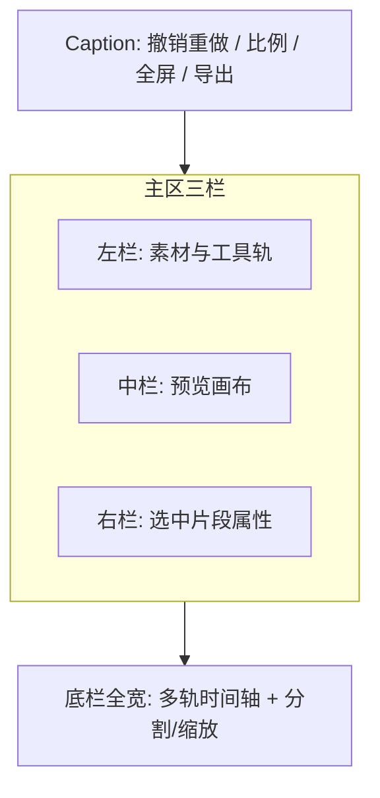

# Clipchamp 视频剪辑窗口实现计划

## 现状

`[apps/client/src/views/clipchamp/clipchamp.tsx](apps/client/src/views/clipchamp/clipchamp.tsx)` 仅为「视频」占位；磁贴/路由/窗口配置已接线。仓内已有：

- FFmpeg **9.0.2** 资源：`tauri.conf.json` → `binaries/ffmpeg.exe` / `ffprobe.exe`（与 Studio lock 同源）
- Gallery 视频导入/时长探测、Capture 录屏入库
- 窗壳范式：Morph/Markdown 的 `Decorations` + `ResizablePanel` + Zustand

**缺口**：项目模型、时间轴、预览合成、FFmpeg IPC、导出、全部剪辑能力。

## 布局（对齐你提供的 Clipchamp 截图）

固定 **三栏 + 底时间轴**（非 Morph 双栏）：



- **左栏**：图标轨 + 面板（我的媒体 / 文本 / 贴纸 / 转场 / 音频…）
- **中栏**：预览（画中画、旋转、选中变换框）+ 播放控件
- **右栏**：上下文属性（音频分离、速度、淡入淡出、颜色、字幕…）
- **底栏**：文本轨 / 视频轨 / 叠加轨 / 音频轨；分割剪刀；缩放拟合
- 壳：对齐 Morph — `Decorations` + `scrollable={false}` + Caption；目录拆为 `caption/` + `workspace/`

## 架构决策（已选定）

| 决策          | 选择                                                                                                                                       |
| ------------- | ------------------------------------------------------------------------------------------------------------------------------------------ |
| 实时预览      | 多 `<video>` / `<audio>` + 叠加层（文本/贴纸/蒙版用 DOM/Canvas）；播放头驱动 seek/play                                                     |
| 导出/探针     | **原生 FFmpeg 9.0.2**（资源二进制），不走 WASM `@ffmpeg`                                                                                   |
| 状态          | 新建 `[apps/client/src/stores/clipchamp.ts](apps/client/src/stores/clipchamp.ts)`；撤销/重做沿用 CoreX 的 `undoStack`/`redoStack` 快照模式 |
| 素材源        | 本地导入为主；可从 Gallery `kind: video` 拉入（二期接通）                                                                                  |
| 滤镜/颜色预览 | CSS `filter` / blend；导出时映射为 ffmpeg `eq`/`colorbalance` 等 filtergraph                                                               |

### 项目数据模型（核心）

```ts
interface Project {
  aspect: '16:9' | '9:16' | '1:1' | '4:5'
  durationMs: number
  tracks: Track[] // text | video | overlay | audio
}

interface Clip {
  id: string
  assetId?: string
  kind: 'video' | 'audio' | 'text' | 'sticker' | 'shape'
  startMs: number
  durationMs: number
  sourceInMs: number
  // transform
  x: number
  y: number
  scale: number
  rotation: number
  opacity: number
  speed: number // 0.1–16
  volume: number
  fadeInMs: number
  fadeOutMs: number
  // video-specific
  filter?: ColorAdjust
  mask?: MaskSpec
  pip?: boolean // 画中画：相对画布的布局预设/自由变换
  text?: TextSpec
  captions?: CaptionCue[]
}
```

编辑操作一律走 `commit(mutate)` → 推 undo 栈；播放头、选中态、面板 Tab **不入**历史。

### FFmpeg 桥接（新建）

在 Client Tauri 增加媒体命令（命名对齐现有 IPC 规范，如 `media:probe` / `media:export`）：

1. 解析 `resource_dir/binaries/ffmpeg.exe`（开发态回退到 sidecar `binaries/`）
2. `ffprobe` → JSON 时长/宽高/音轨
3. `ffmpeg` → 按项目生成 filtergraph（trim/concat、`setpts` 变速、`rotate`/`overlay` 画中画、`drawtext`/`subtitles`、淡入淡出、颜色）写出 mp4
4. 前端通过进度事件驱动导出 UI

参考现有路径解析思路：`[sidecar_command.rs](apps/client/src-tauri/src/system/sidecar_command.rs)` 的 binaries 查找。

## 分期交付

### 一期：可剪可播骨架（优先落地）

- 三栏壳 + Caption（撤销/重做/比例/导出占位）
- Store：项目、轨道、片段、播放头、选中、undo/redo
- 左栏「我的媒体」：导入视频/音频/图片；缩略图列表
- 中栏预览：主视频播放、比例画布、全屏预览、基础变换框
- 底时间轴：视频轨 + 音频轨占位、拖入、选中、播放头 scrub、**分割**、缩放
- 右栏：体积/音量基础滑条

**验收**：导入 → 上时间轴 → 分割 → 改 16:9/9:16 → 播放预览 → Ctrl+Z/Y。

### 二期：叠加与视听控制

- **画中画**：第二视频轨/overlay 叠到画布；预览拖拽缩放；导出 `overlay`
- **旋转**、速度（0.1x–16x）、**音频分离**（视频片段拆出独立音频轨）
- 文本轨：添加/编辑文本片段；入场/出场淡入淡出
- 贴纸轨（静态图/简单图形库）
- 全屏预览完善；导出 MVP：拼接 + trim + 变速 + PiP + 旋转（FFmpeg）

### 三期：表现力

- 字幕轨（手动 cue；可选后续 ASR）
- 颜色模式（曝光/对比/饱和/色温）右栏 + CSS 预览 + ffmpeg 映射
- 蒙版（形状遮罩）、转场（两段间淡化优先）
- 更完整 filtergraph 导出；失败重试与日志

### 四期：打磨与资产打通

- Gallery / Capture 录屏一键进编辑器
- 波形可视化、吸附、快捷键体系、项目本地持久化
- 导出预设（分辨率/码率）、分享入口对齐 Caption

## 目录结构（拟）

```
apps/client/src/views/clipchamp/
  clipchamp.tsx          # Decorations + lazy workspace
  caption.tsx            # 撤销重做 / 比例 / 全屏 / 导出
  workspace/
    workspace.tsx        # 三栏 + 底时间轴 Resizable
    media-rail.tsx       # 左图标轨
    media-panel.tsx      # 左内容面板
    preview.tsx          # 中栏预览 + PiP/旋转
    inspector.tsx        # 右栏属性 Tabs
    timeline/            # 多轨、分割、缩放、playhead
  lib/
    project.ts           # 类型与纯函数（split、detachAudio…）
    export-graph.ts      # 项目 → ffmpeg args
apps/client/src/stores/clipchamp.ts
apps/client/src-tauri/src/.../media_command.rs  # probe + export
```

## 竞品对齐要点（实现时对照截图）

- 左：Import + 媒体缩略图；工具入口含文本/转场/贴纸
- 中：黑底比例画布、选中紫框与手柄、播放条时间码
- 右：竖向图标切换（字幕/音频/淡入淡出/滤镜/颜色/速度）
- 底：剪刀分割、多轨、`+ 添加文字` / `+ 添加音频`、时间尺缩放

## 明确不做（本期边界）

- 云端协作 / 自动字幕 ASR（可留接口）
- Premiere 级调色节点、复杂关键特效、多机位同步
- 浏览器 WASM 导出路径（保留依赖但不接线）
