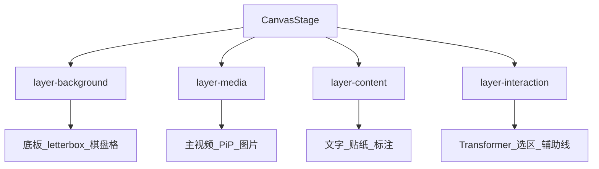

# Clipchamp Canvas 预览 + 通用 Konva 抽取

## 问题

当前 [`preview.tsx`](apps/client/src/views/clipchamp/workspace/preview.tsx) 用绝对定位 `<video>` / `<div>` 叠层，无法可靠做变换手柄、蒙版、层级合成与导出帧一致。Capture 已有 Konva（[`features/capture/components/annotation/`](apps/client/src/features/capture/components/annotation/)），但绑死截图选区，且无视频节点。

## 选定方案

**单一客户端画布内核**放在 [`apps/client/src/lib/canvas/`](apps/client/src/lib/canvas/)（Clipchamp / Capture / 后续功能共用；暂不新建 packages，Studio 重复代码本轮不动）。

**Clipchamp 预览**：整段合成进 Konva——视频/图片用 `Konva.Image` 绑定 `HTMLVideoElement`/`HTMLImageElement`，播放时 `requestAnimationFrame` → `layer.batchDraw()`。导出仍走 FFmpeg，与预览解耦。

### 固定四层（共享壳契约）

调研依据：Konva 编辑器惯例（content 与 `__ui__`/Transformer 分离）、视频编辑器预览（画布底色 ≠ 素材）、以及 Capture 现状已把「底图 / 标注 / 选区+手柄」拆开。先前把「背景」并进「媒体」是错的——letterbox/棋盘格/安全区不属于可导出媒体。

`CanvasStage` **始终**自下而上挂四个命名 `Layer`；业务只往槽位塞节点，禁止打乱层序或把 Transformer 塞进内容层：

| 序  | 层     | `name`              | listening | 职责                                                                        |
| --- | ------ | ------------------- | --------- | --------------------------------------------------------------------------- |
| 1   | 背景层 | `layer-background`  | `false`   | 画布底板：纯色/棋盘格/letterbox、安全区参考（一般不进成片，或仅导出纯色底） |
| 2   | 媒体层 | `layer-media`       | 按需      | 时间线媒体：主视频、图片、画中画等 `Konva.Image`（绑 HTMLVideo/Image）      |
| 3   | 内容层 | `layer-content`     | 按需      | 可导出叠加：文字、字幕、贴纸、标注形状、滤镜/蒙版效果节点                   |
| 4   | 交互层 | `layer-interaction` | `true`    | 不进成片：Transformer、选区暗角/手柄、对齐线、marquee                       |



**Clipchamp 映射**

- background：项目画布底色（黑/自定义）+ 比例 letterbox 外区域
- media：video / overlay 轨的 video·image
- content：text / caption / sticker
- interaction：Transformer、吸附参考线

**Capture 映射**

- background：全屏暗底或空底板（选区外暗角也可放交互层）
- media：截图 `HTMLImageElement`
- content：标注 shapes + SpotlightMask
- interaction：SelectionOverlay + Transformer + marquee

同层内用节点 `zIndex` / 添加顺序细分；跨层语义不得混用。

## 清晰度约定（必须统一）

从 Capture 现有做法抽出并写死 API，避免糊屏：

| 概念       | 规则                                                                  |
| ---------- | --------------------------------------------------------------------- |
| `dpr`      | `Math.max(1, devicePixelRatio)`；监听变化可重挂                       |
| 内容坐标系 | 画布逻辑像素 = 项目分辨率（如 1920×1080），与 CSS 显示尺寸分离        |
| Stage      | `width/height` = 容器 CSS 尺寸；`pixelRatio={dpr}`                    |
| fit        | `scale = min(viewW/contentW, viewH/contentH)`，内容居中               |
| 视频       | 用 `videoWidth/videoHeight` 映射到内容坐标；禁止用 CSS 拉伸冒充清晰度 |
| 滤镜 cache | `node.cache({ pixelRatio: dpr })`（对齐 Capture mosaic/blur）         |

参考现状：[`use-controller.ts`](apps/client/src/features/capture/components/annotation/use-controller.ts) 的 `natural/dpr` + `pixelRatio={dpr}`。

## 目录与职责

```
apps/client/src/lib/canvas/
  metrics.ts          # findStageMetrics / fitScale / contentToView
  stage.tsx           # CanvasStage：固定四层 + pixelRatio + ResizeObserver
  layers.ts           # BACKGROUND | MEDIA | CONTENT | INTERACTION 常量
  media-node.tsx      # Image/Video → Konva.Image + raf（挂 media）
  use-media-clock.ts  # 播放时 batchDraw
  transformer.tsx     # Transformer 壳，固定挂 interaction
  index.ts
```

`CanvasStage` 槽位 API：`background` / `media` / `content` / `interaction`，内部按固定顺序挂 Layer。

Capture 专用（先留在 features/capture，薄适配共享壳）：

- `SelectionOverlay`、截图相位、Magnifier
- 形状 `graphics/` 本轮可继续 import；后续再迁入 `lib/canvas/graphics`

## Clipchamp 接入

1. 重写 Preview：aspect 容器内挂 `CanvasStage`，`contentSize = ASPECT_SIZE[aspect]`。
2. 按轨顺序建节点：video/image → `MediaNode`；text/caption/sticker → `Konva.Text`（或 Image）；zIndex 对齐现轨序。
3. 每帧：用现有 `localTime` seek 逻辑驱动各 `HTMLVideoElement`（隐藏或离屏），再 `batchDraw`。
4. 选中：`Transformer` 改 `x/y/scale/rotation`（归一化坐标 ↔ 内容像素互转），写回 store（`captureUndoPoint` + `applyLive`）。
5. 滤镜/蒙版：优先 Konva Filters / `clipFunc`；导出仍映射 ffmpeg（已有 [`export-graph.ts`](apps/client/src/views/clipchamp/lib/export-graph.ts)）。

删除 Preview 里 DOM `Layer` 叠层（audio 可仍用隐藏 `<audio>`）。

## Capture 迁移（最小侵入）

1. `AnnotationStage` 改用 `CanvasStage` 提供 Stage + pixelRatio + 背景 Image 层。
2. 保留 SelectionOverlay / 标注 Layer / Transformer 行为不变。
3. 验收：截图标注清晰度、导出 PNG 与现网一致。

## 实施顺序

1. 落地 `lib/canvas`（metrics + Stage + MediaNode + 单测/手测 DPR）
2. Clipchamp Preview 切 Canvas 合成 + Transformer
3. Capture `stage.tsx` 改接共享壳
4. 删掉 Preview 旧 DOM 叠层；补清晰度回归清单（1x/2x DPR、竖屏比例、PiP）

## 边界

- 不把 Capture 全量搬进 packages；不做 Studio 同步
- 不在 Canvas 里做最终导出（仍 FFmpeg）
- 不本轮抽聚光灯/放大镜；形状库可二期整体迁入
