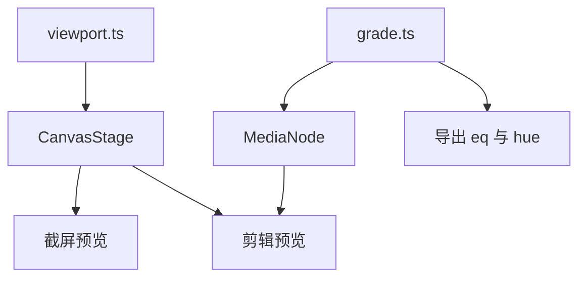

# 画布通用层

## 截屏预览现在的问题

[`screenshot.tsx`](apps/client/src/views/capture/screenshot/screenshot.tsx) 只包了一层 [`CapturePane`](apps/client/src/views/capture/capture-pane.tsx)。点开图片走图库 [`Lightbox`](apps/client/src/views/gallery/lightbox/lightbox.tsx)：`` 加 [`useLightboxZoom`](apps/client/src/views/gallery/lightbox/use-lightbox-zoom.ts)，用 GSAP 改 DOM 的 width/height。这不是画布缩放，放大时由浏览器重采样，也进不了后面的滤镜和标注。

录屏仍用灯箱（里面是 video）。这一轮只换截屏。

## 文档里值得收成通用点的

对照现有 [`lib/canvas`](apps/client/src/lib/canvas)：

- **相对指针缩放**（Zooming Relative To Pointer）：Stage 尺寸保持视口，缩放落在内容 Group 上。`pointer` 减去 group 位置，除以旧 scale，得到内容坐标，再按新 scale 算回位置。这是截屏预览要接的算法。
- **滤镜必须 cache**（React Filters）：静图 `filters` 变更后 `clearCache` + `cache`。视频不要每帧 cache。
- **几何裁切**（Clipping Function）：剪辑蒙版已经是 Group `clipFunc`。矩形裁切用 `clipX/clipY/clipWidth/clipHeight`。Konva 的 Mask 滤镜是亮度键，和蒙版不是一回事，两边都不用。
- **事件**（Events）：背景层、媒体层 `listening={false}`。业务节点 `cancelBubble`。命中检测不要开在只显示的层上（`hitGraphEnabled(false)`）。
- **笔画**（Optimize Strokes）：标注图形默认 `perfectDrawEnabled={false}`、`shadowForStrokeEnabled={false}`。截屏标注里箭头已经部分这样做。
- **选择器**（id / name）：Stage 按层名找层已有。节点用稳定 `id`，`findOne('#id')`。不要为了查找去建 Konva 名字树。
- **撤销**（Undo-Redo 示例）：撤销的是文档快照，不是 Konva 节点。剪辑的 project 栈已经是这样。截屏预览只读，不加撤销。
- **叠放**（zIndex）：以 Layer 内子节点顺序为准。剪辑预览上的 `zIndex` 属性不作为第二套顺序。
- **序列化**（Best Practices）：持久化项目 JSON / 标注数据，不 `stage.toJSON()`。

这些沙盒不进通用层：万级图形、碰撞、转盘、GIF、Web Worker、贴纸工坊、右键菜单、水印。时间轴胶片条继续用 DOM，不要变成上万个 Konva 节点。

## 通用模块

已有、剪辑和截屏都能用：

- [`CanvasStage`](apps/client/src/lib/canvas/stage.tsx)：四层（背景 / 媒体 / 内容 / 交互），`pixelRatio = dpr`，letterbox 的 `frame` Group。
- [`metrics.ts`](apps/client/src/lib/canvas/metrics.ts)：contain 缩放、视口与内容坐标互转。
- [`MediaNode`](apps/client/src/lib/canvas/media-node.tsx) + `useMediaClock`：视频画到画布上。剪辑预览在用。截屏预览用静图，不走时钟。
- [`CanvasTransformer`](apps/client/src/lib/canvas/transformer.tsx)：剪辑变形；截屏标注在浮层里另有一套，预览库不挂。

新增：

- `lib/canvas/viewport.ts`：`fitViewport`、`zoomAtPointer`、`clampPan`。缩放锚点是指针，不是舞台中心。最小为「整图放进视口」，最大约 8 倍。放大后拖移，双击回到 fit。
- `CanvasStage` 增加可选受控视口。不传时行为与现在相同（letterbox）。传入时内容 Group 的 `x/y/scale` 用视口，不再写死 fit。
- `lib/canvas/grade.ts`：一份 `Grade`（曝光、对比度、饱和度、色温、可选模糊与马赛克）。`toKonvaGrade` 给静图，`toFfmpegGrade` 给导出。视频预览非中性时用离屏 `ctx.filter`，避免每帧 `cache()`。

## 截屏预览

在 [`views/capture/screenshot/`](apps/client/src/views/capture/screenshot) 加预览，不再把截屏交给灯箱。

- 图片用已有 `fetchImageFromPath` 解成 `HTMLImageElement`，节点宽高等于原始像素。
- `CanvasStage` 铺满对话框，`contentSize` 为原图像素，视口受控。
- 滚轮：`zoomAtPointer`。拖移：按下移动 group。双击或按钮：`fitViewport`。
- `pixelRatio` 保持设备像素比。放大是放大已解码的位图，不是把 `` 拉大。

录屏页的 `CapturePane` 继续用灯箱。

## 剪辑接哪些

这一轮接到剪辑上的只有调色：

- 预览把 `clip.filter` 交给 `MediaNode`。中性调色不挂滤镜。透明度仍乘 `opacity`。
- 导出 `buildEq` 改为 `toFfmpegGrade`，补上色温（`hue`）。模糊、马赛克先留在类型里，剪辑界面不加滑块。
- 调色滑块拖动用 `lodash-es` 的 `throttle`，松手再记一笔。预设按钮立即写。

剪辑已经在用、这一轮不改交互的：四层 Stage、视频上屏、`clipFunc` 蒙版、Transformer、项目级撤销。视口缩放函数可供预览以后放大画布，这一轮不给时间轴预览加滚轮缩放。

仍不用：`shaders`（整页 WebGPU，对不齐导出）、dnd-kit / sortablejs（时间轴不是列表排序）、is-hotkey（与现有快捷键重复）、Konva Mask 滤镜、每帧 cache 视频。
