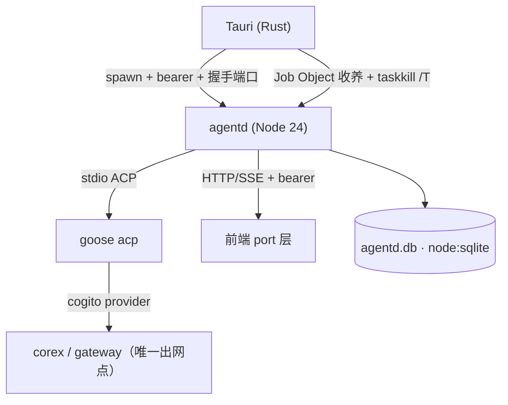

## Plan: agentd —— LangGraph 编排层（产品级重构）

原计划方向可行，但**不能照原样执行**：10 处仓库事实不成立、4 处自相矛盾。下面这份是在核验结果和你锁定的三个决策（先写 supersede ADR / goose 全量移交 stdio / 产品级）之上重写的计划，并且**按「最佳方案」而非「最小改动」选取**。

核心改动（相对上一版又修正了 5 处）：

1. 应用叫 **`apps/agentd`**（`orchestrator` 已被 Rust durable 宿主、compose 服务、前端指令画布三处占用）。
2. **前端不使用 `@assistant-ui/react-langgraph` / `useLangGraphRuntime`**：改为在 `features/agent/port/` 实现一个 `ChatModelPort`（Agent Protocol SSE → `ChatStreamEvent`），复用仓库已有的 `createChatModelAdapter`。LangGraph 只存在于 agentd 内部。理由见「Decisions·D5」——这一条同时消掉了 assistant-ui 版本升级的前置风险。
3. 持久化用 **`node:sqlite` 自持 checkpointer**，但**聊天历史仍归 Rust SQLite 单一真相**，agentd 只存 run/checkpoint/thread 元数据 → 不存在"历史回填"这一步。
4. 侧车产物走 **SEA 单文件 + rolldown 全量 bundle**（贴合现有 `externalBin` 契约），不上 node_modules 目录树。
5. **`goose_serve.rs` 不能整体删除**：`run_goose` 一次性路径被 `automation/goose.rs` 的三条 `goose schedule` 命令依赖，只删 serve 生命周期与 WSS 桥。

**Steps**

### P0 · 决策与证据（阻塞全部后续）
1. 写 `docs/decisions/agent-orchestration-langgraph.md`：显式 supersede `no-langchain.md` 的适用范围（桌面端循环宿主迁出 Rust），并声明 `durable-execution-engine.md` 对**服务端 duroxide** 的结论不变。必须回答四问：幂等键归谁、租户/多工作区策略归谁、审批闸门归谁、**子代理是否保留**（见 P5·step 28 的硬冲突）。
2. 落 `.cogito/plans/findings.md`：Goose 调用链现状图 + 迁移文件三分类表（可直接引用本次调研：`stream.ts`/`run-error.ts`/`goose-*` 可直接搬；`connection.ts`/`session.ts`/`plan-store.ts` 需换传输；`port/model.ts`/`run-state.ts`/`dock/*` 需重写）。
3. 四个时间盒 spike，各自带**可观测的失败判据**（不达标即停止，不允许"再调一调"）：
   - **S1 skein beta**：`skeinRouter({deps: embedInMemoryGraphs(...)})` 挂到自有 Express + `/runs/stream` + `interrupt`/`Command.resume` 端到端。失败判据：端点形状与 `@langchain/langgraph-sdk` 不兼容，或 interrupt 无法跨进程恢复。
   - **S2 打包**：rolldown 全量 bundle → **SEA 单文件**（Node 24），验证 `node:sqlite`、SSE、`child_process.spawn('goose')`、stdio NDJSON 在 SEA 下都可用；记录产物体积/冷启动/P95 首字节。失败判据：SEA 下任一能力不可用 → 自动降级为「Node 官方发行版目录 + 单 bundle 文件」（仍然不是 node_modules 树）。
   - **S3 ACP stdio**：`goose acp` 握手、`session/new`、`session/prompt`、`request_permission`、`elicitation/create`、`session/cancel`、`session/load` 重放，以及 `_goose/unstable/{diagnostics,extensions,providers}` 与 `system-prompt/set` 在 stdio 下是否仍在。同时定版 `@agentclientprotocol/sdk`：1.7.0 vs 2.7.0（`./experimental/node`）。失败判据：`_goose/*` 能力在 stdio 下缺失 → 设置面必须改走 admin API（P2·step 11 已预留）。
   - **S4 ACP 录播夹具**（新增，其他一切的测试地基）：把一条真实会话的 ACP 双向 NDJSON 录下来，落 `apps/agentd/test/fixtures/acp/*.ndjson`，写一个可回放的假 goose 二进制。失败判据：录像无法在无模型凭据环境下稳定重放 → golden 测试无从建立，需改真实 goose + 本地小模型。
4. 产出 Go/No-Go 报告，逐条对照上面四个判据打勾。

### P1 · `packages/agent-protocol`（可与 P0 并行）
5. 照 `packages/sidecar` 建包（源码导出、无 build）：`package.json`（`@cogito/agent-protocol`、private）、`tsconfig.json`（`moduleResolution: Bundler`）、独立 `eslint.config.ts`、`vitest`；scripts 必须叫 `type-check` / `lint` / `unit`（turbo 无 `test`）。
6. **两个子路径导出**（不要一个 barrel 混装）：`./protocol` = 图状态与事件类型（`OrchestrationState`、`GooseRunInput/Result`、`HumanGatePayload`、事件枚举、身份映射），`@langchain/langgraph` 仅在 `./protocol` 作 peerDependency；`./policy` = 审批与风险纯函数（零依赖，client 与 agentd 共用）。
7. 把 `apps/client/src/features/agent/approval.ts` 的纯函数段（`classifyToolEffect`/`isWriteTool`/`findGooseMode`/`findToolPermissionLevel`/`findHardDenyLevel`/`stripServerPrefix`）+ `agent-tools.lock.json` + `tool-risk.ts` 的 `findToolRisk` 搬进 `./policy`，前端改为从包导入。这是**唯一**允许判定"这个工具要不要人批"的代码位置。
8. 硬约束：不 import `apps/*`、不 import `@cogito/chat`（那是前端端口契约）；**不重复定义** `apps/service/spec/openapi.json` 已有的服务端契约；`./protocol` 里不出现 React/UI 词汇。

### P2 · agentd 最小闭环（依赖 P0 的 S1/S3）
9. 建 `apps/agentd`（Node 24 / ESM / TS，构建用 **rolldown**，不用 tsup）。依赖：`@langchain/langgraph`、`@skein-js/express` + `@skein-js/server-kit`、`@agentclientprotocol/sdk`（P0 定版）、`@cogito/agent-protocol`。**在 skein 之上加一层 30 行的 `AgentServer` 接口**（`start/stop/routes/deps`），使上游 Pre-alpha 断更时换自建 HTTP/SSE 只改一个文件。
10. Goose ACP client（stdio）：spawn `goose acp --with-builtin developer`，注入与 Rust 完全一致的 env（`GOOSE_PATH_ROOT=<appData>/goose`、`with_cli_envs` 的 Cursor/Ollama 归一逻辑、dev 隔离变量）。**Windows stdio 三条硬要求**：`windowsHide: true`、显式 UTF-8（无 CRLF 转换）、NDJSON 按 `\n` 分帧并做背压（写端 `drain`）。
11. **不要用 `createExpressServer`**（它只挂 Agent Protocol，没有 `/health`、没有鉴权、CORS 也受 `langgraph.json` 约束）。改为自建 Express：`app.use(bearerAuth)` → `GET /health`（免鉴权，返回 `{service:"cogito-agentd",version,graphs,goose:"ready|starting|failed"}`）→ `app.use(skeinRouter({deps}))` → admin 面 `POST /admin/shutdown`、`POST /admin/goose/restart`、`GET /admin/goose/diagnostics`、`GET|PUT /admin/goose/extensions`、`GET /admin/goose/providers`（为 S3 若 `_goose/*` 不可用预留）。CORS 白名单精确到 `tauri://localhost`、`http://tauri.localhost`、dev 的 `http://localhost:8200`，并放行 `Authorization` 预检。
12. **持久化分两层，不混淆**：① 聊天历史仍由 Rust SQLite（`agent_message`/`agent_session`）持有，agentd **不写**；② agentd 自有 `agentd.db`（`node:sqlite`，WAL + `busy_timeout` + 自建 `_migrations`）只存 LangGraph checkpoint、`thread_id ↔ acpSessionID ↔ runId` 映射、run 事件游标。包装成 3 方法的 `Db` 接口，必要时可换 better-sqlite3。
13. SSE 续传：先测 skein 是否支持 `Last-Event-ID`/`runs.join`；**不支持就用 ② 里的 run 事件游标自建**（`GET /runs/{id}/events?after=<seq>`）。刷新恢复必须由"游标重连"兑现，不能再依赖现在的空闲超时启发式。
14. 验收：`@langchain/langgraph-sdk` 的 `Client.runs.stream` 能消费；interrupt→resume 通；`kill -9` 后重启能续同一 thread；断网 5s 后靠游标补齐不丢帧。

### P3 · Tauri 侧车管理 + 移除 Rust goose（依赖 P2）
15. 新增 `apps/client/src-tauri/src/utils/agentd.rs`（照 `sidecar.rs` 减配，不照 `goose_serve.rs`）：spawn → 读 stdout 握手行取端口/token → 健康检查（校验 `service` + pid 存活，且**必须 no_proxy**：本机 reqwest 会读注册表代理，回环请求会被 502）→ 崩溃重启 ≤3 次（指数退避）→ `agentd://status` 事件 → 优雅关闭（先 `POST /admin/shutdown`，5s 后 `taskkill /T /F`）。
16. **删除范围要拿准，不能整文件删**：`goose_serve.rs` 里**保留** `run_goose`（`automation/goose.rs:31/33/51/57` 的 `schedule remove/add/run-now` 依赖它）、`goose_path_root`、一次性 `build_goose_command`；只删 `spawn_and_watch`/`spawn_inner`/`probe_status`/`restart`/`stop_child`/`watch_process` 与 `GooseStatus` 发布。`goose_acp.rs`、`goose_tls.rs` 整体删。`system/command.rs` 的 `goose:connection`/`goose:ready`/`goose:shutdown`/`goose:restart` 换成 `agentd:*` 四个同构命令。
17. **`gooseStatus` 契约不是"删掉"而是"同构替换"**：`shared/ipc/specs/gooseStatus.ts` 改为 `agentdStatus.ts`（同样 `state/readyMs/reason`，可选新增 `restarts`），枚举三个真实消费面逐一改：① `acp/session.ts:256-260` 的就绪门（它现在是**所有 ACP 操作的前置**）；② `views/agent/settings/sections/diagnostics.tsx:254` 的诊断卡；③ `docs/decisions/security-boundary.md:214` 的安全边界记录（文档必须跟着改，否则门禁与现实不符）。
18. `utils/cogito_provider.rs:163`/`:190` 的两处 `goose_serve::restart(app)` 改为 `agentd::restart_goose(app)`（agentd 收到后重启自己的 goose 子进程并等 `initialize` 完成）。
19. 打包：**SEA 单文件**（rolldown bundle → `node --experimental-sea-config` → 注入 blob），产物名 `agentd-<triple>[.exe]`，因此 `tauri.conf.json` 的 `bundle.externalBin` 直接多一项、`prepare-binaries.ts` 的 `ALWAYS_BINARIES` 多一项、`targets/client.ts` 的 `mapFileName` 加映射、`tools.lock.json` 加 Node 版本 + sha256 —— **现有契约不用改形状**。**6 个 `tauri.*.conf.json` 变体一并核对**（dev/devtest/generated/macos/linux/microsoft）。
20. 验收：`pnpm dev:client:isolated` 起来后 agentd 与 goose 都在；强杀 agentd 自动重启；退出后 `Get-Process goose,agentd` 为空；`goose schedule list` 仍可用（验证 `run_goose` 没被误删）。

### P4 · 前端 port 级切换（依赖 P3）
21. **只新增一个文件组** `features/agent/port/agentd/`：实现 `ChatModelPort`（把 Agent Protocol SSE 折成现有的 `ChatStreamEvent`）与 `ChatHistoryPort`（读取仍走 Rust，不新增写路径）。**不用 `@assistant-ui/react-langgraph`、不用 `useLangGraphRuntime`**：`views/agent/chat/runtime.tsx` 的 `useLocalRuntime(createChatModelAdapter(port))` + `useRemoteThreadListRuntime` 一概不动，只换 `port/instance.ts` 里 `chatModelPort` 的工厂。
22. 事件映射表先写后码（一张表锁住）：ACP `session/update` 各类型 → agentd 的 Agent Protocol 事件 → `ChatStreamEvent` 各类型（text delta / reasoning / tool-call / tool-result / plan part / usage），含取消与错误分支。这张表就是 P5 的验收基准。
23. 审批仍走**现有票据机**：agentd 把 `session/request_permission` 发成 `interrupt`，port 层把它翻成 `requires-action` 事件，UI 卡片仍是原来那张（`tool-risk.ts` 三级 + `approval.ts` 档位）；回复走 `Command.resume`。**不新写一套审批 UI**。
24. flag 落 `features/persist` 的 `AgentPref`（设备级），不是 `stores/`；flag 关闭时 `port/instance.ts` 直接返回旧 `chatModelPort`，因此**旧路径不可能被新代码污染**。
25. 历史不迁移：`agent_message`/`agent_session` 仍是唯一真相，agentd 只维护 `thread_id ↔ acpSessionID ↔ runId`。验收：flag off 与现状逐像素一致（快照测试）；flag on 能对话/审批/中断/刷新恢复（游标续传）。

### P5 · 功能对等（依赖 P4）—— 原计划完全缺失，是本项目真正的工作量
26. 逐项对照 `acp/session.ts`（2200+ 行）建 parity matrix，每项必须落为「已实现 / 显式降级」二选一：审批票据与 300s 超时、`elicitation/create`、刷新恢复（改为游标续传）、后台回合（agentd 常驻，天然后台，只需把 `background-turn.ts` 的 localStorage 镜像干掉）、goal 自驱续跑（`goal-run.ts` 租约搬到 graph 循环）、usage/context、thinking level、S11 模型路由（`model/route.ts`）。
27. **原计划整段漏掉的两块设置面**（不补就是发版即坏）：① `_goose/unstable/{extensions,providers,diagnostics}` + `system-prompt/set` —— S3 若证实在 stdio 下可用就搬进 agentd，否则由 P2·step 11 的 admin API 接住，`views/agent/settings/sections/extensions.tsx` 改调新端点；② `acp/cogito-provider.ts` 的网关 provider 注册仍由 Rust 写 `<appData>/goose/config`，写完调 `agentd::restart_goose`。
28. **子代理是硬冲突，必须做决定**（现状：goose `subagent` 工具 → `cogito-mcp` → Rust 任务板限流 → 发 `agent://subagent-spawn` 事件 → **渲染侧**跑一轮）。goose 不在渲染侧后这条链断了。二选一：A) 子代理改为 graph 的 subgraph（推荐，能力可保留且可观测）；B) 明确禁用 + UI 降级（工具卡显示「当前版本不支持子任务」）。**不允许「先不管」**（会变成静默死工具）。
29. 写一张**取消/超时语义表**：UI Abort → `ChatStreamEvent` 取消 → agentd `runs.cancel` → ACP `session/cancel`；三层各自的超时值（现有 `TICKET_TIMEOUT_MS=300_000`、`RUN_HANDOFF_POLL_MS`）必须在新链路里有对应值，不允许缺失。
30. 规则：任何暂时不对等的能力必须在 UI 显式降级，**不允许静默丢功能**。

### P6 · 完整编排图（可与 P5 并行）
31. `planNode → worker → reviewNode(硬门控) → humanGate`。**`planNode` 不是直连模型**，而是一次 goose plan 模式子会话（复用 `mode.ts` 的 `PLAN_GUIDANCE`，只读工具面），否则破唯一出网点。
32. **worker 必须串行**：只有一个 `goose acp` 进程、所有会话共享同一个工作区，并行写会直接竞态。图里用串行边（coder → tester），把「并行」作为 V2：需要时用 `git worktree` 给每个 worker 一个独立 cwd，否则不做。
33. `reviewNode` 用 `@cogito/agent-protocol/policy` 的 `findToolRisk` 做硬规则（触碰 `guarded` 路径 / 测试未绿 / 输出结构不完整 → 打回 worker 并附意见）；`interrupt` 只用于真需要人的动作，**不新增第二套「谁在等」**。

### P7 · 打包 / CI / compose（依赖 P3、P6）
34. `compose.yaml` + `compose.prod.yaml` 增 `cogito-agentd`（端口避开本机 1024–15000 动态段）；新增 `agentd-ci.yaml` 并带 paths 过滤（别复制 `service-ci.yaml` 里 `.github/workflows/cogito-ci.yaml` 那个失效过滤的 bug）。**compose 里的 agentd 只服务 CI/服务端验证**，桌面端永远走 sidecar，不要把它做成第二个产品形态。
35. `continuous-integration.yaml`：根 `build`/`dev` 的 turbo filter 已排除 client/service/mobile，agentd 会被默认纳入——明确写死（推荐纳入 build + type-check，test 只跑 `unit`，不跑 e2e）。`client-rust-check` 里的 sidecar stub 循环（`for stem in corex-daemon corex-mcp cogito-mcp goose`）加 `agentd`。
36. 三平台 SEA 产物校验：`agentd-<triple>[.exe]` 存在、sha256 入 `checksums.json`、能 `--version` 自报；`pnpm check:agent-junk` 与 `pnpm check:security` 需确认不误报新目录（前者只扫仓库顶层，后者只扫 `apps/client`）。

### P8 · 观测 / 灰度 / 删旧（依赖 P4–P7）
37. 结构化日志：`threadID`/`runId`/`node`/`gooseSessionId`/`traceparent`；指标：interrupt 次数、重启次数、SSE 游标补齐次数、fallback 触发。
38. 灰度：内部 dogfood → flag 默认 off → 分设备开启；legacy 至少保留一个版本。**回滚判据提前写死**（例如：单设备 24h 内 interrupt 丢失 ≥1 次，或重启 >3 次，即回滚）。
39. 删旧与回滚手册：确认无回滚需求后再删 `acp/wss-stream.ts`、`acp/connection.ts`、`goose_acp.rs`、`goose_tls.rs`、`GooseStatus` 发布面；回滚路径写进 ADR 末尾（flag off → 停 agentd → 清孤儿 → `agentd.db` 保留/删除）。

**Relevant files**
- `apps/client/src/features/agent/acp/session.ts` — 审批/elicitation/恢复/后台回合的真身（含 `TICKET_TIMEOUT_MS`、就绪门），P5 的对照基线
- `apps/client/src/features/agent/approval.ts`（`:203-416` 纯函数段）、`tool-risk.ts`、`agent-tools.lock.json` — 下沉到 `@cogito/agent-protocol/policy`
- `apps/client/src/features/agent/port/instance.ts`（`chatModelPort`/`historyPort` 单例）+ `port/model.ts` — 唯一的 runtime 切换缝与事件翻译层
- `packages/chat/src/adapters/chat-model.ts`（`createChatModelAdapter:669`）— 新 port 直接复用，不写新适配器
- `apps/client/src-tauri/src/utils/goose_serve.rs` — `run_goose:442` / `goose_path_root:486` **保留**；`spawn_inner:203` / `stop_child:582` / `restart` **替换**
- `apps/client/src-tauri/src/automation/goose.rs`（`:31/33/51/57`）— `run_goose` 的四个调用点，删错了就断调度
- `apps/client/src-tauri/src/utils/sidecar.rs`（`spawn_and_watch:96`、`stop_child:238`）— agentd 生命周期的抄写模板
- `apps/client/src-tauri/src/utils/child_job.rs`（`adopt:22`）— 孤儿回收；Job 成员资格被子进程继承，goose 随之被回收
- `apps/client/src-tauri/src/utils/instance.rs` — 双实例隔离（identifier/管道/端口），agentd 需要同构的隔离变量
- `apps/client/src-tauri/src/app/bootstrap.rs`（`:202-203` spawn、`:257-264` 退出）— 唯一挂载点
- `apps/client/src-tauri/src/utils/cogito_provider.rs`（`:102` token-helper、`:163`/`:190` restart）— 移交后的改动点
- `apps/client/src/shared/ipc/specs/gooseStatus.ts` + `views/agent/settings/sections/{diagnostics,extensions}.tsx` — 状态与设置面的三个真实消费点
- `apps/client/scripts/prepare-binaries.ts` + `scripts/commands/features/sidecar/{targets/client.ts,tools/goose.ts}` + `tools.lock.json` — 打包三处
- `packages/sidecar` — 新协议包的目录/配置模板；`packages/chat` — `ChatModelPort`/`ChatStreamEvent` 契约
- `apps/service/src/orchestrations/agent.rs`（`agent_run:335`、`approve_and_execute:469`、`wait_for_decision:565`）— 服务端编排，边界参照物
- `docs/decisions/{no-langchain,durable-execution-engine,approval-channel,security-boundary}.md` — ADR 必须正面回应（最后一个因为改了状态契约）

**Verification**
1. `pnpm --filter @cogito/agent-protocol unit`、`pnpm --filter @cogito/agentd unit`（注意不是 `test`）
2. **Golden 回放**（S4 地基）：同一份 `test/fixtures/acp/*.ndjson` → 快照比对 ACP 事件 → Agent Protocol 事件 → `ChatStreamEvent` 三段产物，任何字段漂移都红
3. `apps/agentd/scripts/e2e.mjs`：spawn → health → run → interrupt → resume → 断 SSE 5s → 游标补齐 → kill -9 → 重启续跑 → shutdown，退出后断言无残留 pid
4. Rust：`cargo test` 覆盖握手行解析、端口校验、退出码、重启退避、`agentdStatus` 三态的序列化；`goose schedule list` 回归（证 `run_goose` 未误删）
5. 前端：`pnpm --filter @cogito/client unit` + 现有 43 个 `features/agent` 测试全绿；flag off 快照对比；`packages/chat` 的 `createChatModelAdapter` 单测不改也应该过（证明复用而非重写）
6. 手工：`pnpm dev:client:isolated`（dev identifier / corex-dev 管道 / WebView2 profile 全部隔离）双开验证
7. `pnpm lint`、`pnpm check`、`pnpm check:agent-junk`；三平台 SEA 产物可运行且校验和匹配

**Decisions**（均为「最佳」而非「最小改动」）
- **D1 命名** `apps/agentd`（`@cogito/agentd`）、Rust `utils/agentd.rs`、compose `cogito-agentd`——避开三处 `orchestrator` 撞名
- **D2 持久化分层**：聊天历史归 Rust，agentd 只持 graph/run 元数据；`node:sqlite`（内置于 Node 24，无原生模块、无 ABI 风险）；**不用 better-sqlite3、不用 `@skein-js/local`**（后者经 `langgraph-checkpoint-sqlite` 硬依赖 better-sqlite3，与本仓 `allowBuilds.better-sqlite3: false` 直接冲突）
- **D3 模型调用只经 goose**：`planNode`/`reviewNode` 都是 goose 子会话，LangGraph 节点不直连 LLM（守住 gateway 唯一计量/审计点）
- **D4 审批真相唯一**：`interrupt` 只是传输，"这个工具要不要人批"仍由 `@cogito/agent-protocol/policy` 判定，client 与 agentd 同一份代码
- **D5 前端只保留一条 runtime 通路**：实现 `ChatModelPort` 过 Agent Protocol SSE，**不引入 `@assistant-ui/react-langgraph` / `useLangGraphRuntime`**。理由：后者自带 thread/state/消息模型，会与 `useRemoteThreadListRuntime` + `ThreadHistoryAdapter` 争主权，且要求 `@assistant-ui/core ≥0.3.34`（本仓 0.3.32）；而 `createChatModelAdapter` 已经能聚合文本/推理/工具/审批（`chat-model.ts:51` 文档口径）。收益：零额外 runtime、零版本升级风险、审批 UI 与 parity 都沿用旧路。
- **D6 打包走 SEA 单文件**：rolldown 全量 bundle → SEA，命中现有 `externalBin` 契约（`agentd-<triple>[.exe]`），不是 node_modules 树
- **D7 服务器用自有 Express + `skeinRouter`**：因为需要 `/health`、bearer 鉴权、admin 面与精确 CORS，`createExpressServer` 不够用
- **D8 端口零竞态**：agentd 自 bind `127.0.0.1:0` 后把端口/token 写进 stdout 握手行，Rust 不预先探测
- **D9 worker 串行**：单 goose 进程 + 共享工作区，并行只在 `git worktree` 隔离下才允许
- **D10 边界**：不改 `apps/studio`、不改服务端 duroxide 编排、不改 `apps/compute`（不在 pnpm workspace）、不自托管 LangGraph Platform

**Further Considerations**
1. **子代理保留还是砍**（P5·step 28）：A) 改 subgraph（能力保留，但多一层图设计）/ B) 先禁用 + UI 降级（工量最小，但少一个已经宣传的能力）。建议 A，并把它放在 P6 而不是 P5，避免 parity 阻塞主线上车。
2. **`node:sqlite` 的成熟度**：Node 24 里它仍标 experimental（无 flag）。S2 必须同时验 WAL、并发写、`busy_timeout`、崩溃后 journal 恢复；接口只暴露 3 个方法，万一要换成 better-sqlite3 只改一个文件（但打包会从 SEA 退成「Node 目录 + 原生件」，代价要提前知道）。
3. **skein 断更的逃生路径**：上游 `1.0.0-beta.1`、周下载 <150、README 自述 Pre-alpha，且 npm registry 指向 `registry.npmmirror.com`（beta 包可能缺）。已由 D7 的 `AgentServer` 薄接口兑付；若 S1 直接失败，备选是「`@langchain/langgraph` + 自写 `/threads` `/runs/stream`」，工作量约 +5–7 天，不改变其他阶段。
4. **`@agentclientprotocol/sdk` 版本**：仓库锁 1.7.0（catalog 里有 1.8.0 覆盖），上游 2.7.0 新增 `./experimental/node`。建议 agentd 独立升到 2.x（client 继续 1.7 直到删旧），S3 双版本各跑一遍 ACP 握手与 `session/load`。
