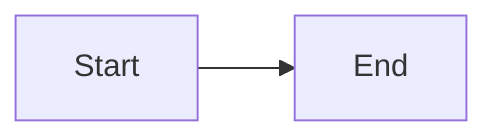

# Heading One

Paragraph with **bold**, *italic*, and `code`.

## Lists

- Item A
- Item B

1. First
2. Second

- [ ] Todo
- [x] Done

## Table

| Name | Value |
| --- | --- |
| Alpha | 1 |
| Beta | 2 |

## Code

```ts
const answer = 42
```

## Math

$$
E = mc^2
$$

Inline $a^2 + b^2 = c^2$ works.

## Mermaid


