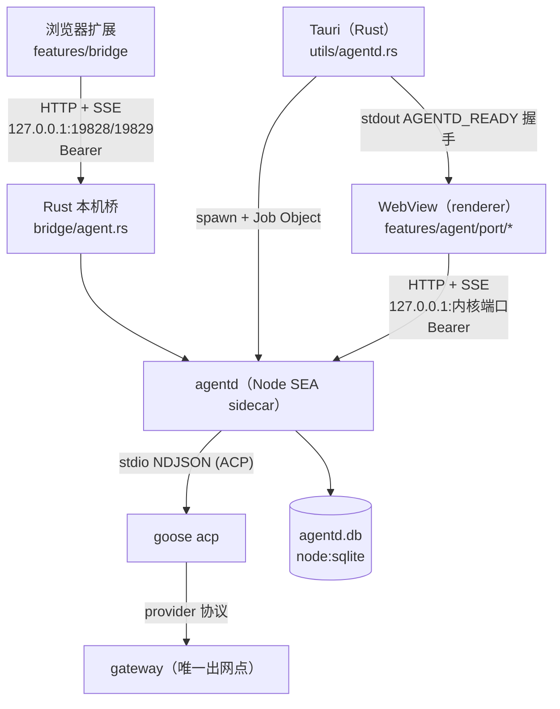
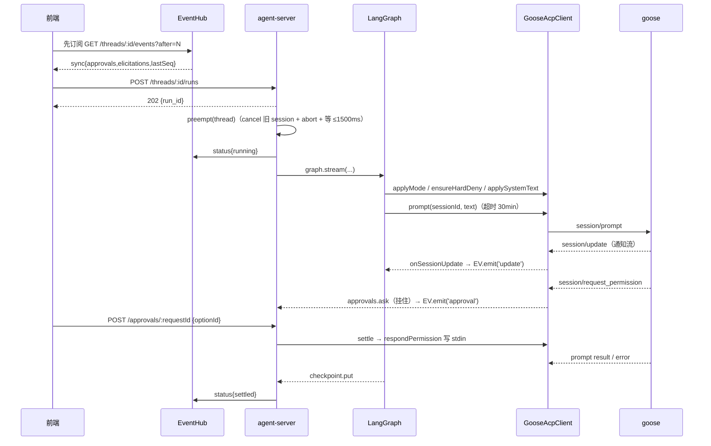

# Agent 模块功能逻辑审查（2026-11-23）

> 范围：桌面端 agent 全链路——`apps/agentd`、`packages/agent-runtime`、`packages/agent-protocol`、
> `apps/client/src/{features,views}/agent`、`apps/client/src-tauri/src/{bridge,utils}`，
> 以及 `apps/extension`、`apps/studio`、`packages/agent` 的对照面。
>
> 基线：commit `ce0d3ba7` + 工作区 45 个未提交改动（含 `packages/agent-protocol` 的工具效果分类）。
> 本轮只做审查，**不改代码**；修复方案见 [agent-fix-roadmap.md](./agent-fix-roadmap.md) 与
> `docs/decisions/agent-*.md`。

## 0.1 R0 落地状态（2026-11-23）

| 缺陷 | 状态 | 落点 |
| --- | --- | --- |
| F-001 白名单可撤销硬禁用 | ✅ 已修 | `goose/allowlist.ts` 移除 `_goose/unstable/tools/permissions/set`；`ensureHardDeny` 仍直接走 ACP client |
| F-002 子进程错误导致崩溃 | ✅ 已修 | `goose/client.ts` 监听 `child`/`stdin`/`stdout` 错误 + `safeWrite`；`main.ts` 兜 `uncaughtException`/`unhandledRejection` |
| F-006 首轮取消无效 / 归属错误 | ✅ 已修 | `session-registry.ts` + `graph.onSession`；`executeRun` 只在 `runID` 匹配时清理与结案 |
| F-007 关停必超时 | ✅ 已修 | `agentServer.closeConnections()` + `closeIdleConnections` / `closeAllConnections`；`supervisor.stop()` 先于退出 |
| F-010 会话复用不看 cwd | ✅ 已修 | `graph.ts` 的 `fingerprintSession(cwd, mcpServers)` |
| F-030 `after` 非法值降级 | ✅ 部分 | 非法值现在 400；`(epoch, seq)` 留到 R1 |
| 信任边界（cwd / MCP / thread_id / configId） | ✅ 已加 | `validation.ts`：cwd 必须绝对且存在（配置 `AGENTD_ALLOWED_ROOTS` 后还必须落在根内）；MCP command 必须是现存绝对文件且默认只认 `corex-mcp`/`cogito-mcp`（`AGENTD_MCP_ALLOW_ARBITRARY=1` 放宽）；thread_id 字符/长度校验；configId 白名单 |
| F-003 / F-004 / F-005 | ✅ R1 已修 | 见 0.2 |
| F-008 / F-009 / F-011 / F-014 / F-029 | ✅ R2 已修 | 见 0.3 |
| F-013 | ✅ R4 已修 | 「模式两个真相」定为**快照优先**，见 0.6

R0 遗留（明确不做，避免误以为已覆盖）：`/runs/stream` 断连仍不 abort（R2）；`session/load` / `session/close`
仍在透传白名单（需逐项评估调用方）；`permissions/set` 仍是 agentd 内部写入路径（设计如此，公开面已无入口）；
`AGENTD_ALLOWED_ROOTS` 目前**没有**由 Tauri 注入真实工作区列表，未配置时只校验「绝对且存在」
（注入真实根列入 R4，避免这次改动跨到 Rust 数据层）。

## 0.2 R1 落地状态（2026-11-23）

| 缺陷 | 状态 | 落点 |
| --- | --- | --- |
| F-003 事件流不持久化 | ✅ 已修 | `event-store.ts` + 迁移 v3 的 `run_events`（主键 `(thread_id, epoch, seq)`）；`events.ts` 的 `emit` **先落库再广播**，写失败降级为内存并带 `durable=false`；`replay(threadID, after?, epoch?)` 返回 `{events, epoch, minSeq, truncated, reset}` |
| F-004 审批回执被吞 / 票据无关闭路径 | ✅ 已修 | `gate-store.ts` + 迁移 v4 的 `gate_requests`：`insert` → `settle`（只允许 pending → 终态，幂等）→ `cancelPending`；approvals / elicitations 结案一律走 `finish(..., 'settled' \| 'expired' \| 'cancelled')`，落库 + 广播 `approval_settled` / `elicitation_settled` |
| F-005 `sync` 丢弃待审批快照 | ✅ 已修 | `sync` 帧扩展为 `{epoch,lastSeq,minSeq,truncated,reset,approvals,elicitations}`；`parseRunFrame` 解析全部字段；`AGENTD_ROUTES.events(threadID, after, epoch?)` |
| F-026 多客户端各自取票 | ✅ 已修 | 审批/回执路由改 `settleFor(threadID, requestId, …)`：校验票据属于该 thread（否则 `not_found`）、optionId 属于该 approval（否则 `invalid_option`），并**广播给所有订阅者**，不再是谁取谁得 |
| F-012 游标只在成功路径落库 | ✅ 已修 | `agent_session."lastEpoch"` 列（迁移 patch 6）+ `SessionBindingSchema.lastEpoch`；client 记录 `epoch` 并带到 events URL；取消/报错路径同样落游标 |
| F-019 恢复路径绕过策略 | ✅ 已修 | `port/session.ts` 的 `resolveApprovalTicket` / `resolveElicitationTicket` 为 live 与 sync 快照共用，恢复时同样走 `decideApprovalForThread` |
| 启动遗留 pending（僵尸卡） | ✅ 已修 | `main.ts` 启动时 `gateStore.cancelPending()`，把上个进程的 pending 全部结案为 `cancelled` |

R1 与计划的差异（明确记下来，避免误以为已覆盖）：

- 保留策略当前是**按时间**（7 天；启动一次 + 每小时 unref 定时器），不是计划里的「字节 + 天数双阈值」；
  单事件 payload 上限也没加 —— 依赖 `truncated` 标记 + 后续 R4 的体积治理。
- `truncated` 只作为**标志**透出（日志 + 帧字段），断流后的正文重建（回查历史消息重填）留到 R4。
- `sync` 只报 `lastSeq`，没有计划里的「当前 run 终态」字段：那属于状态机，跟 R2 一起做。
- 旧格式 `after=epoch:seq` 没有实现。客户端现在用独立 `epoch` 查询参数 + 严格数字 `after`，非法值 400。
- 扩展端游标仍只写 `lastSeq`（扩展没有 Rust 绑定层），`lastEpoch` 留到 R4。

**R1 验收（实测）**：`@cogito/agentd` 21 文件 / 122 例、`@cogito/agent-runtime` 4 / 35、
`@cogito/client`（`src/features/agent` + `src/views/agent`）72 / 622、`@cogito/extension` 9 / 33 全绿；
`agentd` type-check + build、client / extension type-check、
`cargo check -p cogito-core -p cogito-database -p cogito-command`、`cargo test -p cogito-core agent_session`、
`cargo test -p cogito-database agent_session` 通过；`agentd` / `agent-runtime` lint 与 client / extension
`features/agent` eslint 全绿。

## 0.3 R2 落地状态（2026-11-23）

单一 run 状态机落地在 `@cogito/agent-runtime/agentd/turn.ts`：`runTurn`（幂等建线程 → 先订阅 → POST
`/runs` → 泵帧）与 `pumpTurn`（唯一事件泵，恢复订阅复用它）。client 与 extension 各自只剩「适配 + 策略」。

| 缺陷 | 状态 | 落点 |
| --- | --- | --- |
| F-008 race 丢帧 | ✅ 已修 | 未消费的 `frames.next()` 与 `queue.take()` promise **留住**，注入胜出后继续 await；两端各自的 `makeInjectQueue` 已删除 |
| F-009 deadline 不参与等待 | ✅ 已修 | 空闲计时器是 `Promise.race` 的一路（默认 60 分钟），半开连接也会以 `idle_timeout` 收尾，而不是永远「思考中」 |
| F-011 首帧前抛出 | ✅ 已修 | client / extension 端口的已知早退（身份未就绪、provider 缺失/停用、会话不存在）改成先产出一条可见 `error` 事件；不再让适配器只拿到失败 Promise |
| F-014 切模型参数未使用 | ✅ 已修 | 每轮显式 `providerID/modelID` 在建会话**之前**写 goose defaults（同目标去重）；内联 / 子代理 / 目标首轮这些「本轮新建会话」的场景现在真的按指定模型跑 |
| F-029 `deriveOption` 的 `/allow/` 兜底 | ✅ 已修 | 只认精确 `allow_once` / `reject_once`；找不到就按取消结案（fail-closed），不会把「允许一次」写成 `allow_always` |
| 错误归因两端不一致 | ✅ 已修 | `agentd/run-error.ts` 从 client 上提到协议层；`TurnFailure.code` 区分 `subscribe_failed` / `run_rejected` / `stream_closed` / `idle_timeout` / `run_failed`，消息已带「哪一层坏了」 |
| `/runs/stream` 断连不 abort | ✅ 已修 | agentd 侧：客户端断开时中止本条 run（`runID` 对得上才算）并 `goose.cancel`，`runs.disconnected` 单独计数 |
| F-013 模式两个真相 | ✅ 已修（R4 收尾） | 快照优先级定为「快照压过当前偏好」：`runThreadPrompt` 传 `agentMode`，goose 会话档与审批判定同源，详见 0.6 |
| 上下文估算与实测不符 | ✅ 已修（R4） | 新增 `features/agent/sent-system-text.ts`：`runThreadPrompt` 发送前登记本轮实际 `systemText`，composer footer / 右栏面板改为读它（没发过才回退到推导值）；一次性线程登记表有 200 条上限，`closeThreadSession` 会清 |

**R2 验收（实测）**：`@cogito/agent-runtime` 6 文件 / 61 例（含 `turn.test.ts` 的 14 例 fake transport）、
`@cogito/agentd` 21 / 123（新增断连收尾用例）、`@cogito/client`（agent 范围）71 / 610、
`@cogito/extension` 9 / 33 全绿；两端 type-check + build、agentd / agent-runtime lint、
client / extension `features/agent` eslint 全绿。

## 0.4 R3 落地状态（2026-11-23）

| 缺陷 | 状态 | 落点 |
| --- | --- | --- |
| F-031 `packages/agent` 死模块 | ✅ 已删 | 只保留 `src/provider.ts`（+ 单测）：`loop.ts` / `client/openai-compatible.ts` / `agent.ts` / `events.ts` / `message.ts` / `model.ts` / `permission.ts` / `skill.ts` / `tool.ts` / `index.ts` 全部删除；`package.json` 只导出 `./provider`，描述改成「provider 契约」 |
| F-032 `agent-protocol/protocol` 零引用契约 | ✅ 已删 | 目录整体删除，包只导出 `./policy`；描述同步 |
| F-025 工具分类三份且撞名 | ✅ 已修 | client `tool-labels.isWriteTool` 改名 `usesWriteCard`（明确是**渲染形态**），新增 `tool-classification.test.ts` 对账：写卡 ⊆ 安全写、动文件 ⊆ 安全写、剥前缀同结论、有意差异固定下来 |
| F-027 `open` / `fetch` 把写工具判成只读 | ✅ 已修 | 两个歧义动词移出 `READ_VERBS`；`open_pr` / `fetch_url` 现在 fail-closed 按写；已知只读的 `webfetch` / `web_fetch` / `websearch` / `web_search` 进精确只读名单 |
| F-033 文档与实现不符 | ✅ 已修 | `apps/agentd/README.md` 端点表补齐（`/runs`、`/events`、`/cancel`、`/approvals`、`/elicitations`、`/metrics`、`/goose/invoke`…）；`agent-orchestration.md` 修正空闲超时（现在在 `turn.ts` 且是真空闲计时）、模型切换（⚠️ 只写 defaults）、子代理调用链、业务规则落点；`plan-mode.md` 的「权限回调直接拒绝」改为审批判定 `reject_once`；`agent-run-status.md` 更新事件泵路径与终态集合 |

**R3 验收（实测）**：`@cogito/agent` 1 文件 / 15 例、`@cogito/agent-protocol` 3 / 24、
`@cogito/client`（agent + views/agent）72 / 614 全绿；`agent` / `agent-protocol` type-check 通过；
studio 侧 `@cogito/agent/provider` 仍可解析（`quota/gate.test.ts` 等 924 例通过）。
studio 自身 `type-check` 有 **3 条既有失败**（`@cogito/hooks` 缺包、`MagneticTile` 的
`component` 联合类型少 `wallpaper`），与本次删除无关，未在本轮处理。

## 0.5 R4 落地状态（2026-11-23，分批）

| 缺陷 | 状态 | 落点 |
| --- | --- | --- |
| F-015 内联改写可能弹审批 / 真执行 | ✅ 已修 | `runThreadPrompt` 新增 `withTools?: boolean`，内联传 `false` —— 这一轮真的拿不到 MCP 工具，而不是靠系统提示「请不要用工具」 |
| F-016 目标续跑租约过期 / `send()` 静默失败 | ✅ 已修 | `goal-continue.ts` 后台轮每 30s 续租（TTL 10min）；`goal-auto-advance` 用「发送后正文是否被清空」判定 `send()` 真发出，未发出则收 `paused` 并提示 |
| F-018 orphan 补写与清 running 的顺序 | ✅ 已修 | `background-turn.ts` 的 `finally` 与「强行让位」分支都改成**先补写历史再清标记**；单测断言「补写发生时持久标记仍在」 |
| F-020 刷新后不能压缩 / 抢运行中的轮 | ✅ 已修 | `compactThreadSession` 改用 `hasThreadSession`（认库里的 binding），并拒绝在 `record.run` 活跃时压缩 |
| F-021 agentd 掉线后长时间「生成中」 | ✅ 已修 | `AGENTD_NOT_READY` → `clearAcpHandle()` + abort 所有本地轮 + `abortAllBackgroundTurns()` + `clearRunState()` |
| F-024 恒假条件 | ✅ 已修 | `applyThinkingToOpenSessions` 删掉 `thread.mcpServers.length < 0` |
| F-030 代理改写后丢帧 | ✅ 已修 | `readSse` 改逐行解析：多行 `data:` 按规范拼接、`\r\n\r\n` 也算帧边界、`event:run`（无空格）与注释行都支持 |
| F-034 db.ts 注释与事实不符 | ✅ 已修 | 头注改成四大类实情（元数据 / 事件日志 / 票据 / 含正文的 checkpoint），并说明同步 API 的阻塞取舍 |
| F-037 `GET /threads/:id` 恒 `idle` | ✅ 已修 | 新增 `readThreadStatus()`，`/threads/:id` 与 `/state` 如实报 `running`/`idle`；state 读取失败留痕 |
| F-038 查询不缓存 / 迁移无事务 | ✅ 已修 | `openDb` 加语句缓存（SQL 全为字面量，集合有限）；每个迁移 `BEGIN/COMMIT/ROLLBACK` |
| 扩展端游标缺 epoch | ✅ 已修 | `AgentThreadRow.lastEpoch` + `persistCursor` 落库 + 订阅时带上（非索引字段，不用升 Dexie 版本） |
| F-017 计划「立即 done」/ 永远 running | ✅ 已修 | 新增 `features/agent/plan-execute-session.ts`：**先 prepare → 再 send → 真发出去了才置 `running`**，并记住开始那一刻的助手尾部 id；`aside.tsx` 只调 `beginPlanExecution`，`plan-run-finish.tsx` 只做观察、由状态机幂等结案（同一尾部只写一次）。发送失败会回滚刚建的目标记录 |
| F-026 多客户端无写者租约 | ✅ 已修（R4） | `x-cogito-client` 头（两端 transport 都带）+ agentd `canTakeWriterLease`：自己旧轮可 supersede，别人的返回 **409 `writer_lease_held`**（带 `holder.{clientID,runID,revision}`，`runs.lease_conflicts` 计数），显式 `takeover: true` 才能接管；持有者超过 10 分钟未收尾视为已死。协议层把 409 映射成 `TurnFailure{code:'writer_busy'}`，两端文案一致 |

**R4 验收（实测）**：`@cogito/agent-runtime` 6 / 66（SSE 4 例 + 写者租约 2 例）、
`@cogito/agentd` 21 / **127**（写者租约 4 例）、`@cogito/client`（agent 范围）74 / **630**
（`background-turn` 补写顺序 1 例、计划状态机 9 例、systemText 登记 6 例）、
`@cogito/extension` 9 / 33 全绿；client / extension type-check、agentd / agent-runtime lint、
client `features/agent` + `views/agent` eslint 全绿。

R4 仍剩余：`AGENTD_ALLOWED_ROOTS` 注入（Rust 侧传真实工作区根）、`truncated` 正文重建、
F-013（模式两个真相，需产品定优先级）。

## 0.6 R4 收尾（2026-11-23）

| 缺陷 | 状态 | 落点 |
| --- | --- | --- |
| F-013 模式两个真相 | ✅ 已修（**快照优先**，见下） | `runThreadPrompt` 新增 `agentMode`（本轮模式，来自消息快照）；`resolveSessionMode(threadID, agentMode)`、`decideApprovalForThread(…, agentMode?)`、`isReadOnlySession(threadID, agentMode?)`、`findRunGooseMode(threadID, agentMode?)` 全链路认同一个值。`port/model.ts` 传 `runMode`，目标续跑传 `'goal'`，`ThreadSession.agentMode` 供 `resumeThreadRun` 用（用户中途切档不该把在跑的那轮判成拒绝），收尾清空 |
| `truncated` 之后不重建 | ✅ 已修（R5-D3） | `POST /threads/:id/replay` → `session/load` 重放 → `kind:'replay'` 事件 → 客户端按 `messageId` **覆盖**正文（`ChatStreamEvent.replace`）。触发：本轮 `sync.truncated` 记意图、收尾后补；恢复订阅时立刻补；409/502 降为诊断（`agent.session.replay`）。前提实测与取舍见 [agent-r5-hardening.md](../decisions/agent-r5-hardening.md) D3 |
| `AGENTD_ALLOWED_ROOTS` 未注入真实根 | ⚠️ 决策：**不注入** | 见 0.6 |

### F-013「模式两个真相」的取舍

同一轮里有两个模式源：提示词/约束认**消息快照**（重新生成要复现当初那一次），goose 会话档与
审批判定认**当前偏好**。两者分歧时最坏的结果是：快照说「执行」，提示词要求动手，而审批按当前
`plan` 档锁写 → 写工具全部 `reject_once`，模型反复改道，用户看到「说了要做但什么都没发生」。

**决定：快照优先。** 理由：一轮的语义（要不要动手）在发出那一刻已经确定，用当前偏好去改写
正在复现的那一轮，等于让用户没法复现历史；而新消息天然带当前快照，不存在「想让当前偏好生效
却被老快照盖住」的场景。安全感也不因此下降 —— `plan` / `ask` 快照仍然把写压成「必须先问」
甚至直接拒，只是反过来不再被**后来的**计划档污染。

### `truncated` 之后怎么补正文（已实现）

`sync` 帧的 `truncated` 表示「`after` 落在淘汰区，中间有缺口」。补正文只有两条路，早先两条都不划算：

1. **goose 回放**：ACP 的 `session/load` 会把历史以 `session/update` 反向通知重放 —— 实测
   （goose 1.48.0，`apps/agentd/scripts/probe-replay.ts`）`messageId` 跨重放稳定、工具结果也重放，
   但粒度是**按消息聚合**，所以客户端必须覆盖而不是追加。这条已落地；
2. **checkpoint 里的 `reply`**：只是最后一轮的聚合结果（每轮覆盖写），拿它拼历史会伪造成
   「只剩一轮」—— **继续排除**，不要再作为候选。

所以现在只把事实留清楚：`sync.truncated` 打一条带 thread id 的诊断告警（`agent.session.events`），
用户的闭环是「重发一次」。可执行的回放方案（`POST /threads/:id/replay` → `session/load` → `replay` 事件）
写在 [agent-r5-hardening.md](../decisions/agent-r5-hardening.md) D3，**前提已实测**
（`messageId` 跨重放稳定、工具结果也重放、粒度按消息聚合，探针 `apps/agentd/scripts/probe-replay.ts`）。

### `AGENTD_ALLOWED_ROOTS` 不由 Tauri 注入

agentd 有 `AGENTD_ALLOWED_ROOTS`（`path.delimiter` 列表）：配置后 `cwd` 必须落在某个根内，否则
`cwd_not_allowed`。看似该由 Rust 在 spawn 时注入工作区根，实际弊大于利：

1. **换不来安全边界**。渲染进程拿得到 agentd 的 endpoint + bearer token（`agentd:endpoint` 命令就是
   给它的），所以「表里的根」如果是渲染进程塞进去的，它自己就能绕；真正的约束只有两条——在 Rust
   侧代理/校验请求（Rust 是可信侧），或 OS 级沙箱（R5）。静态根表只能挡「本端代码写错了」。
2. **会误拒合法 cwd**。`pickWorkspaceCwd` 在没有任何工作区时回落到 **home**（内联改写、压缩、无
   工作区对话都走它）；工作区是**运行期**可增删的，进程启动时快照下来的根表会把「刚加进来的文件夹」
   判成 `cwd_not_allowed`，用户看到的是「发不出去」，而原因离他很远。
3. 唯一有真实收益的风险（任务目录跑到工作区外）已经不存在：`views/agent/tasks/task-form.tsx` 的
   目录下拉只列**该工作区下的目录**（`directoryItems`），`workspacePath` 不可能指向工作区外。

**决定**：保持它作为**受控/托管部署**的可选收紧开关（默认不设），「cwd 只能落在工作区内」放到 R5
（OS 沙箱或 Rust 侧代理校验）。Rust 侧只在 spawn 时透传环境变量，不构造根表。


## 0. 结论摘要

这套链路的分层方向是对的：`renderer ↔ agentd ↔ goose`，审批判定收敛成纯函数，事件帧/游标/ACP 映射已上提到
`@cogito/agent-runtime`。真正的问题不在「少一个功能」，而在**状态归属错位**：

| # | 根因 | 后果 |
| --- | --- | --- |
| 1 | **运行事件只有内存环形缓冲**（`agentd/src/events.ts`），`run_events` 表零引用 | 断流超过 2000 条后静默缺段；agentd 重启后 `seq` 归零、历史不可重放 |
| 2 | **审批是一次性推送事件，不是持久请求** | 刷新后审批卡消失；回执失败被当成成功；goose 退出后票据挂到超时 |
| 3 | **run 状态机在 client / extension / studio 各一份** | 同一份协议两种行为（拒绝语义、错误归因、游标落库）；修复要改三处 |
| 4 | **硬禁用靠写 goose 的 `permission.yaml`，而同一条 HTTP 面又能改回来** | `auto` 档下黑盒 shell 可被重新放行，安全模型自相矛盾 |
| 5 | **每个 turn 的参数（模式/模型/工具面/cwd）来源不唯一** | 消息快照与实际档位相反、切模型不生效、换工作区仍写旧目录、内联改写挂全工具 |

与之对照，行业产品（VS Code Copilot / Cursor / Codex / Cline / OpenHands）在五件事上是收敛的：
**事件日志是持久真相、审批是持久请求可重放、审批与沙箱正交、单一 runtime + 平台薄适配、多客户端显式单写者**。
详见 [ai-coding-agent-architecture.md](../../reference/ai-coding-agent-architecture.md)。

## 1. 审查方法与基线

### 1.1 方法

1. 三组并行只读审查：`apps/agentd` 服务端、`apps/client` 前端层、`packages` + studio/extension；
2. 对高危结论做源码复核（`allowlist.ts`、`events.ts`、`runs.ts`、`port/session.ts`、`tool-effect.ts` 等）；
3. 跑现有门禁，记录基线（含**已存在的失败**，不修）；
4. 行业对标以官方文档为准（链接见对标文档）。

### 1.2 基线结果（2026-11-23 19:44）

| 命令 | 结果 |
| --- | --- |
| `pnpm --filter @cogito/agentd unit` | 16 文件 / 84 例 全通过 |
| `pnpm --filter @cogito/agent-runtime unit` | 4 文件 / 34 例 全通过 |
| `pnpm --filter @cogito/client exec vitest run src/features/agent src/views/agent` | **1 失败** / 621 通过（622 例） |

失败项：

```text
src/features/agent/approval.test.ts > 工具效果回归（分词判定 + fail-closed） > 只读工具不再被动词里的短子串误判成写
AssertionError: expected 'write' to be 'read'
  expect(classifyToolEffect('cogito_browser_open')).toBe('read')
```

原因是工作区未提交的 `packages/agent-protocol/src/policy/tool-effect.ts` 新增了
`EXPLICIT_WRITE_NAMES = ['cogito_browser_open']`（把「打开网页」定义为副作用），
`tool-effect.test.ts` 已同步，但 client 的 `approval.test.ts` 仍按旧语义断言。
这不是本次审查引入的，而是**协议包与消费方契约未同步**的实例（F-025）。

### 1.3 未覆盖

- 真机 goose 1.57.0 的时序（只依据源码与仓库既有 ACP 能力记录推断）；
- Windows Job Object / 进程树回收的实测（`utils/child_job.rs` 未跑集成）；
- studio 的 opencode 引擎只做边界对照，未逐行审查；
- 云端 gateway 计费与配额链路。

## 2. 模块地图

### 2.1 进程拓扑



### 2.2 agentd 路由（实际 22 条）

| 方法 | 路径 | 说明 |
| --- | --- | --- |
| GET | `/health` | 免鉴权，供 Rust 校验 `service` 身份 |
| GET | `/metrics` | 只增计数器 |
| POST | `/admin/shutdown` | 202 后异步关停 |
| POST | `/admin/goose/restart` | 未托管时不挂载 |
| GET | `/goose/{providers,extensions,diagnostics,defaults,sessions}` | ACP 读方法映射；未就绪 503 / 失败 502 |
| POST | `/goose/invoke` | 白名单透传 |
| POST | `/goose/sessions` | `session/new`，校验 cwd |
| POST | `/goose/sessions/:id/mode` | 校验 modeId |
| POST | `/goose/sessions/:id/config` | **无校验**，原样透传 |
| POST | `/goose/sessions/:id/cancel` | ACP `session/cancel` |
| POST | `/threads` | 幂等 upsert |
| GET | `/threads/:id` | 恒定 `status:'idle'`、`values:{}` |
| GET | `/threads/:id/state` | `graph.getState` 薄封装 |
| POST | `/threads/:id/runs/stream` | LangGraph SDK 兼容面 |
| POST | `/threads/:id/runs` | **前端正式路径**，202 + 后台跑 |
| POST | `/threads/:id/cancel` | ACP cancel + abort 图 |
| GET/POST | `/threads/:id/approvals[/:requestId]` | 票据列表 / 回执 |
| GET/POST | `/threads/:id/elicitations[/:requestId]` | 结构化追问 |
| GET | `/threads/:id/events` | 会话事件 SSE（`?after=<seq>`） |

> README 的端点表只列了 13 条，且漏掉 `/metrics`、`/goose/invoke`、`/runs`、`/cancel`、`/events`、
> `/approvals`、`/elicitations`、`GET /threads/:id`（F-033）。

### 2.3 关键文件与职责

| 文件 | 关键函数 | 职责 |
| --- | --- | --- |
| `apps/agentd/src/main.ts` | `bootstrap` / `disposeAll` / `shutdown` | 组装依赖、握手行、信号处理 |
| `apps/agentd/src/server.ts` | `cors` / `sameSecret` / `bearerAuth` | Express 外壳、CORS、鉴权 |
| `apps/agentd/src/agent-server.ts` | `preempt` / `executeRun` / `waitForIdle` / `readSessionID` | 线程登记、同线程单飞、run 生命周期、SSE |
| `apps/agentd/src/graph.ts` | `gooseNode` / `runTurn` / `bindIncoming` / `ensureHardDeny` / `applyMode` | 会话复用、审批准入、工具面加固 |
| `apps/agentd/src/events.ts` | `emit` / `since` / `subscribe` | 全局 seq + 每线程环形缓冲 |
| `apps/agentd/src/goose/client.ts` | `spawnGooseAcp` / `request` / `respondPermission` | stdio JSON-RPC、反向请求应答 |
| `apps/agentd/src/goose/supervisor.ts` | `start` / `onExit` / `restart` | goose 进程状态机 |
| `apps/agentd/src/checkpointer.ts` | `getTuple` / `list` / `put` / `pruneThread` | checkpoint 持久化（200 条/线程） |
| `apps/agentd/src/approvals.ts` / `elicitations.ts` | `ask` / `settle` / `pending` / `cancelThread` | 挂住 ACP 回包等人工回执（300s） |
| `packages/agent-runtime/src/agentd/*` | `readSse` / `parseRunFrame` / `createRunCursor` / `createApprovalLedger` | 协议客户端（环境无关） |
| `packages/agent-runtime/src/policy/approval.ts` | `decideApproval` | 唯一「要不要问人」纯函数 |
| `packages/agent-protocol/src/policy/*` | `findHardDenyLevel` / `classifyToolEffect` / `findToolRisk` | 分类器与硬策略 |
| `apps/client/src/features/agent/port/session.ts` | `runThreadPrompt` / `resumeThreadRun` / `respondToApproval` | 一轮运行、恢复订阅、审批回执 |
| `apps/client/src/features/agent/port/model.ts` | `buildModelPort().run` / `findTarget` | ChatModelPort 实现、目标解析 |
| `apps/client/src/features/agent/port/thread-history.ts` | `load` / `update` / `persistOrphanTurn` | 历史读取、后台轮补写 |
| `apps/client/src/features/agent/acp/background-turn.ts` | `spawnBackgroundPump` | 每 thread 一个后台泵（UI detach 不取消） |

### 2.4 术语

| 术语 | 含义 |
| --- | --- |
| thread | 客户端会话 id（= Rust SQLite `agent_session.id`），agentd 以它为键做单飞与事件分区 |
| run | 一次 `POST /threads/:id/runs` 触发的图执行 |
| turn | 模型的一轮「思考 + 工具 + 回答」，对应 ACP 的 `session/prompt` |
| session | goose 侧 ACP 会话，`acpSessionID` 挂在 thread 上 |
| seq | agentd 进程内全局自增事件序号（**不是**持久游标） |
| cursor | 客户端「已应用到的 seq」；`sync` 帧可让它回退 |
| ticket | 审批/追问的等待票据，`requestId` 由 goose 生成 |
| epoch | 本审查建议新增的概念：agentd 进程启动标识，用来区分重启前后的 seq |

## 3. 一次 turn 的时序（现状）



必须注意的实现事实：

1. **先订阅再 POST** 是硬约束，否则补发与订阅之间的事件会永久丢失；
2. `sync` 的 `lastSeq` 语义是「服务端已经写到这条连接上的位置」，不是服务端最新；
3. 写出口的 `lastWritten` 从 **0** 初始化（刻意如此，避免 agentd 重启后旧大游标吞掉新事件）；
4. ~~`sync` 里带着 `approvals` / `elicitations` 快照，但协议层 `parseRunFrame` 只读 `lastSeq`~~
   → **R1 已修**：`parseRunFrame` 读出 `epoch/minSeq/truncated/reset/approvals/elicitations`；
5. 同线程单飞靠 `preempt`：等不到 1500ms 也继续开新轮（有并发写 checkpoint 的窗口）—— 仍在（agentd 侧，R4）；
6. ~~取消只 abort 外层迭代，不调用 `iterator.return()`~~ → **R2 已修**：`pumpTurn` 在 `finally` 里
   `frames.return()`，SSE 读取器的 `cancel` 会真的跑；agentd 侧 `/runs/stream` 断连也会取消 goose。

## 4. 真相源与状态归属

| 实体 | 运行时真相 | 持久真相 | 风险 |
| --- | --- | --- | --- |
| 会话/消息 | assistant-ui runtime | Rust SQLite `agent_session` / `agent_message` | 后台补写、目标续跑、定时任务三条旁路直接写库，parentID 靠猜（F-018） |
| 运行态（哪些线程在跑） | `acp/run-state.ts` 内存 Set | `localStorage` + Rust `agentTurn:*` running 集合 | 三处同步；agentd 挂掉后无人清理（F-021） |
| 事件游标 `seq` | `seqByThread` + `record.lastSeq` | `agent_session.{lastSeq,lastEpoch}` + agentd `run_events` | R1 已补 `lastEpoch`，`run_events` 可补发；仍不报「当前 run 终态」（F-008，R2） |
| 审批票据 | `approvalLedger`（模块级 Map） | agentd `gate_requests`（状态机 + 结案广播） | R1 已修：结案幂等、跨客户端广播；旧「回执被吞」不再复现 |
| 追问票据 | `pendingElicitations` 内存 | agentd `gate_requests` | R1 已修：落库 + 结案 `settled`/`expired`/`cancelled`，启动时清理遗留 pending |
| 模式 | `thread-scope` + `persist` `modeByThread` | Tauri Store | 运行提示词 / goose 档 / 审批判定统一认**消息快照**（F-013 已结） |
| 审批档 | `pendingApproval` 内存覆盖 + `approvalByThread` | Tauri Store | 临时档只放内存，与落盘档并存 |
| 计划 | `plan-store` 内存 cache | SQLite `agent_plan`（400ms 防抖）+ 可选 `.cogito/plans/*.md` | 文件与档案双真相；右栏未挂载时不比对 |
| 目标推进 | `goal-run` 派生对象 + 租约 | SQLite `agent_goal` | 租约在内存/SQLite 两处，后台轮无续租（F-016） |
| 上下文用量 | `goose-usage` 内存 Map | 无 | 刷新后归零直到下一条 `usage_update` |

## 5. 缺陷清单

> 严重度：**P0** = 安全 / 崩溃 / 数据丢失；**P1** = 错误行为或用户可感知卡死；**P2** = 收敛、可观测、文档。
> 确证度：**确证** = 源码路径足以推断；**高度可疑** = 时序窗口明确，需运行确认；**待验证** = 依赖上游行为。

### 5.1 P0

#### F-001 白名单允许撤销硬禁用（安全）

- **位置**：`apps/agentd/src/goose/allowlist.ts` 的 `ALLOWED_GOOSE_METHODS` 含
  `_goose/unstable/tools/permissions/set`。
- **现象**：任何持有 bearer 的调用方 `POST /goose/invoke` 即可把 `shell` 写成 `always_allow`，
  覆盖 `graph.ts` 的 `ensureHardDeny` 在会话建立时写入的 `never_allow`。
- **触发**：扩展 / 网页 / 任意本机进程拿到令牌；或前端代码路径误用。
- **影响**：`auto` 档下黑盒 shell 直通，硬策略形同虚设；与 `docs/apps/client/agent-orchestration.md`
  「硬禁用不依赖用户操作」的不变量矛盾。
- **确证度**：确证。
- **方向**：把「写权限」从公开白名单移除；若确需，改为 agentd 内部专用方法且只允许写 `never_allow`。

#### F-002 goose 子进程错误无监听，整个 agentd 崩

- **位置**：`apps/agentd/src/goose/client.ts` 的 `spawnGooseAcp` 只注册 `child.on('exit')`；
  `request` / `respondPermission` 直接 `child.stdin.write(...)`；`main.ts` 无 `uncaughtException`。
- **现象**：二进制缺失、无执行权限、goose 刚死但 exit 未派发时写 stdin（EPIPE）→ 未捕获的 `'error'` 事件
  → 进程退出，Tauri 最多重启 3 次后彻底 failed。
- **触发**：打包缺件、PATH 变化、goose 崩溃瞬间的审批回执。
- **影响**：整条 agent 链路不可用；`supervisor.start()` 的 try/catch 兜不到。
- **确证度**：确证（Node `ChildProcess` 的 `'error'` 无监听即抛）。
- **方向**：补 `child.on('error')` / `child.stdin.on('error')` / `child.stdout.on('error')`；
  写前检查 `writableEnded`；宿主级兜底记录后优雅退出。

#### F-003 事件流不持久化，裁剪后静默缺段

- **位置**：`apps/agentd/src/events.ts`（`BUFFER_LIMIT = 2000`，`since` 只按 `seq > after` 过滤）；
  `apps/agentd/src/db.ts` 的 `run_events` 表**全仓零引用**。
- **现象**：断流期间单线程事件超过 2000 条（长工具输出很常见）→ 头部被裁掉，但 `since(after)`
  不报「已裁剪」；`sync.lastSeq` 仍宣告已同步。agentd 重启后 `seq` 从 0 重来，客户端只能靠回退游标，
  无法重建已丢失的正文。
- **影响**：刷新/断线后正文缺段且无法自愈；排查时看起来像模型少输出。
- **确证度**：确证。
- **方向**：事件落库（`thread_id, epoch, seq, kind, payload`），先落库再广播；`sync` 增加
  `epoch` 与 `truncated`；裁剪后显式让客户端重建。
- **R1 落地**：`event-store.ts` + 迁移 v3 的 `run_events`；`emit` 先落库再广播（写失败降级为内存 + `durable=false`）；
  `replay` 返回 `{events, epoch, minSeq, truncated, reset}`。裁剪后的正文重建（F-016 残余）留到 R4。

#### F-004 审批回执失败被吞成成功，票据无关闭路径

- **位置**：`apps/client/src/features/agent/port/session.ts` 的 `respondToApproval`：
  `approvalLedger.take()` 成功即返回 `true`，`void settleRemoteApproval(...)` 丢弃返回值。
- **现象**：agentd 已按 300s 超时结案或返回 404 时，UI 仍 toast「允许一次」；
  一轮结束时不清理 pending 票据，历史卡永远可点。
- **影响**：用户以为工具执行了，实际没有；或审批卡擦不掉。
- **确证度**：确证。
- **方向**：以服务端结案事件为准（settle 成功/失败都要回灌 UI）；run 结束时 `forget` 未结案票据。
- **R1 落地**：`gate_requests` 表 + `settle`（只允许 pending → 终态，幂等）→ 结案落库并广播
  `approval_settled`；client 的 `resolveApprovalTicket` 与 sync 快照共用同一路径，按账本状态去重。

#### F-005 协议层丢弃 `sync` 里的待审批快照

- **位置**：`packages/agent-runtime/src/agentd/runs.ts` 的 `parseRunFrame` 只读 `frame.data.lastSeq`。
- **现象**：agentd 在 `sync` 中已下发 `approvals` / `elicitations`（`agent-server.ts` 的 `writeSse('sync', …)`），
  协议层忽略；当审批事件已不在 `since(after)` 窗口内时，唯一的补偿通道丢失。
- **影响**：刷新 / 应用重启后待审批卡永久消失，而 goose 仍在等（直到 300s 超时）。
- **确证度**：确证。
- **方向**：`sync` 帧解析带出 pending 快照，交给与 `approval` 事件相同的处理路径（含策略判定）。
- **R1 落地**：`parseRunFrame` 解析 `approvals` / `elicitations`；client 与 extension 的 sync 处理都走
  `resolveApprovalTicket` / `resolveElicitationTicket`（与 live 帧同一条路径，恢复时同样过策略）。

#### F-006 首轮取消无效；`activeRuns` 归属错误

- **位置**：`apps/agentd/src/agent-server.ts` 的 `readSessionID`（只从 checkpoint 取）、
  `executeRun` 的 `finally`、`preempt`。
- **现象**：
  1. 首轮跑起来之前 checkpoint 里没有 `sessionId` → 取消只 abort 外层，goose 侧完全不停，UI 显示已停止；
  2. `finally` 无条件 `activeRuns.delete(threadID)` 且 `approvals.cancelThread(threadID)` 按线程全量结案；
     当 `preempt` 等不到旧轮（>1500ms）时，旧轮收尾会删掉新轮登记并结掉新轮票据。
- **影响**：长工具继续跑；同 thread 两个图并发写 checkpoint；新轮审批被静默取消。
- **确证度**：确证（1） / 高度可疑（2，取决于时序）。
- **方向**：`sessionId` 在 `runTurn` 拿到时写内存映射，取消优先读内存；`finally` 校验 `runID` 再清理；
  票据结案按 run 维度而不是 thread 维度。

#### F-007 关停必然超时，goose 可能成孤儿

- **位置**：`apps/agentd/src/main.ts` 的 `shutdown`：`server.close(cb)` 等所有连接结束，SSE 是长驻连接。
- **现象**：只要有一个 `/events` 或 `/runs/stream` 连接存活，`cb` 永不触发 → 5s 后 `process.exit(1)`；
  `disposeAll()` 不执行，`supervisor.stop()` 不跑。
- **影响**：优雅退出从未发生；退出码恒为 1；agentd 单死时 goose 及其 MCP 子进程可能残留
  （只有宿主退出时的 Job Object 能兜底）。
- **确证度**：确证。
- **方向**：先广播关闭所有 SSE / 调 `server.closeAllConnections()`，再 `supervisor.stop()`，最后 close。

### 5.2 P1

| # | 位置 | 问题 | 影响 | 确证度 |
| --- | --- | --- | --- | --- |
| F-008 ✅ | `port/session.ts` `runThreadPrompt` 的 `Promise.race([frames.next(), queue.take()])` | race 落败的 `frames.next()` promise 无人接管，其解析值被丢弃（R2 已修：promise 留住） | 审批后紧随的第一个 update（文本增量或 tool-result）消失 → 卡片卡「执行中」/正文缺段 | 高度可疑（机制确定） |
| F-009 ✅ | 同上，`while (Date.now() < deadline)` | deadline 只在两次 await 之间检查；半开连接时 `frames.next()` 永不 resolve（R2 已修：计时器进 race） | 60 分钟空闲上限形同虚设，界面永久「思考中」 | 确证 |
| F-010 | `apps/agentd/src/graph.ts` `fingerprintMcpServers` / `gooseNode` | 会话复用只看 mcpServers 指纹，**不看 cwd** | 换工作区后继续同一 thread，工具仍在旧目录读写 | 确证 |
| F-011 ✅ | `port/model.ts` `findHost` / `port.run` 早退；`runtime.tsx` `identity.ensure()` | 首帧之前 `throw`（R2 已修：先产出一条可见 `error` 事件） | assistant-ui 只打 `Message reload failed`，界面永久转圈 | 确证 |
| F-012 ✅ | `port/session.ts` 成功路径才 `POST_ACP_BINDING`；扩展在 `finally` 写 | 两端游标落库不对称（R1 已修：`onCursor` 终态必落，含 `lastEpoch`） | 取消/报错后刷新，重放旧 `settled` 把下一轮判成结束 | 确证 |
| F-013 | `port/model.ts` `resolveRunMode(messages)` vs `effective-approval.ts` 读当前偏好 | 模式有两个真相 | 重新生成时提示词要求执行，goose 却是 plan/approve，写工具被拒 → 「计划执行不完整」 | 高度可疑 |
| F-014 ✅ | `port/session.ts` `runThreadPrompt` 签名有 `providerID/modelID`，函数体未使用 | 切模型对已有会话不生效（R2 已修：建会话前写 defaults；会话级切换仍未接） | 与 `agent-orchestration.md` §2 的承诺相反 | 确证 |
| F-015 ✅ | `features/agent/inline-prompt.ts` 注释「不挂工具」，实际走 `runThreadPrompt` 无条件挂 MCP | 内联改写可能弹审批/真执行写操作（R4 已修：`withTools: false`） | 改写卡住或误改文件 | 确证 |
| F-016 ✅ | `features/agent/goal-continue.ts` `startGoalTurn` 不续租；`goal-auto-advance.tsx` 依赖 `send()` 抛错 | 后台轮 >10 分钟租约过期；`send()` 在 `!canSend` 时静默返回（R4 已修：后台续租 + 「正文是否被清空」判定） | goal 停在 running 且无租约，界面「推进中」永不动 | 确证（结构） |
| F-017 | `views/agent/chat/components/aside.tsx` `runImplement`；`plan-run-finish.tsx` | 计划执行状态机在组件内，`setPlanStatus('running')` 在 `send()` 之前 | 计划被立刻标 done（假完成）或永远 running | 高度可疑 |
| F-018 ✅ | `port/thread-history.ts` `persistOrphanTurn` | 先清 running 标记、后补写历史（R4 已修：顺序反过来，含强行让位分支）；parentID 取「最后一条 user 行」 | 毫秒级窗口刷新 → 回复永久丢失（已修）；分支场景挂错 parent（仍待验证） | 确证（顺序） / 待验证（parentID） |
| F-019 | `port/session.ts` `resumeThreadRun` 的 approval 分支 | 补发的审批直接推给人，不经过 `decideApprovalForThread` | `auto` / `readonly` 下本该自动放行或拒绝的审批变成弹卡 | 高度可疑 |
| F-020 ✅ | `port/session.ts` `compactThreadSession` | 只查内存 `sessionByThread.sessionId`；不检查 `record.run`（R4 已修：`hasThreadSession` + 拒绝运行中的轮） | 刷新后压缩必报「尚无 session」；可能 preempt 掉正在跑的轮 | 确证（1） / 高度可疑（2） |
| F-021 ✅ | `port/session.ts` 的 `AGENTD_NOT_READY` 分支；`clearRunState` / `abortAllBackgroundTurns` / `clearAcpHandle` 生产零调用 | agentd 掉线后运行态不清理（R4 已修：四个清理全部接上） | 左栏永久「生成中」、未读判定错 | 确证 |
| F-022 | `graph.ts` stale session 重试重发整条 prompt | 已 emit 的 update 不撤回 | 正文「半截 + 从头再来」；工具可能执行两次 | 高度可疑 |
| F-023 | `main.ts` `disposeAll` 里 `process.exit(0)` | 在跑的 run 不收尾、checkpoint 半写 | 重启后状态停在运行中 | 确证 |
| F-024 ✅ | `port/session.ts` `applyThinkingToOpenSessions` 的 `thread.mcpServers.length < 0` | 恒假条件（R4 已删） | 每次改思考档都向所有会话并发 `set_config_option`，噪音与浪费 | 确证 |
| F-025 ✅ | `packages/agent-protocol/src/policy/tool-effect.ts` + client `approval.test.ts` | 「写工具」判定至少三份（policy / tool-labels / tool-paths）；R3 已收敛：安全判定只有 policy，写卡判定改名 `usesWriteCard`，并有 `tool-classification.test.ts` 对账不变量 | 同一工具在「会不会被拒」「画什么卡」「算不算改文件」三处结论不同 | 确证（基线已现） |
| F-026 ✅ | `bridge/agent.rs` 纯透传 + `approvalLedger` 每 WebView 独立 | 同 thread 多客户端无单写者；审批只能被一方取走（R1 已修：服务端 `gate_requests` + `settleFor` 幂等结案 + 广播；写者租约仍列在 R4） | 双方都 toast 成功，另一方「已失效」；两边各自 follow 同一 thread | 高度可疑 |
| F-027 ✅ | `tool-effect.ts` 的动词启发式 | R3 已修：`open` / `fetch` 是歧义动词，已移出只读表；`open_pr` / `fetch_url` 现在 fail-closed 按写（auto 档不再直接放行），已知只读的 `webfetch` / `websearch` 进精确名单 | `auto` 档直接放行有副作用的工具 | 确证（设计缺陷） |
| F-028 | `stripServerPrefix` 用 `lastIndexOf('__')` | 工具名本身含 `__` 会被误剥（`a__b__c` → `c`） | 分类/展示错 | 待验证 |
| F-029 ✅ | `packages/agent-runtime/src/agentd/approvals.ts` `deriveOption` 的 `/allow/` 兜底 | 若只有 `allow_always` 没有 `allow_once`，会把「这一次」升级成永久（R2 已修：只认精确 `*_once`） | 写进 goose `user` 段，永久放行 | 高度可疑 |
| F-030 ✅ | `packages/agent-runtime/src/agentd/sse.ts` `readSse` | 每帧只取第一条 `data:`；只认 `\n\n` 不认 `\r\n\r\n`（R4 已修：逐行解析 + 多行拼接 + 两种边界） | 经代理/网关改写换行时丢帧或丢多行 data | 确证（本地直连安全） |

### 5.3 P2

| # | 位置 | 问题 |
| --- | --- | --- |
| F-031 ✅ | `packages/agent/src/{loop,agent,tool,skill,message,permission,events,client/openai-compatible}.ts` | R3 已删：包内只留 `provider.ts`（studio 唯一消费面），描述改为「provider 契约」 |
| F-032 ✅ | `packages/agent-protocol/src/protocol/index.ts` | R3 已删（零引用 + 三重漂移），包只导出 `./policy` |
| F-033 ✅ | `apps/agentd/README.md`、`agent-orchestration.md`、`plan-mode.md`、`agent-run-status.md` | R3 已对齐：端点表补齐 9 条，空闲超时 / 模型切换 / 子代理 / 计划只读 / 事件泵路径均按实现改写 |
| F-034 ✅ | `apps/agentd/src/db.ts` 注释 | R4 已改：头注写清四类实情（元数据 / 事件日志 / 票据 / **含 prompt·reply 全文的 checkpoint BLOB**）与同步 API 的阻塞取舍 |
| F-035 | `events.ts` `clear` / `clearAll`；`threads` Map | 前两者导出但无人调用；thread 登记无上限（R0 已加 2000 上限 + 淘汰） |
| F-036 | `checkpointer.ts` | `getTuple/list` 按 `checkpoint_id DESC`，`pruneThread` 按 `rowid DESC`；`getTuple` 用 checkpoint 的 type 反序列化 metadata |
| F-037 ✅ | `agent-server.ts` `GET /threads/:id` / `handleState` | R4 已修：新增 `readThreadStatus()` 如实报 `running`/`idle`，state 读取失败留痕（以前恒 `idle` + 静默空状态） |
| F-038 ✅ | `apps/agentd/src/db.ts` | R4 已修：语句缓存 + 迁移 `BEGIN/COMMIT/ROLLBACK`；`DatabaseSync` 全同步阻塞仍为已知取舍（写在头注里） |
| F-039 | `packages/agent/src/client/openai-compatible.ts` / 各 app labels | `parseArgs` 解析失败把原始字符串当 input；toolCallId 回退可能重复；中文 labels 与计划模型多份 |
| F-040 | studio `host/capabilities/opencode/*` vs client | 审批语义、工具分类、计划模型、上下文用量、错误归因全部两套实现 |

## 6. 状态机：现状与目标

### 6.1 run / cancel

| 阶段 | 现状 | 目标 |
| --- | --- | --- |
| 启动 | `preempt` 等 1500ms，等不到继续 | 同 thread 严格单飞；旧轮必须到达终态或显式放弃并记录 |
| 取消 | abort 外层迭代，图内部继续 | `session/cancel` + `iterator.return()` + run 级 abort；取消是终态而非 error |
| 首轮取消 | 拿不到 sessionId → 无效 | run 一拿到 sessionId 就登记，取消立即可达 |
| 断连 | `/runs/stream` 断连不 abort | 断连策略显式：detach 继续 / 关闭取消，由客户端声明 |

### 6.2 审批

| 阶段 | 现状 | 目标 |
| --- | --- | --- |
| 请求 | agentd 内存 Map + SSE 推送 | 持久请求（表 + 索引），带 `requestId` / `threadID` / `runID` / 过期时间 |
| 重连 | `sync` 带快照但协议层丢弃 | 重连走 approval replay，按快照重建卡片 |
| 回执 | 幂等性缺失；失败被吞 | 幂等 settle（状态机 + revision）；成功/失败/超时都广播结案 |
| 多客户端 | 各自账本，只能一方取走 | 服务端广播 `approval_settled`，所有客户端同步禁用 |
| 结束 | 票据挂到 300s | run 结束 / goose 退出时批量结案并广播 |

### 6.3 resume / replay

| 阶段 | 现状 | 目标 |
| --- | --- | --- |
| 游标 | 单个 `seq`，重启归零 | `(epoch, seq)`；epoch 变化即全量重放 |
| 缺口 | 裁剪后静默 | `sync.truncated` → 从持久事件日志或 SQLite 重建 |
| 终态 | 重放旧 `settled` 误判 | `sync` 报告「当前 run 状态」，而不是靠历史帧推断 |

## 7. 死代码与双轨

| 逻辑 | 实现 A | 实现 B | 处理 |
| --- | --- | --- | --- |
| 自研 agent loop ✅ | `packages/agent/src/loop.ts` | 无消费方 | R3 已删除（连同同包其余死模块） |
| 协议类型 | `agent-protocol/src/protocol` | 实际使用 `agent-runtime/agentd/runs.ts` + ACP SDK | 删除或按真实形状重写 |
| run 状态机 | client `port/session.ts` | extension `port/model.ts` | 上提到 `@cogito/agent-runtime` |
| 审批档文案 | client `approval.ts` | studio `features/chat/approval.ts` | 收敛到 `@cogito/chat` 或 design labels |
| 写工具分类 | `agent-protocol/policy/tool-effect.ts` | `tool-labels.ts` / `tool-paths.ts` / studio `shared/agent-tools.ts` | policy 一份，其余只做展示映射 |
| 计划模型 | client `features/agent/plan.ts` | studio `features/agent/plan.ts` | 统一任务清单模型 |
| 上下文估算 | client `context-estimate.ts` | `use-context-usage.ts` 自拼系统提示 | 端口暴露「本轮 systemText」后再估算 |
| 用量 | `goose-usage.ts` | studio `RunAccounting` | 明确「无 usage 数据」的 UI 状态 |

## 8. 测试覆盖缺口

| 模块 | 现状 | 建议 |
| --- | --- | --- |
| `apps/agentd/src/goose/{client,supervisor}.ts` | 无单测 | fake child process：spawn error、EPIPE、exit、并发 restart |
| `apps/agentd/src/main.ts` | 无单测 | shutdown 与 SSE 连接、`disposeAll` 顺序 |
| `agent-server.ts` 的 `preempt` 降级 / finally 归属 | 未覆盖 | runID 校验、旧轮收尾不误伤新轮 |
| `/runs/stream` 断连 | 未覆盖 | 断连后是否 abort、是否继续写 checkpoint |
| 首轮取消 | 未覆盖 | 断言 `session/cancel` 真的发出 |
| 事件裁剪 + `after` 落在窗口外 | 未覆盖 | 断言 `sync.truncated` 或历史重建 |
| `port/session.ts`（约 1200 行） | 无测试 | 注入 `fetch` 的假 agentd：sync 带审批、gap、epoch 变化、race 丢帧、首帧 throw |
| `port/thread-history.ts` | 只有 `scrubDetachStubs` | orphan 补写顺序、分支 parentID |
| `goal-continue.ts` / `goal-auto-advance.tsx` | 无测试 | 后台续租、`send()` 静默返回 |
| `plan-run-finish.tsx` / `aside.tsx runImplement` | 无测试 | 立刻标 done 的竞态 |
| `bridge/agent.rs` | 只有令牌纯函数 | SSE 转发、断连、跨线程越权 |
| 基线失败 | `approval.test.ts` 的 `cogito_browser_open` | 先统一语义，再同步测试 |

## 9. 手工复现与验收清单

1. **首轮取消**：新会话发一条会跑长工具的消息，立刻点停止 → goose 侧应收到 `session/cancel`。
2. **审批刷新**：审批卡出现时刷新窗口 → 卡片应重新出现，且仍可回执。
3. **审批双客户端**：桌面 + 扩展同时打开同一 thread，一方批准 → 另一方卡片应显示已结案。
4. **断线补发**：用长输出工具制造 >2000 条事件，断开 SSE 再重连 → 正文应完整（或明确提示需重建）。
5. **agentd 重启**：`POST /admin/shutdown` 后重连 → 不应把旧 `settled` 当成本轮结束。
6. **换工作区**：同一 thread 从工作区 A 切到 B 再发消息 → 工具 cwd 应为 B。
7. **切模型**：已有会话切模型后发消息 → 下一次 run 应使用新模型。
8. **内联改写**：在编辑器触发内联改写 → 不应出现工具审批卡。
9. **goose 崩溃**：kill goose → 所有待审批票据应结案，前端不应留僵尸卡。
10. **并发抢占**：同 thread 快速发两条 → 第二条应等第一条终态，或明确报告已抢占；不得并发写 checkpoint。

## 10. 后续

- 修复顺序与验收：见 [agent-fix-roadmap.md](./agent-fix-roadmap.md)。
- 目标架构决策：`docs/decisions/agent-run-event-log.md`、`agent-approval-service.md`、
  `agent-run-state-machine.md`、`agent-policy-enforcement.md`。
- 行业依据：`docs/reference/ai-coding-agent-architecture.md`。
