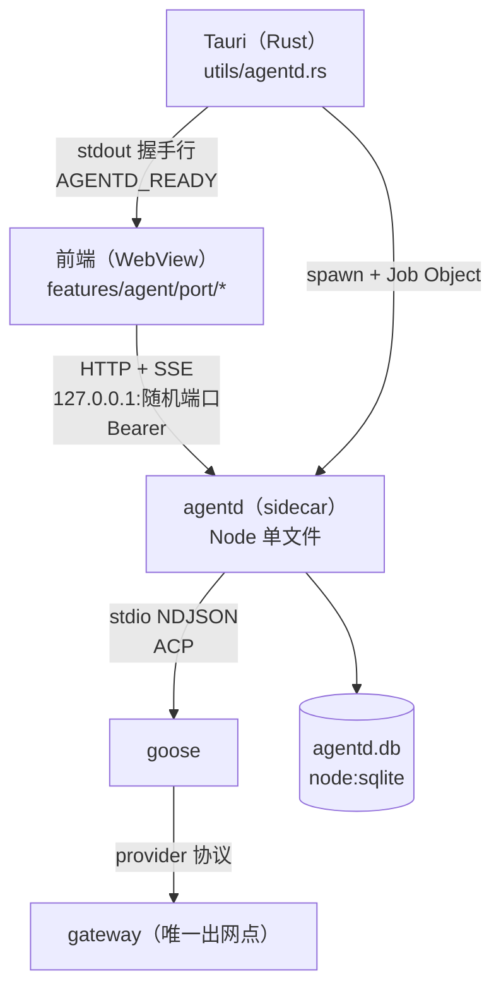

# 桌面端 agent 编排层（agentd）：拓扑、能力对照、取消语义

这套东西的决策理由在 [ADR](../../decisions/agent-orchestration-langgraph.md) 里。
本文件只管**运维与对接**：谁拉起谁、哪些能力还在、超时到底多长、出问题看哪里。

> **2026-11-23 审查提示**：本文件已按 R1 / R2 的实现校正过（事件持久化、审批票据、空闲超时、模型切换、
> 子代理调用链）。仍有偏差的条目在原文处用 ⚠️ 标出；完整缺陷清单、证据与修复顺序见
> [agent-audit.md](./agent-audit.md) 与 [agent-fix-roadmap.md](./agent-fix-roadmap.md)，
> 目标架构见 `docs/decisions/agent-*.md`。

## 1. 进程拓扑

四条必须记住的边界：

1. **agentd 只绑 `127.0.0.1`**，端口由内核挑（`AGENTD_PORT=0`），真实端口只通过 stdout 的
   `AGENTD_READY {…}` 行报给宿主。不做「先探测空闲端口再传进来」那种 TOCTOU 方案。
2. **agentd 被 Tauri 收养进 Job Object**，它的 `goose` 子进程继承成员资格；主进程被强杀时
   由内核回收整棵树。关停顺序是「HTTP `/admin/shutdown` → 等 800 ms → `taskkill /T /F`」。
3. **agentd 只写自己的 `agentd.db`**（graph checkpoint / run 状态 / 会话映射）。聊天历史仍然是
   Rust SQLite 的 `agent_message` 单写者，两边不互相写。
4. **前端只有 `port/` 一条 runtime 通路**。`port/model.ts` 把 Agent Protocol 事件翻译成
   `ChatStreamEvent`，`packages/chat` 的 `createChatModelAdapter` 原样复用。

## 2. 能力对照（parity）

P5 逐项对照了被删掉的 `acp/session.ts`（2400+ 行），每项只有两种下场：**已实现** 或
**显式降级**。没有「悄悄少一块」的第三态。

| 能力 | 状态 | 落点 / 说明 |
| --- | --- | --- |
| 工具审批（一工具一票） | ✅ 已实现 | agentd `approvals.ts` 只转发 `optionId`；「该不该问」在 client `decideApproval`，「永远不许跑」在 `@cogito/agent-protocol/policy` —— 见下节 |
| 审批超时 | ✅ 已实现 | `APPROVAL_TIMEOUT_MS = 300_000`（与旧 `TICKET_TIMEOUT_MS` 同值），超时按取消结案 |
| 提问追问 `elicitation/create` | ✅ 已实现 | agentd `elicitations.ts` 挂住 ACP 回包，`/threads/:id/elicitations/:requestId` 回执；未注册处理器/超时按 `decline`/`cancel` 结案。URL 模式（浏览器交互）仍不支持，直接 decline |
| 刷新后接着看进行中的回合 | ✅ 已实现 | `/threads/:id/events?after=<seq>` 游标续传 + `acp/session-binding.ts` 落库 |
| 后台回合（切走再回来） | ✅ 已实现 | agentd 常驻，回合本来就跑在进程外；`background-turn.ts` 只负责前端侧的泵与回放 |
| 上下文用量条 | ✅ 已实现 | `usage_update` → `writeGooseUsage(threadID, used, size)` |
| 思考级别（thinking level） | ✅ 已实现 | `GOOSE_THINKING_EFFORT` 的 `_goose/unstable/config/upsert`；会话内即时生效是**试写**，失败只写全局键 |
| 模型 / 供应商切换 | ⚠️ 部分 | `/goose/*` 透传面 + `switchGooseProviderModel` 写的是 goose **defaults**：影响**下一次建会话**，已开的会话本轮不变。R2 起每轮显式 `providerID/modelID` 会在建会话前先写 defaults（内联 / 子代理 / 目标首轮因此真的按指定模型跑）；会话级切模型还没接（goose 没有可用的 model 配置项） |
| 权限档（readonly/auto/ask…） | ✅ 已实现 | `session/set_config_option({configId:'mode'})`。**不是** `session/set_mode` —— 后者 goose 宽容返回 `{}` 但状态不变 |
| 每轮系统提示 | ✅ 已实现 | `_goose/unstable/session/system-prompt/set`（`append` + `key=cogito`），由 agentd 在会话建好后写 |
| 设置面（extensions/providers/diagnostics/defaults） | ✅ 已实现 | `/goose/{providers,extensions,diagnostics,defaults,sessions}` 透传 |
| MCP 工具面 | ✅ 已实现 | 由**会话创建方**（前端）在 `session/new` 时给出，agentd 只落进 state |
| 子代理（`subagent` 工具） | ✅ 已实现 | 调度侧在渲染进程（`agent://subagent-spawn` → `acp/subagent.ts`），子任务走 `port/session.ts` 的 `runThreadPrompt`（R2 起内部就是共享的 `runTurn`），只换传输不改职责 |
| goal 自驱续跑 | ✅ 已实现 | 仍在渲染侧租约（`goal-run.ts`），未搬进 graph 循环 —— 见下 |
| 取消 / 停止按钮 | ✅ 已实现 | `POST /threads/:id/cancel` → ACP `session/cancel` → abort 图 |

**关于子代理为什么不算「硬冲突」**：计划里担心「goose 不在渲染侧后这条链断了」。实际链路是
`goose subagent 工具 → cogito-mcp → Rust 任务板限流 → agent://subagent-spawn 事件 → 渲染侧跑一轮`。
goose 本来就在进程外，渲染侧从来只负责**接活**，而接活那一端（`acp/subagent.ts`）现在调的是
`port/session.ts` 的 `runThreadPrompt` —— 换的是传输，不是职责。所以既不需要改 subgraph，
也不需要禁用工具。

**关于 goal 自驱续跑没搬进 graph**：搬到图里能换来「关掉窗口也继续跑」，但要重写租约、幂等与
中断恢复，且现有实现有 `readGoalRun` 作为「无人值守」的证据被审批策略读取。当前判断是
**不搬**：等功能面稳定后再单独做，届时以 subgraph 形式接，而不是再复制一套循环。

### 2.1 审批分三层，一层都不能缺

goose 的判定顺序是「`user` 段 → 只读 annotation → `smart_approve` 段 → 默认问」。
cogito 想要的是「硬策略 > 用户偏好 > 档位」，顺序相反 —— 所以硬禁用不能只靠档位表达。

| 层 | 回答的问题 | 在哪 | 生效时机 |
| --- | --- | --- | --- |
| 硬策略 | 「哪些工具永远不许跑」 | `policy/approval.ts` 的 `findHardDenyLevel`（黑盒 shell + goose 原厂写工具） | agentd 在**每个 goose 会话建立时**写一次 `never_allow`（`graph.ts` `ensureHardDeny`） |
| 档位 | 「本轮要不要问」 | `findGooseMode`：`auto` → `auto`，`ask` → `smart_approve`，`readonly` → `approve` | 前端每轮随 `input.mode` 下发，agentd `applyMode` |
| 业务规则 | 「这一次该不该问」 | client `approval-decision.ts` 的 `decideApprovalForThread`（包 `@cogito/agent-runtime/policy` 的纯判定） | 状态机 `@cogito/agent-runtime/agentd/turn` 收到 `approval` 帧（含 `sync` 快照）后立即替用户拍板并回执 |

两条不变量：

1. **硬禁用不依赖用户操作**。它是唯一能在 goose `auto` 档（直接 Allow、不看审批）下拦住黑盒
   shell 的东西，所以写入时机必须是「会话建立」，不是「用户切审批档」。旧实现挂在后者，
   全新会话在用户碰过那个下拉之前一条 `never_allow` 都没有。
2. **替用户拍板要回具体选项，不要回 cancelled**。`cancelled` 在 goose 里是中止整个回合，
   模型只知道「被打断」，不会改用 `cogito_workspace_write`，用户只看到对话停了。
   只读档拒写工具回的是 `reject_once`，只读工具则在 `approve` 档下由前端自动 `allow_once`。

**`readonly` 为什么是 `approve` 而不是 `smart_approve`**：`smart_approve` 对没有
`read_only_hint` 的工具会请模型自己判「这个调用是不是只读的」，而只读档的承诺是「写工具一定
不执行」——不能押在模型判断上。`approve` 下所有工具都先问，前端再分类处置，既有确定性
又不打扰用户。

## 3. 取消与超时语义

三层各自的值必须存在，缺一层就会出现「看起来只是卡住」的无声失败。

| 层 | 值 | 位置 | 触发后 |
| --- | --- | --- | --- |
| 用户在 UI 点停止 | 立即 | `port/session.ts` → `POST /threads/:id/cancel` | ACP `session/cancel` + abort 图 |
| agentd 让位给新回合 | 1500 ms 等待，50 ms 轮询 | `agent-server.ts` `PREEMPT_WAIT_MS` | 等不到也继续（不能因旧回合赖着而拒绝新回合） |
| 审批票据 | 300 s | `approvals.ts` `APPROVAL_TIMEOUT_MS` | 按 `cancelled` 结案（fail-closed） |
| 追问票据 | 300 s | `elicitations.ts` `ELICITATION_TIMEOUT_MS` | 按 `cancel` 结案（与 UI 里点「取消」同义） |
| goose 单次 JSON-RPC 请求 | 60 s | `goose/client.ts` `DEFAULT_REQUEST_TIMEOUT_MS` | 抛错，由节点决定是否重开会话 |
| 前端等 agentd 就绪 | 30 s | `port/session.ts` `READY_TIMEOUT_MS` | 报「编排层未就绪」并给诊断入口 |
| 一轮最长空闲（无任何事件） | 60 min | `@cogito/agent-runtime/agentd/turn.ts` `DEFAULT_IDLE_TIMEOUT_MS` | 计时器参与 `Promise.race`，每收到一帧重置；超时以 `TurnFailure{code:'idle_timeout'}` 收尾（不是无限「思考中」） |
| 宿主等 agentd 优雅退出 | 800 ms，然后 `taskkill /T /F` | `utils/agentd.rs` `shutdown_and_wait` | 强杀进程树 |
| agentd 自身关停兜底 | 5 s | `main.ts` `SHUTDOWN_TIMEOUT_MS` | 强制 `process.exit` |

## 4. 可观测

两个端点，都不引 OpenTelemetry（agentd 是单进程侧车，现在没有可推的后端）：

- `GET /health`（免鉴权）：`service` / `version` / `pid` / `goose` / `restarts` / `uptimeMs`
- `GET /metrics`（**需 bearer**）：`{ counters, lastAt, uptimeMs }`

计数器（全在 `apps/agentd/src/observability.ts` 的 `METRIC_NAMES` 里登记，只增不减）：

| 名 | 含义 | 何时该看它 |
| --- | --- | --- |
| `runs.started` / `runs.settled` / `runs.failed` / `runs.cancelled` | 回合结局 | `failed/started` 偏高 = 上游或 goose 出问题；四个数加不齐 = 有回合卡住 |
| `runs.preempted` | 同线程被新一轮挤掉 | 偏高説明前端在频繁重发 |
| `approvals.requested` / `settled` / `timeout` | 审批闸门 | `timeout > 0` = 有人放着审批卡不管（或 UI 没渲染） |
| `elicitations.requested` / `settled` / `timeout` | 追问闸门 | 同上 |
| `events.sse.connections` | SSE 连接数 | 远大于回合数 = 前端在反复重连 |
| `events.cursor.replays` | 带 `?after=` 且真的补发了的次数 | 这是「断流频率」的直接度量 |
| `goose.restarts` | 内层 goose 重启 | 与 `/health` 的 `restarts` 不同：后者是本进程内，前者跨重启累计 |

结构化日志一行一条：`AGENTD_EVENT {"event":"…","at":"…","threadID":"…","runID":"…",…}`。
字段**全部平铺**（不嵌套），所以 `jq 'select(.event=="run.settled")'` 与
`Select-String 'run.settled'` 都直接可用。常见事件：`run.started` / `run.settled` /
`run.preempt` / `approval` / `elicitation` / `events.replay`。

## 5. 出问题看哪里

| 症状 | 先看 | 常见根因 |
| --- | --- | --- |
| `AGENTD_FATAL` 后立即退出（码 2） | 启动参数里的环境变量 | `AGENTD_TOKEN` 缺失或不足 16 字符 / `AGENTD_DB` 没给 —— 这是刻意的 fail-closed |
| `/health` 的 `goose` 不是 `ready` | `AGENTD_GOOSE_PATH_ROOT` 指向的目录 | 缺 `config.yaml` / `secrets.yaml`，或没配 provider+model（`session/new` 会直接 -32603） |
| UI 里从来不出审批卡 | `<GOOSE_PATH_ROOT>/config/permission.yaml` 的 `user` 段 | goose 的 `user` 段优先级最高且是**精确字符串**匹配：命中的工具直接 Allow / Deny，不发 `session/request_permission`。先到「设置 → 工具权限 → 手动偏好」看一眼，必要时「重置」（备份后删文件，下个会话自动重写硬禁用） |
| 工具直接被拒、没有任何弹窗 | 同上，看 `user.never_allow` | `never_allow` 在 goose 里是**静默拒绝**（模型只收到 `User permission denies this tool`），界面上和普通工具失败分不开。`shell` / `write` / `edit` 等属于**设计禁用**，不是用户拒绝 —— agent 应改用 `cogito_terminal_run` / `cogito_workspace_write` |
| 401 且提示「可能刚重启过」 | 宿主日志的 `agentd 握手行已收到 port=` | 端口变了但前端缓存了旧端点；`port/agentd-rpc.ts` 的 `forgetEndpoint()` 会清缓存重取 |
| 切了权限档但行为没变 | 是否走了 `session/set_config_option` | `session/set_mode` 是**假的**：返回 `{}` 但不改状态 |
| 审批请求被当成通知丢掉 | JSON-RPC `id` 类型 | `id` 允许 **string**，只认 number 会把 `request_permission` 漏掉 |

## 6. 打包与部署

- **桌面端**：`apps/agentd` 用 rolldown 打成自包含 CJS，再由 `scripts/build-sea.ts` 注入成单文件
  `agentd-<triple>[.exe]`，与其它侧车同目录同命名（`apps/client/src-tauri/binaries/`）。
  `build.rs` 与 `tauri.conf.json` 的 `externalBin` 两边都必须列它，漏一边只会在打包阶段才报错。
- **容器**：`docker/agentd/Dockerfile` 只服务 CI 与「容器内验协议」，**不做第二个产品形态**。
  上下文必须是仓库根（依赖 workspace 内的 `@cogito/agent-protocol`），`.dockerignore` 在仓库根。
  镜像里没有 goose 二进制，也**刻意不配 `AGENTD_GOOSE_PATH_ROOT`**，于是 `/health` 的 `goose` 是
  `disabled`（意图是「不托管」）而不是 `failed`（配了路径却找不到二进制）—— 这是要断言的降级形态。
- **端口**：容器内固定 `8080`；compose 宿主侧用 **28080**（大于 15000）。本机 TCP 动态端口段是
  1024–15000，落进去的端口随时被 WinNAT 抽走，报 `bind: An attempt was made to access a socket
  in a way forbidden by its access permissions` —— 看着像权限问题，实际是端口保留。
- **校验和**：`binaries/checksums.json` 的语义是「**远端** staged 产物的 sha256」，agentd 是本地
  构建产物，不进那份清单。它的产物校验靠三件事：`--version` 能自报（在 `readConfig` 之前早退，
  所以不需要 token）、CI 三平台各自运行一遍、`apps/agentd/scripts/probe-run.ts` 在有 provider 的
  机器上跑真一轮。
