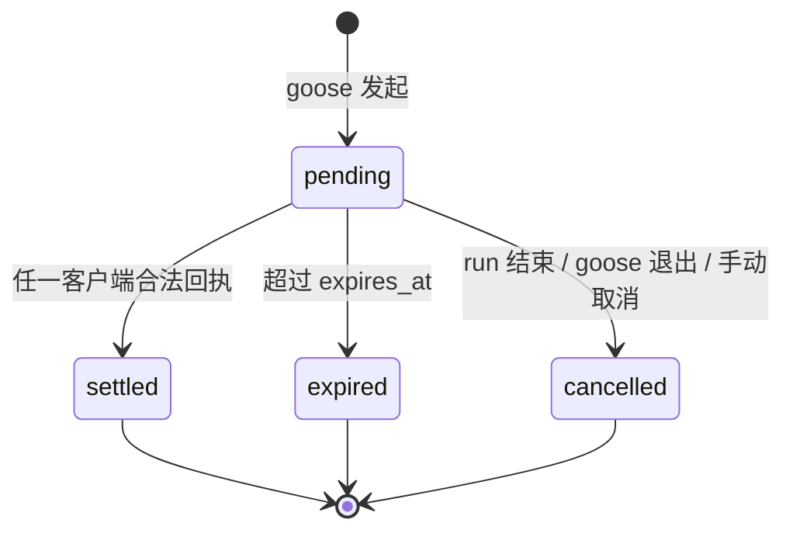

# ADR：审批与追问升级为一等持久请求

- 状态：提议（2026-11-23）
- 影响范围：`apps/agentd/src/{approvals,elicitations,agent-server,graph}.ts`、
  `packages/agent-runtime/src/agentd/*`、`apps/client`、`apps/extension`
- 关联：[agent-audit.md](../apps/client/agent-audit.md) 的 F-004 / F-005 / F-026；
  [agent-run-event-log.md](./agent-run-event-log.md)

## 1. 背景

现状：

- agentd 用内存 `Map` 挂住 ACP 反向请求，300s 超时；
- 前端把审批当**一次性推送事件**处理，票据存在各 WebView 自己的 `approvalLedger`；
- `sync` 明明下发了 pending 快照，协议层 `parseRunFrame` 却只读 `lastSeq`；
- `respondToApproval` 以「本地 take 成功」为成功，回执失败只打 warning；
- goose 退出 / run 结束时不批量结案；多客户端各自为政。

线上表现：刷新后审批卡消失（goose 仍在等）、点「允许」但工具没执行、桌面与扩展互相抢票。

## 2. 决策

**审批与追问是服务端持有的持久请求：有独立 id、有状态机、可重放、幂等结案、结案广播。**

### 2.1 数据模型

```sql
CREATE TABLE gate_requests (
  request_id   TEXT PRIMARY KEY,
  kind         TEXT NOT NULL,      -- approval | elicitation
  thread_id    TEXT NOT NULL,
  run_id       TEXT NOT NULL,
  session_id   TEXT NOT NULL,
  payload      TEXT NOT NULL,      -- toolCall / schema 等
  state        TEXT NOT NULL,      -- pending | settled | expired | cancelled
  decision     TEXT,               -- optionId / allow | reject / accept | decline
  revision     INTEGER NOT NULL DEFAULT 0,
  created_at   INTEGER NOT NULL,
  expires_at   INTEGER NOT NULL,
  settled_at   INTEGER
);
CREATE INDEX gate_requests_pending ON gate_requests(thread_id, state);
```

内存索引只做查询加速；**真相在表里**。

### 2.2 生命周期



- `settle` 必须带 `expectedRevision`（或状态校验），**只允许 pending → settled 一次**；
- 任何终态都要：
  1. 写库；
  2. 追加一条 `kind:'status', subtype:'approval_settled'` 事件（或扩展事件类型）；
  3. 广播给该 thread 的**所有**订阅者；
- 回执非法（未知 optionId / requestId 不属于该 thread）→ 400，且不改状态；
- run 结束 / `goose` 退出 → 该 run 的 pending 全部转 `cancelled` 并广播；
- 超时 → `expired`，回给 goose 的决策固定为 fail-closed（拒绝 / decline）。

### 2.3 重连与多客户端

1. 客户端订阅时，`sync` 带上 `pending` 列表（与 ADR-1 的 `sync` 扩展合并）；
2. 客户端用与实时 `approval` 事件**完全相同**的处理路径重建卡片（含 `decideApproval` 策略判定）；
3. 任一客户端结案后，其余客户端收到 `approval_settled`，按钮变「已处理」并显示结论；
4. 服务端不做「某个客户端专用」的票据；谁先合法回执谁赢；
5. 客户端账本只做 UI 缓存；**是否成功以服务端事件为准**，`take()` 不再等价于成功。

### 2.4 归属校验

- 票据的 `thread_id` / `run_id` 由 agentd 在发起时写入，**不允许**回退成 `sessionId`；
- 若会话不是经由 `/threads/:id/runs` 建立（例如直接 `POST /goose/sessions`），
  要么拒绝发起需要审批的轮次，要么建立持久 `session → thread` 映射后再允许；
- 回执路径校验 `requestId` 属于 URL 里的 `threadId`。

## 3. 理由

1. Codex app-server 的做法就是「审批带唯一 id，客户端重连时走 approval replay，无可用连接则拒绝」，
   这直接解决「刷新后卡片消失」；
2. VS Code 把审批做成 once / session / always 三种作用域并集中管理，说明审批需要自己的生命周期；
3. 只有服务端持有 pending 集合，才能做到「run 结束时批量结案」与「多客户端一致」；
4. 把结案事件写进事件日志后，审批历史与正文历史共用同一条重放通道，减少恢复分支。

## 4. 不变量

1. 一个 `requestId` 只有一个终态，且只能由一次合法回执触发；
2. **没有客户端连接时，审批按 fail-closed 处理**（拒绝），不允许「无限等待」；
3. 任何 run 终止都会让该 run 的所有 gate 进入终态；
4. 客户端不能通过本地 take 改变服务端状态；
5. 审批结论必须回灌到事件流，另一个客户端能观察到。

## 5. 代价

- 多一张表与一套状态机；需要迁移与清理任务；
- 多客户端场景需要 UI 处理「已被别人处理」；
- 回执幂等要求客户端携带 revision，旧客户端需要兼容（无 revision 时按「pending 即可」处理一次）。

## 6. 备选方案

| 方案 | 否决理由 |
| --- | --- |
| 只修客户端账本（本地 forget / 报错） | 解决不了刷新后票据丢失与多客户端一致性 |
| 用 LangGraph `interrupt` 承载审批 | 图目前只有一个节点，interrupt 不能覆盖 goose 侧的反向请求时序；且会与 ACP 票据双轨 |
| 信任 goose `permission.yaml` 的 `user` 段做「已批准」 | 它会变成永久偏好，且文件被重置后语义丢失；审批应是每次请求的事 |
| 把审批放到客户端 SQLite | 扩展/多窗口无法共享；agentd 才是唯一能回写 goose 的一方 |

## 7. 验收

1. 刷新后 pending 审批卡重建，可回执；
2. 两个客户端同 thread，一方批准 → 另一方收到 settled 且不可再点；
3. 回执 404 / 超时 → UI 明确失败，不 toast 成功；
4. kill goose → 所有 pending 变 cancelled 并广播；
5. run 被抢占/取消 → 旧 run 的票据不被新 run 结案（按 run_id 过滤）。

## 8. 重新考虑条件

- goose 提供「审批结果查询」API，可直接以 goose 为真相 → 改为代理 + 缓存；
- 引入云端共享会话 → 票据迁到服务端，agentd 只做执行与回写。
