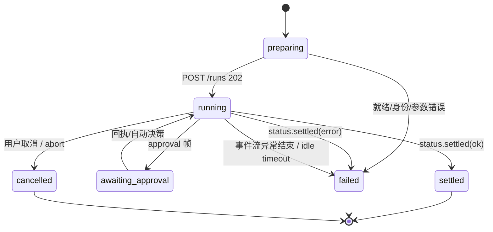

# ADR：run 状态机收敛为单一实现

- 状态：**已接受（2026-11-23 落地于 R2）**
- 落地位置：`packages/agent-runtime/src/agentd/turn.ts`（`runTurn` / `pumpTurn`）；`agentd/run-error.ts`
  （归因上提）；client `port/session.ts`、extension `port/model.ts` 只剩适配与策略。
- 与提议的差异：终态仍为 `settled / cancelled / failed` 三选一，但以 `TurnItem.stop` 与
  `TurnFailure.code` 表达；`onCursor` 在 `finally` 里必调一次；首帧前不抛由「端口先 `yield` 一条
  `error` 事件」保证（而非在状态机里造一个空快照）。
- 未覆盖：`sync` 不携带「当前 run 终态」字段（与本 ADR 的提议不一致，留待需要时补）；
  F-013 的「模式两个真相」属于产品优先级问题，不在本 ADR 范围。
- 影响范围：`packages/agent-runtime`、`apps/client/src/features/agent/port/*`、
  `apps/extension/src/features/agent/port/*`
- 关联：[agent-audit.md](../apps/client/agent-audit.md) 的 F-008 / F-009 / F-011 / F-012 / F-013 / F-014；
  [agent-run-event-log.md](./agent-run-event-log.md)

## 1. 背景

「订阅事件 → POST runs → 读 SSE → 去重 → 处理审批 → 等 settled」这段逻辑有两份实现：

- `apps/client/src/features/agent/port/session.ts` 的 `runThreadPrompt`（约 1200 行，含后台泵、恢复、计划、目标）；
- `apps/extension/src/features/agent/port/model.ts` 的 `buildBridgeModelPort().run`。

两者已经出现实质分歧：

| 行为 | client | extension |
| --- | --- | --- |
| 审批「取消」 | 优先 `reject_once` | `cancelled:true` 结束整轮 |
| 游标落库 | 仅成功路径 | `finally` 落库 |
| 错误归因 | `annotateRunFailure` | 直接 `throw new Error(message)` |
| 恢复 | `resumeThreadRun` | 无 |
| 参数 | cwd / mcpServers / systemText / provider | 只发 `{prompt, mode}` |

同时 `runThreadPrompt` 内部还有三处结构性缺陷：race 丢帧、deadline 不参与等待、首帧前 throw。

## 2. 决策

**在 `@cogito/agent-runtime` 提供唯一的 `runTurn` 状态机；client 与 extension 只提供 capability 与副作用。**

### 2.1 接口

```ts
interface RunTurnInput {
  threadID: string
  prompt: string
  // 本轮的显式参数：不再从全局/当前会话隐式读取
  mode: SessionMode
  provider?: { providerID: string; modelID?: string }
  cwd?: string | null
  workspaceID?: string | null
  mcpServers?: AcpMcpServer[]
  systemText?: string
  // 能力差异由调用方声明
  capabilities: {
    resume: boolean
    background: boolean
    plan: boolean
    goal: boolean
  }
}

interface RunTurnDeps {
  transport: AgentdTransport
  policy: (toolName: string, options: ApprovalOption[]) => ApprovalDecision
  onApproval?: (ticket: ApprovalTicket) => void
  onElicitation?: (ticket: ElicitationTicket) => void
  onUpdate: (event: ChatStreamEvent) => void
  onCursor: (cursor: RunCursor) => void   // 每个终态都会调用
  signal?: AbortSignal
}

async function* runTurn(input: RunTurnInput, deps: RunTurnDeps): AsyncGenerator<RunTurnItem>
```

`runTurn` 负责：

1. `waitReady` → `ensureThread` → 订阅事件（**先订阅**）→ `POST /runs`；
2. 帧泵：SSE 与本地注入合并；**不丢帧**（见 2.2）；
3. 游标：`sync` 重置、`seq` 去重、终态落库；
4. 审批：调用 `policy`，自动回执或推给 UI；结案以服务端事件为准；
5. 终态：`finish` / `error` / `cancelled` / `aborted` 四选一，且只发一次；
6. 取消：`POST /cancel` + abort 本地泵；由 agentd 决定 goose 侧行为。

`runTurn` **不负责**：assistant-ui 快照聚合（仍在 `@cogito/chat` 适配器）、计划/目标语义（client 侧策略）、
后台泵的持久化（client `background-turn` 作为 `onUpdate` 的消费者）。

### 2.2 必须修掉的三处

1. **race 丢帧**：保存未消费的 `frames.next()` promise，注入事件胜出后继续 await 它，而不是丢弃；
   或用单一异步迭代器 + 注入队列合并（`for await` 内更新一个 `pendingInject`）。
2. **deadline 参与等待**：`Promise.race` 加一个定时器分支；超时 → 发 `error{kind:'idle-timeout'}` 并终止。
3. **首帧前不抛**：所有「已知原因」的早退（无 provider、identity 未就绪、无文本）先 `yield { content: [] }`
   或等价的空快照，再抛错；否则 assistant-ui 会永久转圈。

### 2.3 状态机



- 每个终态都要 `onCursor`（F-012）；
- `cancelled` 不是 error：不进入失败统计，不触发「重试」错误块；
- `failed` 必须带 `errorKind` 与「去哪看」的提示（复用 `annotateRunFailure`）。

## 3. 理由

1. 两份实现已经产生行为分裂，继续各改一处只会扩大差异；
2. VS Code 用 harness 抽象、Codex 用 app-server 让多前端共用核心，都是同一思路；
3. `runTurn` 是纯协议客户端，不依赖 React / Tauri / chrome，可单测注入 fake transport；
4. client 的 plan/goal/background 是**策略**，不是协议；把它们留在 `runTurn` 之外，扩展可以不实现，
   同时共享最易错的帧处理。

## 4. 不变量

1. 一轮只有一个终态，且只发一次；
2. 事件按 `(epoch, seq)` 严格去重，任何路径都不丢帧；
3. 审批的自动决策只来自注入的 `policy`，不在 `runTurn` 里写业务规则；
4. 游标在终态必落一次，不依赖成功路径；
5. `runTurn` 不读全局单例（当前会话、当前模式），所有参数显式传入。

## 5. 代价

- 一次跨包重构，client 的 `session.ts` 要拆成「runTurn + client 策略」；
- 扩展需要补齐 capability 声明与 `onCursor` 落库；
- 需要一套 fake agentd 测试夹具（见 ADR-1 验收）。

## 6. 备选方案

| 方案 | 否决理由 |
| --- | --- |
| 只把 client 修好，扩展照旧 | 两套行为继续漂移；扩展的 `cancelled` 语义仍然是错的 |
| 用 assistant-ui 的 runtime 统一 | 它管的是消息快照，不管 SSE 游标、审批票据与服务端结案 |
| 用 LangGraph SDK 客户端 | 只覆盖 `/runs/stream`，前端正式路径是 `/runs` + `/events`，且 SDK 不处理审批 replay |
| 把 client 的 session.ts 直接搬到扩展 | 带进大量 Tauri/assistant-ui 依赖，扩展无法运行 |

## 7. 验收

1. `runTurn` 单测（fake transport）：sync 带 pending approvals、gap/epoch 变化、race 注入、idle timeout、
   首帧 throw、终态落游标；
2. client 与 extension 的同一用例输出一致（审批取消 → `reject_once`；错误归因文案一致）；
3. 取消路径：首轮取消能发出 `session/cancel`（配合 ADR-3 的 agentd 侧修复）；
4. 回归：`pnpm --filter @cogito/client exec vitest run src/features/agent src/views/agent` 全绿。

## 8. 重新考虑条件

- 出现第三种客户端（例如 Web）且能力差异超出 capability 建模 → 考虑把策略也参数化；
- assistant-ui 提供官方的「远端 thread + 服务端事件」原语 → 重新评估自研泵的必要性。
