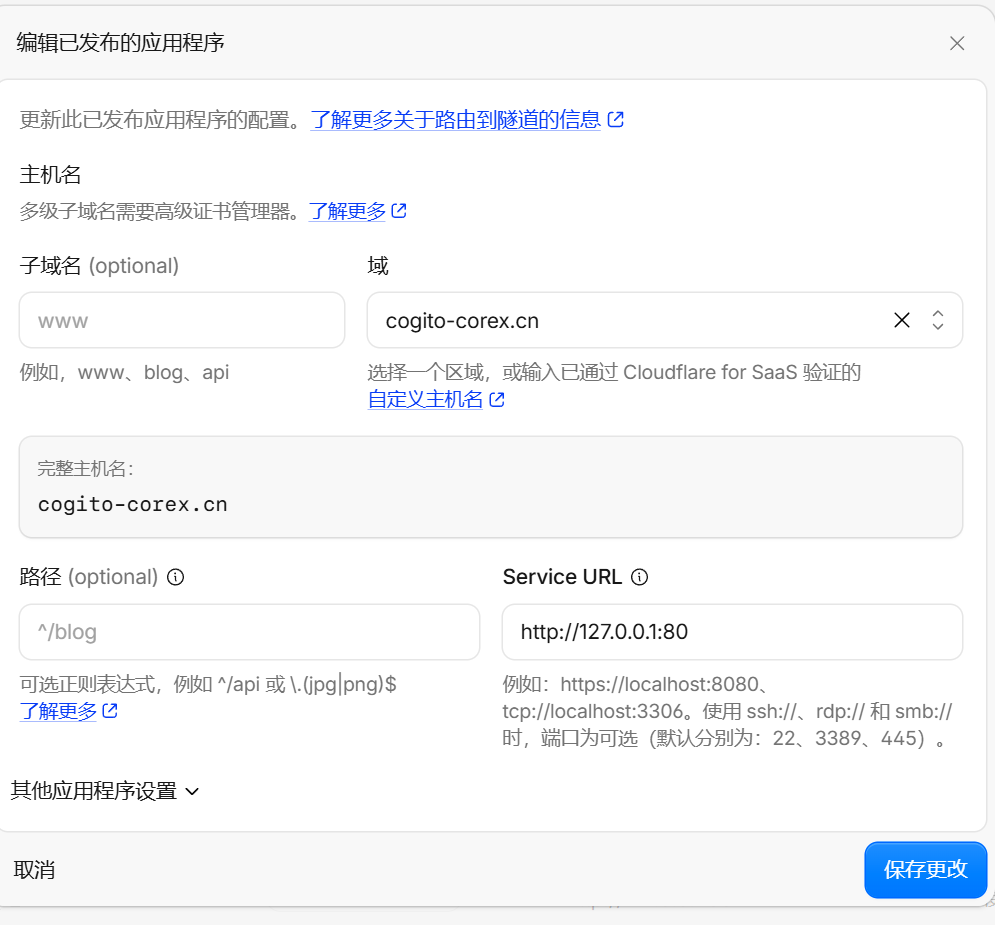
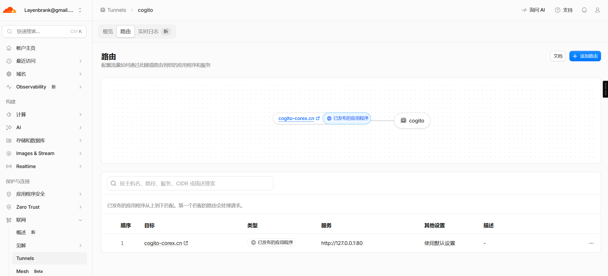
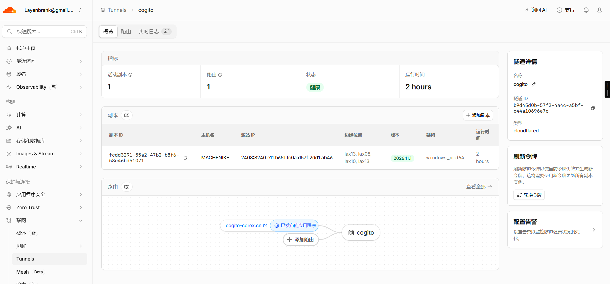
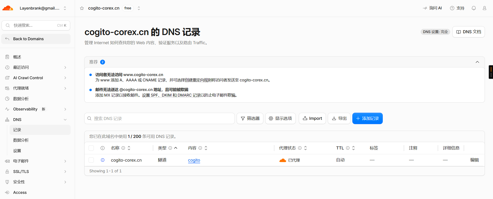
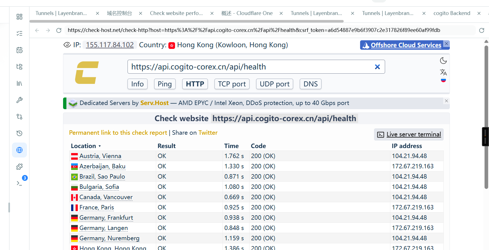

# Cloudflare Tunnel + 本机 nginx：把内网服务发布到公网

> 本文记录「家庭/办公室内网服务 → Cloudflare 边缘 → 公网域名」的完整落地过程，
> 包含 Cloudflare 侧每一步的菜单路径、nginx 全部配置代码与逐段解释、验证命令、
> 以及踩过的坑和排查手册。照着做可以 30 分钟内复刻一套。

> **第一次做？** 从 [§0](#0-先读这里给第一次做的人) 开始（速查卡 + 术语表 + 前置清单）；
> **只想排障？** 直接跳 [§8](#8-故障排查手册)；**只想改配置？** 看 [§4.1](#41-为什么中间要有一层-nginx) 末尾的「改哪里」对照表。

| 项目 | 值 |
|---|---|
| 公网域名 | `cogito-corex.cn`（根域，不是子域） |
| 隧道名 / ID | `cogito` / `b9d45d0b-57f2-4a4c-a5bf-c44a10696e7c` |
| 隧道类型 | Remotely-managed（配置在仪表盘，本地无 config.yml） |
| 本机网关 | nginx 1.28.0，`D:\Applications\Nginx`，监听 `0.0.0.0:80` |
| 前端产物 | `D:\Documents\workspace-cogito\apps\backend\dist` |
| 后端上游 | `127.0.0.1:3000`（Docker `cogito-service`） |
| cloudflared | 2026.11.1，装成 Windows 服务 `cloudflared`（Automatic） |

## 0. 先读这里（给第一次做的人）

### 0.1 一句话说清楚这套东西在干什么

家里/公司的电脑上跑着一个网站（本机 nginx 在 `127.0.0.1:80`），
你想在手机流量、在朋友家、在公司，用 `https://cogito-corex.cn` 打开它。

**Cloudflare Tunnel 就是一条「从你家主动拨出去、一直挂着」的电话线**：
本机小程序 cloudflared 主动连 Cloudflare 并保持长连接；公网请求先到 Cloudflare 边缘，
边缘再顺着这条线把请求送回你家。所以——

- 不需要公网 IP；
- 不需要在路由器上做端口映射；
- 运营商封 80/443、你在大内网（CGNAT）里，都无所谓；
- 唯一要求：本机能正常上网（出站 443 / 7844 通）。

```text
手机 ──https──▶ Cloudflare 边缘 ──(出站长连接)──▶ 本机 cloudflared ──http──▶ 本机 nginx ──▶ 后端 :3000
```

### 0.2 速查卡（只想跑起来的人看这张表）

> 顺序很重要：**先把本机链路跑通（nginx + 后端），再去 Cloudflare 建路由**。
> 反过来的话，路由建好了但源站没起，公网看到的是 502，很容易误判成「隧道坏了」。

| # | 在哪做 | 做什么 | 做完的标志 | 详见 |
|---|---|---|---|---|
| 1 | Cloudflare | 确认域名 NS 已指向 Cloudflare | 域名页状态「有效」；`Resolve-DnsName 你的域名 -Type NS` 返回 `*.ns.cloudflare.com` | §3.0 |
| 2 | 本机 | 装 nginx（Windows 绿色包）放到 `D:\Applications\Nginx` | `nginx -v` 有版本号 | §2.3 |
| 3 | 本机 | 按 §4 铺 7 个配置文件 | `nginx -t` 输出 `syntax is ok` | §4 |
| 4 | 本机 | 后端跑起来（本例 Docker） | `curl http://127.0.0.1:3000/` = 200 | §2.0 |
| 5 | 本机 | 起 nginx | `curl -H "Host: cogito-corex.cn" http://127.0.0.1/` = 200 | §6.1 |
| 6 | Cloudflare | Tunnels → 创建隧道 → Cloudflared → 起名 | 页面给出 token 安装命令 | §3.2 |
| 7 | 本机（管理员） | `cloudflared.exe service install <token>` | `Get-Service cloudflared` = Running；概览「状态 健康 / 副本 1」 | §3.3 |
| 8 | Cloudflare | 隧道 → 路由 → 添加路由 → 已发布的应用程序，Service URL 填 `http://127.0.0.1:80` | 路由表出现 1 行；DNS 自动出现「隧道」记录 | §3.4 |
| 9 | 任意网络 | 手机流量打开 `https://cogito-corex.cn` | 页面渲染正常、接口 200 | §7 |
| 10 | 本机（可选） | 配开机自启 | 重启后 `Get-Process nginx` 有进程 | §6.2 |
| 11 | 出错时 | 按症状 / 报错码查表 | — | §8 |

### 0.3 术语表（后文出现的中文、英文、界面词都在这里）

| 词 | 意思 | 在本方案里是 |
|---|---|---|
| Cloudflare 边缘（edge） | CF 在各地的接入服务器 | 访客先连它，TLS 在它这里终止 |
| Tunnel / 隧道 | 本机 → 边缘 的一条出站长连接 | 名叫 `cogito` |
| cloudflared | 建立隧道的小程序（守护进程） | 装成 Windows 服务，开机自启 |
| 副本 / 连接器（replica / connector） | 一条隧道可以有多台机器同时连进来 | 本机 1 个副本 = 正常 |
| 已发布的应用程序 / 公有主机名（Public hostname） | 「全世界都能解析的域名 → 源站地址」这条规则 | `cogito-corex.cn → http://127.0.0.1:80` |
| 私有主机名（Private hostname） | 只有装了 WARP 的设备能解析，**不产生公网 DNS** | 本方案不需要，可删（§3.6） |
| Service URL / 源站地址 | 边缘把请求转发到哪个地址 | 只能填本机或容器地址 |
| 源站（origin） | 真正干活的服务 | 本机 nginx `127.0.0.1:80` |
| 上游 / upstream | nginx 把请求转给谁 | `cogito_api` = `127.0.0.1:3000` |
| 反向代理（reverse proxy） | 对外一个入口、对内按规则分发 | 就是这里的 nginx |
| apex / 根域 | 不带子域的裸域名 | `cogito-corex.cn`（不是 `app.cogito-corex.cn`） |
| CNAME flattening | 根域按规定不能挂 CNAME，CF 把它「摊平」成 A/AAAA 返回 | 隧道记录能挂在根域上靠的就是它 |
| WARP / 1.1.1.1 客户端 | Cloudflare 的 VPN 类客户端（Zero Trust） | 装了它会优先走「私有主机名」 |
| Zero Trust | CF 的企业安全套件，Tunnels / Access 都在它下面 | 隧道菜单在这里 |
| Access | 在域名前面加一层登录验证 | 可选，见 §3.7 |
| SPA | 单页应用：URL 变化不请求新文件，前端自己接管路由 | 刷新子路径要回退 `index.html` |
| 444 | nginx 特有状态：不回任何内容，直接断开 | 兜底站点用它减少探测面 |

### 0.4 你手上得先有这些

| 项 | 要求 | 怎么确认 |
|---|---|---|
| 域名 | 已托管在同一个 Cloudflare 账号（免费版够） | CF → 域名 → 状态「有效」；`Resolve-DnsName 你的域名 -Type NS` |
| 机器 | Windows 10/11，能开管理员 PowerShell | 右键「以管理员身份运行」不报错 |
| 端口 | 本机 80 空闲 | `Get-NetTCPConnection -State Listen -LocalPort 80` 无输出 |
| 后端 | 有服务在 `127.0.0.1:3000` 监听（本例 Docker） | `curl http://127.0.0.1:3000/` |
| 前端产物 | 已构建的 `dist`（里面必须有 `index.html`） | `Test-Path D:\Documents\workspace-cogito\apps\backend\dist\index.html` |
| 出站网络 | 443 能出去（cloudflared 靠它连边缘） | 服务装完，概览页「状态 健康」 |

---

## 目录

- [0. 先读这里（给第一次做的人）](#0-先读这里给第一次做的人)
- [1. 架构与原理](#1-架构与原理)
- [2. 前置条件与环境](#2-前置条件与环境)
- [3. Cloudflare 侧配置（分步）](#3-cloudflare-侧配置分步)
- [4. nginx 侧配置](#4-nginx-侧配置)
- [5. 关键设计决策](#5-关键设计决策)
- [6. 部署与运维](#6-部署与运维)
- [7. 验证清单](#7-验证清单)
- [8. 故障排查手册](#8-故障排查手册)
- [9. 扩展：多服务、多端口、多子域](#9-扩展多服务多端口多子域)
- [10. 安全清单](#10-安全清单)
- [附录 A：文件清单与变更记录](#附录-a文件清单与变更记录)
- [附录 B：界面字段中英对照](#附录-b界面字段中英对照)
- [附录 C：从零铺一遍（目录、文件对照、验证命令）](#附录-c从零铺一遍目录文件对照验证命令)

---

## 1. 架构与原理

### 1.1 为什么用 Tunnel 而不是端口映射

| 方案 | 需要公网 IP | 需要路由/端口映射 | 怕 CGNAT | 证书 | 适用 |
|---|---|---|---|---|---|
| 端口映射 + DDNS | 要 | 要 | 怕 | 自建/ACME | 传统家庭宽带 |
| 云服务器反代 | 要（云上） | 不用 | 不怕 | 云上申请 | 有云主机 |
| **Cloudflare Tunnel** | **不用** | **不用** | **不怕** | CF 边缘自动 | 家庭/内网首选 |

cloudflared 是**出站**连接：本机主动连 Cloudflare 边缘并保持长连接（4 条 QUIC/HTTP2 隧道），
公网请求从边缘顺着这条连接打回来。所以：运营商封 80/443、没有公网 IP、在 NAT 后面全部无所谓。

### 1.2 数据流

```text
                         ┌──────────────────────────────┐
  手机 / 公网访客 ──https──▶│ Cloudflare 边缘 (TLS 在此终止) │
                         │  DNS: cogito-corex.cn        │
                         │  → 隧道 cogito               │
                         └──────────────┬───────────────┘
                                        │ 出站长连接（cloudflared 主动建立）
                                        │ 无需任何入站端口
                         ┌──────────────▼───────────────┐
                         │ 本机 cloudflared (Windows 服务) │
                         └──────────────┬───────────────┘
                                        │ http://127.0.0.1:80
                         ┌──────────────▼───────────────┐
                         │ 本机 nginx :80（网关/反代）    │
                         │ ├─ /            → dist 静态   │
                         │ ├─ /api/v1/     → 127.0.0.1:3000
                         │ └─ 其它 host     → 444 断开   │
                         └──────────────┬───────────────┘
                                        │
                         ┌──────────────▼───────────────┐
                         │ Docker: cogito-service :3000  │
                         │   + postgres / redis / ...    │
                         └──────────────────────────────┘
```

### 1.3 地址与端口总表

| 层 | 地址 | 说明 |
|---|---|---|
| 公网 | `https://cogito-corex.cn` | 只走 443（由 CF 边缘提供证书） |
| 公网 | `http://cogito-corex.cn` | 也可访问（当前未强制跳 https） |
| 公网 | `https://api.cogito-corex.cn` | API 专用入口（整站透传到后端，见 §3.8 / §4.8） |
| 本机 | `http://127.0.0.1:80` | nginx 主站，cloudflared 的唯一目标 |
| 本机 | `http://cogito-corex.cn` / `http://192.168.x.x` | 局域网直连（Host 匹配即可） |
| 上游 | `127.0.0.1:3000` | `cogito-service`（API + 自身也托管静态资源） |
| 其它 | `28080`(agentd) `8080`(gocaptcha) `5432` `6379` `16686`(jaeger) | 仅供本机/容器网络使用，**不要**暴露到公网 |

---

## 2. 前置条件与环境

### 2.0 开跑之前的自检

打开**管理员 PowerShell**（开始菜单搜 PowerShell → 右键「以管理员身份运行」），整段粘进去跑一遍，
输出符合下表的预期再往下走：

```powershell
Write-Host "1) 80 端口占用（应为空）"
Get-NetTCPConnection -State Listen -LocalPort 80 -ErrorAction SilentlyContinue |
  Select-Object LocalAddress, OwningProcess

Write-Host "2) 后端 3000（应有 Listen）"
Get-NetTCPConnection -State Listen -LocalPort 3000 -ErrorAction SilentlyContinue |
  Select-Object LocalAddress, OwningProcess

Write-Host "3) cloudflared 版本与服务状态"
cloudflared --version
Get-Service cloudflared -ErrorAction SilentlyContinue | Select-Object Name, Status, StartType

Write-Host "4) nginx 版本（-v 输出走 stderr，看到红字也正常）"
& 'D:\Applications\Nginx\nginx.exe' -v

Write-Host "5) 现在有几个 nginx 进程（正常只有 master + worker）"
Get-CimInstance Win32_Process -Filter "Name='nginx.exe'" | Select-Object ProcessId, ExecutablePath

Write-Host "6) 前端产物是否存在（期望 True）"
Test-Path 'D:\Documents\workspace-cogito\apps\backend\dist\index.html'

Write-Host "7) 域名 NS 是否已在 Cloudflare"
Resolve-DnsName cogito-corex.cn -Type NS | Select-Object NameHost
```

| 检查项 | 不符时先做 |
|---|---|
| 80 被占 | 见 §2.4；实在腾不出来就把所有 `listen 80` 改成 `listen 8080`，隧道 Service URL 同步改 |
| 3000 没监听 | 先把后端起来（本例 `docker compose up -d`），否则后面每步验证都会 502，白折腾 |
| cloudflared 没装 / Stopped | §2.3 装、§3.3 注册服务 |
| 出现两套 nginx | §2.4，只保留 `D:\Applications\Nginx` 这一套 |
| `dist` 不存在 | 回前端仓库 `pnpm build`（Vite 默认输出 `dist`） |

### 2.1 实测版本

```text
cloudflared version 2026.11.1 (built 2026-11-17T05:28 UTC)
nginx version: nginx/1.28.0
Get-Service cloudflared → Status: Running / StartType: Automatic
Docker: cogito-service(3000) postgres redis gocaptcha agentd compute orchestrator worker jaeger
```

### 2.2 目录约定

```text
D:\Applications\Nginx\
├─ conf\
│  ├─ nginx.conf                     ← 主入口（只放全局 + include）
│  ├─ conf.d\00-upstreams.conf       ← 上游定义（改后端端口只改这里）
│  ├─ nginxconfig.io\               ← 可复用片段
│  │  ├─ general.conf                  gzip + 入口缓存
│  │  ├─ proxy.conf                    代理头 + WebSocket + 超时
│  │  └─ security.conf                 安全响应头 + 隐藏文件拒绝
│  └─ sites-available\
│     ├─ cogito-corex.cn.conf        ← 主站（listen 80）
│     ├─ 00-default.conf             ← default_server，未知 Host 返回 444
│     └─ _port-site.example.conf.disabled ← 端口型站点模板（不生效）
├─ logs\  (error.log / nginx.pid / cogito.access.log / cogito.error.log)
└─ nginx.exe
```

> **为什么要拆成这么多文件**：主入口只负责全局与 include，新增站点/上游不用动主配置；
> 片段（gzip / 代理头 / 安全头）在多个站点间复用，改一处全网生效。

> **文件后缀就是开关**：`nginx.conf` 只 include 了 `conf.d\*.conf` 和 `sites-available\*.conf`，
> 所以**文件名必须以 `.conf` 结尾才会被加载**。模板文件故意叫 `_port-site.example.conf.disabled`，
> 意思是「放在那儿但不生效」，要用时把 `.disabled` 去掉即可。

### 2.3 装软件（全新机器才需要）

**nginx（Windows 版是绿色包，没有安装程序）**

1. 打开 <https://nginx.org/en/download.html>，下载 **Stable** 里的 `nginx-1.28.x.zip`；
2. 解压到 `D:\Applications\Nginx`（解压后应能直接看到 `nginx.exe`、`conf\`、`logs\`、`html\`）；
3. 看版本：`& 'D:\Applications\Nginx\nginx.exe' -v` → `nginx version: nginx/1.28.0`；
4. **不要双击 `nginx.exe`**：它在前台占住窗口，窗口一关进程就没了（起法见 §6.1）。

**cloudflared**

```powershell
# 方式一：winget（最简单）
winget install --id Cloudflare.cloudflared

# 方式二：下 exe 到 C:\Program Files\cloudflared\，再把这个目录加进 PATH
curl.exe -L -o cloudflared.exe https://github.com/cloudflare/cloudflared/releases/latest/download/cloudflared-windows-amd64.exe
```

> `service install` 需要**管理员**权限；装完 `cloudflared --version` 应有版本号输出。

### 2.4 两个「看起来像灵异」的前置问题

**① 80 端口被别人占了**（IIS、Skype、旧 nginx、某些国产软件都会占）

```powershell
Get-NetTCPConnection -State Listen -LocalPort 80 | ForEach-Object {
  $proc = Get-Process -Id $_.OwningProcess -ErrorAction SilentlyContinue
  "$($_.LocalAddress):80  <-  PID $($proc.Id)  $($proc.ProcessName)  $($proc.Path)"
}
```

- 占用者是 `nginx.exe` 但不是你这份 → 看 ②；
- 是 IIS → 管理员执行 `iisreset /stop`；
- 是别的软件 → 要么关掉，要么整体换端口（所有 `listen 80` → `listen 8080`，隧道 Service URL 同步改）。

**② 机器上装了两套 nginx**（本次真踩到：winget 装的一套 + 手装的一套）

两套 master 抢同一个 80 时，`nginx -s reload` 可能命中「另一个」实例，典型症状是
**改了配置没反应**，或报 `invalid PID number "" in "...nginx.pid"`。

```powershell
Get-CimInstance Win32_Process -Filter "Name='nginx.exe'" | Select-Object ProcessId, ExecutablePath

# 只留 D:\Applications\Nginx 这一套：
taskkill /F /IM nginx.exe
Remove-Item D:\Applications\Nginx\logs\nginx.pid -ErrorAction SilentlyContinue
Start-Process -FilePath 'D:\Applications\Nginx\nginx.exe' `
  -ArgumentList '-p','D:\Applications\Nginx\','-c','conf/nginx.conf' -WindowStyle Hidden
```

### 2.5 Windows 防火墙要不要放行 80

| 场景 | 要不要放行 | 说明 |
|---|---|---|
| 只给公网用（cloudflared 装在本机） | **不用** | cloudflared 连的是 `127.0.0.1:80`，回环流量不过防火墙 |
| 局域网手机/平板也想直连 `http://192.168.x.x` | 要 | 管理员：`New-NetFirewallRule -DisplayName "nginx 80" -Direction Inbound -Protocol TCP -LocalPort 80 -Action Allow` |

---

## 3. Cloudflare 侧配置（分步）

### 3.0 第零步：确认域名已经在 Cloudflare 托管

3.4 的「域」下拉框能不能选到你的域名、保存路由时能不能自动建 DNS，前提只有一个：
**域名的 NS 已经指向 Cloudflare**。

```powershell
Resolve-DnsName cogito-corex.cn -Type NS | Select-Object NameHost
# 期望：xxx.ns.cloudflare.com / yyy.ns.cloudflare.com
```

如果返回的是阿里云 / 腾讯云 / GoDaddy 的 NS，先做这几步：

1. Cloudflare → **添加域（Add a site）** → 选 Free → 输入域名；
2. CF 给你两个 NS（形如 `ada.ns.cloudflare.com`、`bob.ns.cloudflare.com`）；
3. 去域名注册商后台 → 找域名 → **修改 DNS 服务器** → 换成这两个；
4. 等生效（通常几分钟，最长 24 小时），CF 域名页由「待处理」变「**有效**」。

> 这一步没做，3.4 的「域」里根本不会出现你的域名——这是新手最容易卡的第一个点。

### 3.1 Tunnels 菜单在哪

新版仪表盘把隧道挪到了 **Networking** 下，两个等价入口：

- `https://dash.cloudflare.com/<account-id>/tunnels`
- Zero Trust → 左侧 **联网（Networking）→ Tunnels**

如果访问旧路径 `one.dash.cloudflare.com/<account-id>/networks/tunnels`，会出现
「Cloudflare Tunnels 已移至新位置 / 前往 Tunnels」的跳转提示，点按钮即可。

> account-id 就是 URL 里第一段（本账号 `4c4eeb1c…`），不是 zone id。

### 3.2 创建隧道

1. Tunnels 页 → **创建隧道**（右上角蓝按钮）→ 环境选 **Cloudflared** → 起名字 `cogito` → 保存隧道；
2. 页面立刻给出**安装命令**（三个平台各一段，选 **Windows**）；命令里的那一长串就是 **token**，
   形如 `eyJhIjoiN2...`（几百个字符，等效于密码，别贴进聊天/截图/Git）；

   ```powershell
   # Windows：把 token 直接装成系统服务（推荐）
   cloudflared.exe service install <YOUR_TOKEN>
   ```

3. 这就是 **remotely-managed（token 模式）**：隧道配置（路由、副本）全在仪表盘，
   本机**没有** `config.yml`、不需要 `cloudflared tunnel run`。

> 期望结果：保存后进入隧道详情页，顶部有「概览 / 路由 / 实时日志」三个页签，
> 此时**状态应该是「非活动 / 不健康」**——因为还没装服务。装完服务（3.3）才会变「健康」。
>
> token 弄丢了：隧道详情页 → **配置 / 安装** 里可以重新查看，或「轮换令牌」生成新的（旧的立即失效）。

| 模式 | 配置位置 | 本机文件 | 适用 |
|---|---|---|---|
| Quick Tunnel | 无 | 无 | 临时演示，地址随机 `*.trycloudflare.com`，**不要用于长期入口** |
| Locally-managed | 本机 `config.yml` + `cloudflared tunnel run` | 有 | 想用 Git 管理配置 |
| **Remotely-managed（本方案）** | 仪表盘 | 无（只有服务 + token） | 家用/长期、随时改路由 |

### 3.3 把 cloudflared 装成 Windows 服务

**管理员** PowerShell 里执行：

```powershell
cloudflared.exe service install <TOKEN>     # 注册为 Windows 服务（自动启动）
Get-Service cloudflared                     # 期望 Status=Running / StartType=Automatic
# 卸载：cloudflared.exe service uninstall
```

装完确认三件事（缺一件都别往下走）：

1. `Get-Service cloudflared` → `Running` / `Automatic`；
2. 回仪表盘 → 隧道 → **概览**：状态 **健康**、活动副本 **1**；
3. 副本表里「主机名」是你这台机器名，「源站 IP」是你家宽带的出口 IP（IPv4/IPv6 都可能）。

| 症状 | 原因 | 处置 |
|---|---|---|
| 服务 Stopped 且起不来 | token 复制不全 / 非管理员安装 | 管理员重装：`cloudflared.exe service uninstall` 再 `install` |
| 服务 Running 但概览「不健康」 | 出站被拦（公司网/校园网/防火墙） | 换网络试；或前台跑 `cloudflared tunnel --loglevel debug run --token <TOKEN>` 看报错 |
| 概览「活动副本」> 1 | 既装了服务、又手动 `tunnel run`，或有第二台机器 | 只留一个；多副本本身不坏，但状态会抖 |

> **别同时留两个副本**（服务 + 手动 `cloudflared tunnel run`）：同一个隧道出现多副本时，
> 排查 502 会分不清请求落到哪一份。

### 3.4 添加「已发布的应用程序」路由

隧道详情 → **路由** 页签 → 右上角蓝色 **+ 添加路由** → 选 **已发布的应用程序**：

| 字段 | 值 | 说明 |
|---|---|---|
| 子域名（可选） | 空 | 根域就是不加前缀，所以留空 |
| 域 | `cogito-corex.cn` | 下拉里选；选不到说明 NS 还没生效（§3.0） |
| 完整主机名 | 自动显示 `cogito-corex.cn` | 上面两个字段拼出来的，不用手填 |
| 路径（可选） | 空 | 留空 = 匹配全部路径；填 `/api` 就只接这一支 |
| **Service URL** | `http://127.0.0.1:80` | **指向 nginx，不是直接指后端** |
| 其他应用程序设置 | 默认 | HTTP/2、TLS 校验等保持默认即可 |

照着这一页填（改完点右下角 **保存更改**）：



保存后的页面长这样——「路由」页上半部分是图形化链路（域名 → 已发布的应用程序 → 隧道），
下半部分是**表格**，表格里那一行就是真正生效的规则（服务列必须是 `http://127.0.0.1:80`）：



健康状态在「概览」页确认（活动副本 1、状态 健康）：



> 把顺序记牢：**手机 → CF 边缘 → 隧道 → cloudflared → nginx:80 → 后端:3000**。
> 只有「服务」这一列写错，公网就会 502，而本机怎么测都正常。

几条硬规则：

- **Service URL 只能是 `127.0.0.1` / `localhost` / 容器名**，不能填公网 IP 或域名。
- 想改服务地址：该行 **操作 → 编辑路由 → 改 Service URL → 保存更改**。
- 路由**自上而下匹配，第一条命中即生效**；子域/路径更具体的要放上面。
- 已发布应用程序 = 全互联网可解析；私有主机名 = 只有 WARP 客户端能解析（见 3.6）。

### 3.5 DNS 记录是怎么来的

保存路由时 Cloudflare 自动建一条记录，**不要手动再建 A/CNAME**，否则冲突：



- 仪表盘上类型显示为 **隧道**（内容 = 隧道名 `cogito`）；
- 实际下发的是 `CNAME <tunnel-id>.cfargotunnel.com`，且**必须保持橙色云（已代理）**；
- 根域（apex）做 CNAME 靠 **CNAME flattening**，CF 会把结果解析成 A/AAAA 返回：
  实测 `dns.google` 查 A 得到 `104.21.94.48` / `172.67.219.163`，AAAA 得到
  `2606:4700:3034::6815:5e30` / `2606:4700:3034::ac43:dba3`。

自己核对（避开本机 DNS 干扰，直接问 Cloudflare 的公共 DNS）：

```powershell
Resolve-DnsName cogito-corex.cn -Type A -Server 1.1.1.1
# 期望：CF 的 IP（104.x / 172.67.x），绝对不是 192.168.x.x
```

如果这里返回的是你家的局域网地址，说明**本机 DNS 被劫持或被 hosts/Clash 覆盖了**——
网站本身没坏，是你这台机器走错了路（详见 §8.2）。

**僵尸记录坑**：如果之前手动建过指向老隧道 ID 的 CNAME（例如删除隧道后残留），
「添加路由」会报 400「记录已存在」。处理顺序：
DNS → 记录 → 编辑那条 CNAME → **删除**（确认弹窗）→ 回隧道重新加路由，让它自动重建。

### 3.6 私有主机名（Private hostname）是什么，什么时候删

| 类型 | 谁能解析 | 产生公网 DNS | 典型用途 |
|---|---|---|---|
| 已发布的应用程序 | 全互联网 | 是 | 对外建站 |
| 私有主机名 | 只有装了 WARP / 1.1.1.1 / Zero Trust 客户端的设备 | 否 | 出差/手机上像在内网一样访问家里服务，配 Access 做身份校验 |

坑点：**同主机名同时存在两条路由时**，WARP 客户端会走私有主机名那套解析，
如果它的 Service 是 `-`（没填源站），手机就会「打不开」但公网别人却正常。
本次排查中就把这样一条空路由删掉了（概览「路由」计数从 2 变 1）。
要么删掉，要么填上真实的 `http://127.0.0.1:xxxx`。

### 3.7 可选：给域名加一层 Access

Zero Trust → **Access → 应用程序 → 添加应用程序（Self-hosted）**，主机名填 `cogito-corex.cn`，
策略用「邮箱一次性验证码 / Google / GitHub」，再把会话时长设短。
好处：即使域名被扫到，也要先过身份验证；代价：所有访客（含手机）都要登录一次。

### 3.8 再发布一个入口：`api.cogito-corex.cn`（后端 API 公网可访问）

主站 `cogito-corex.cn` 是给浏览器用的（SPA + 同源 `/api/v1`）。如果还想让
**移动端 / 外部集成 / 第三方客户端**直接调后端，用一个独立域名更清爽：

```text
api.cogito-corex.cn  --CF 边缘-->  cloudflared  -->  nginx:80  --整站透传-->  127.0.0.1:3000
```

做法和 §3.4 完全一样，只改两个字段：

| 字段 | 值 |
|---|---|
| 子域名 | `api` |
| 域 | `cogito-corex.cn` |
| 路径 | 空 |
| **Service URL** | `http://127.0.0.1:80`（**仍然指 nginx，不要直接指 3000**） |

保存后 CF 立刻建 DNS 并弹「路由添加成功」：

```text
类型: CNAME
名称: api.cogito-corex.cn
指向: b9d45d0b-57f2-4a4c-a5bf-c44a10696e7c.cfargotunnel.com
```

> **为什么 Service URL 还是 80 而不是 3000**：一旦把 3000 直接挂到公网，
> 限流、鉴权头、访问日志、CORS 就全散了；指到 nginx 后，两个域名共用一套网关，
> 想加 Cloudflare Access / 限速 / WAF 也只改一处。nginx 侧怎么分流见 §4.8。

公网验证（第三方节点，绕开本机 DNS 与代理）：



---

## 4. nginx 侧配置

### 4.1 为什么中间要有一层 nginx

| 不做的后果 | nginx 解决什么 |
|---|---|
| 隧道直接指 `127.0.0.1:19828`，等于把内部端口完全暴露 | 公网只认 nginx，内网拓扑不外泄 |
| 前端静态资源与 API 两个上游、跨域 | 同源托管：`/` 静态 + `/api/v1` 反代，前端用相对路径即可 |
| 缓存、压缩、安全头无处配置 | 统一在 nginx 做 |
| 以后要加服务就得改隧道 | 加站点 / 加 location 即可，隧道只认 80 |

**配置是怎么被加载的**（看懂这张图，就知道该改哪个文件）：

```text
nginx.conf                       ← 只有 1 个入口，放全局设置 + 两条 include
  ├─ conf.d\*.conf               ← http 级：upstream（上游地址）
  └─ sites-available\*.conf      ← server 级：每个站点一个 server {}
        └─ include nginxconfig.io\{general,proxy,security}.conf   ← 片段复用
```

| 我想改的东西 | 改哪个文件 |
|---|---|
| 后端端口（3000） | `conf\conf.d\00-upstreams.conf` |
| 前端静态目录（dist） | `conf\sites-available\cogito-corex.cn.conf` 的 `root` |
| 再加一个「按端口访问」的本机服务 | 复制 `_port-site.example.conf.disabled` → 去后缀 → 改 `listen` / `proxy_pass` |
| 再加一个公网域名 | CF 加一条路由 + 新建一个 `server {}`（`server_name` 写新域名） |
| 安全响应头 / CSP | `conf\nginxconfig.io\security.conf` |
| gzip / 缓存 | `conf\nginxconfig.io\general.conf` |
| 代理头 / 超时 / WebSocket | `conf\nginxconfig.io\proxy.conf` |

### 4.2 主入口 `conf/nginx.conf`

```nginx
worker_processes 1;
error_log D:/Applications/Nginx/logs/error.log warn;
pid       D:/Applications/Nginx/logs/nginx.pid;

events {
  multi_accept       on;
  worker_connections 4096;
}

http {
  charset      utf-8;
  default_type application/octet-stream;
  include      D:/Applications/Nginx/conf/mime.types;

  # 临时目录钉死在安装目录：否则换个目录启动时 nginx 会去 <当前目录>\temp 建目录并报
  # [emerg] CreateDirectory() "C:\Users\xxx/temp/client_body_temp" failed (3: ...)
  client_body_temp_path  D:/Applications/Nginx/temp/client_body_temp;
  proxy_temp_path        D:/Applications/Nginx/temp/proxy_temp;
  fastcgi_temp_path      D:/Applications/Nginx/temp/fastcgi_temp;
  uwsgi_temp_path        D:/Applications/Nginx/temp/uwsgi_temp;
  scgi_temp_path         D:/Applications/Nginx/temp/scgi_temp;

  server_tokens           off;
  sendfile                on;
  tcp_nopush              on;
  tcp_nodelay             on;
  keepalive_timeout       65;
  client_max_body_size    32m;   # 上传大文件/长 prompt 用
  types_hash_max_size     2048;
  types_hash_bucket_size  64;

  log_format main '$remote_addr - $remote_user [$time_local] "$request" '
                  '$status $body_bytes_sent "$http_referer" '
                  '"$http_user_agent" rt=$request_time';

  log_format cloudflare '$client_ip - [$time_local] "$request" '
                        '$status $body_bytes_sent "$http_referer" '
                        '"$http_user_agent" ray=$http_cf_ray country=$http_cf_ipcountry '
                        'rt=$request_time';

  map $http_upgrade $connection_upgrade { default upgrade; "" close; }

  map $http_cf_connecting_ip $client_ip {
    default $http_cf_connecting_ip;
    ""      $remote_addr;
  }

  include D:/Applications/Nginx/conf/conf.d/*.conf;          # 上游
  include D:/Applications/Nginx/conf/sites-available/*.conf; # 站点
}
```

要点：

- **全部用绝对路径**：参考 `conf.bak` 时发现旧配置写死了 `C:/Users/iwell/...`，换机必炸。
- **5 个 `*_temp_path` 也写死**：不写它们时，nginx 会按「运行前缀」去找 `temp\`；
  换个目录启动就直接 `emerg`（见 §6.1 的说明）。
- `map $http_upgrade $connection_upgrade` 让 WebSocket/SSE 能通；
- `map $http_cf_connecting_ip $client_ip` 只影响日志与转发头，**不改 `$remote_addr`**（原因见 5.1）。

### 4.3 上游 `conf/conf.d/00-upstreams.conf`

```nginx
upstream cogito_api {
  server 127.0.0.1:3000;
  keepalive 16;
}
```

后端换端口 / 换机器只改这里，站点配置不用动。

### 4.4 主站 `conf/sites-available/cogito-corex.cn.conf`

```nginx
server {
  listen      80;
  server_name cogito-corex.cn localhost 127.0.0.1;

  root  D:/Documents/workspace-cogito/apps/backend/dist;
  index index.html;
  charset utf-8;

  # 允许本机(cloudflared)与局域网；其余来源拒绝（不会拦公网，见 5.1）
  allow 127.0.0.1;
  allow ::1;
  allow 192.168.0.0/16;
  allow 10.0.0.0/8;
  allow 172.16.0.0/12;
  deny  all;

  access_log D:/Applications/Nginx/logs/cogito.access.log cloudflare;
  error_log  D:/Applications/Nginx/logs/cogito.error.log warn;

  include D:/Applications/Nginx/conf/nginxconfig.io/security.conf;

  # 带内容哈希的构建产物：一年强缓存
  location ^~ /assets/ {
    access_log off;
    expires    1y;
    try_files  $uri =404;
  }

  # 其它静态资源
  location ~* \.(?:js|css|woff2?|ttf|otf|eot|png|jpe?g|gif|svg|webp|ico|map)$ {
    access_log off;
    expires    7d;
    try_files  $uri =404;
  }

  # API 转发（路径原样透传，不加尾斜杠）
  location /api/v1/ {
    include    D:/Applications/Nginx/conf/nginxconfig.io/proxy.conf;
    proxy_pass http://cogito_api;
  }

  location /bing/ {
    include    D:/Applications/Nginx/conf/nginxconfig.io/proxy.conf;
    proxy_pass http://cogito_api;
  }

  location /intelligence/ {
    include    D:/Applications/Nginx/conf/nginxconfig.io/proxy.conf;
    proxy_pass http://cogito_api;
  }

  # 嵌入专用。带尾斜杠：/embed/v1/embeddings -> 127.0.0.1:11435/v1/embeddings
  location /embed/ {
    include    D:/Applications/Nginx/conf/nginxconfig.io/proxy.conf;
    proxy_pass http://127.0.0.1:11435/;
  }

  # SPA 路由回退
  location / {
    try_files $uri $uri/ /index.html;
  }

  include D:/Applications/Nginx/conf/nginxconfig.io/general.conf;
}
```

前端用的三个同源前缀来自 `apps/backend/.env.production`：

```dotenv
VITE_COGITO=/api/v1
VITE_ENGINE=/bing
VITE_INTELLIGENCE=/intelligence
```

> `/intelligence` 在开发环境对应 `http://localhost:11434/api`（Ollama）；
> 目前代码里只有类型声明、没有调用方，所以指到 3000 无害。真启用 AI 能力时改成
> `proxy_pass http://127.0.0.1:11434/api/;`（**注意尾斜杠**，把 `/intelligence/x` 重写成 `/api/x`）。
> 不要把嵌入指到这里：Ollama `0.34` 把 `dengcao/Qwen3-Embedding-0.6B:F16` 标成 completion，
> `POST :11434/v1/embeddings` 与 `/api/embed` 都是 501。

### 4.4.1 本机 Qwen3 Embedding

聊天继续走 `ollama.exe serve`（`127.0.0.1:11434`）。嵌入另起 Ollama 自带的 `llama-server.exe`，只听本机 `11435`：

| 项 | 值 |
| --- | --- |
| 程序 | `%LOCALAPPDATA%\Programs\Ollama\lib\ollama\llama-server.exe` |
| 权重 | `ollama show dengcao/Qwen3-Embedding-0.6B:F16 --modelfile` 里的 `FROM` blob |
| 监听 | `--host 127.0.0.1 --port 11435` |
| 参数 | `--embedding --pooling last --embd-normalize 2 --ctx-size 2048` |
| 别名 | `--alias dengcao/Qwen3-Embedding-0.6B:F16`（网关模型名必须与它一致） |
| 密钥 | `--api-key-file %LOCALAPPDATA%\cogito\embed-api-key`（一行，不入库） |

公网只暴露嵌入路径：`location /embed/` 反代到 `http://127.0.0.1:11435/`（见上一节）。调用方把基址写成 `https://<域名>/embed/v1`，请求 `POST /embeddings`，头 `Authorization: Bearer <密钥>`。源站不带密钥时 llama-server 回 401。`:11434` 不挂到隧道上。

client 知识库预设填 `http://127.0.0.1:11435/v1`。service 与模型在同一台机器时，网关 `baseUrl` 用同一个本机地址；service 在别处时用隧道地址。日后 `ollama show` 的 Capabilities 里出现 `embedding`，可以把上游改回 `:11434/v1`，路径仍是 OpenAI `/v1/embeddings`。

### 4.5 兜底站点 `conf/sites-available/00-default.conf`

```nginx
server {
  listen      80 default_server;
  server_name _;
  return      444;   # 直接断开连接，不回任何内容
}
```

没匹配到 `server_name` 的请求（扫描器、用 IP 直连、错误 Host）直接静默断开，
既不暴露默认站点，也不返回 404 给探测工具。

### 4.6 三个复用片段

`nginxconfig.io/general.conf`（server 级，含 location）

```nginx
gzip on; gzip_static on; gzip_vary on; gzip_proxied any;
gzip_comp_level 6; gzip_min_length 1024;
gzip_types text/plain text/css text/xml application/json application/javascript
           application/rss+xml application/atom+xml image/svg+xml application/wasm;

location ~* \.(?:html?)$ { expires -1; }          # 入口 HTML 不缓存，发版立即生效

location = /favicon.ico { log_not_found off; access_log off; try_files $uri =404; }
location = /robots.txt  { log_not_found off; access_log off; try_files $uri =404; }
```

`nginxconfig.io/proxy.conf`（location 级）

```nginx
proxy_http_version 1.1;

proxy_set_header Host              $host;
proxy_set_header X-Real-IP         $client_ip;
proxy_set_header X-Forwarded-For   $proxy_add_x_forwarded_for;
proxy_set_header X-Forwarded-Proto https;
proxy_set_header X-Forwarded-Host  $host;
proxy_set_header X-Forwarded-Port  443;

proxy_set_header Upgrade           $http_upgrade;      # WebSocket / SSE
proxy_set_header Connection        $connection_upgrade;
proxy_buffering                    off;

proxy_connect_timeout 10s;
proxy_send_timeout    300s;
proxy_read_timeout    300s;   # 长回答 / 流式输出别被 60s 掐断
```

`nginxconfig.io/security.conf`（server 级）

```nginx
add_header X-Content-Type-Options "nosniff" always;
add_header X-Frame-Options        "SAMEORIGIN" always;
add_header Referrer-Policy        "strict-origin-when-cross-origin" always;

# Permissions-Policy: interest-cohort 已被 Chrome 移除，下发只会在控制台报
# "Unrecognized feature: 'interest-cohort'"，故整条注释掉（默认全放开，
# 避免误伤麦克风/摄像头）。要收紧再加 camera=()/microphone=()。
# add_header Permissions-Policy "browsing-topics=()" always;

# CSP: 放开 wasm/blob/ws；script-src 额外放行 CF Web Analytics 的 beacon
add_header Content-Security-Policy "default-src 'self' data: blob: https:; script-src 'self' 'unsafe-inline' 'unsafe-eval' blob: https://static.cloudflareinsights.com; style-src 'self' 'unsafe-inline'; img-src 'self' data: blob: https:; font-src 'self' data:; connect-src 'self' https: wss: ws:; worker-src 'self' blob:; frame-ancestors 'self';" always;

# HSTS 想开再打开（公网是 https，本地 http 调试不受影响）
# add_header Strict-Transport-Security "max-age=31536000; includeSubDomains" always;

location ~ /\.(?!well-known) { deny all; }   # 拒绝 .env/.git 之类
```

> 注意 nginx 的继承规则：**location 里一旦出现自己的 `add_header`，server 级的 add_header 全部失效**。
> 所以 `/assets/`、静态资源这些 location 里不要再写 add_header，或者把安全头重复写一遍。

### 4.7 端口型站点模板

`sites-available/_port-site.example.conf.disabled`（改后缀即生效）：

```nginx
# server {
#   listen      8081;
#   server_name localhost 127.0.0.1;
#   allow 127.0.0.1; allow 192.168.0.0/16; deny all;
#   access_log D:/Applications/Nginx/logs/8081.access.log main;
#   location / {
#     include    D:/Applications/Nginx/conf/nginxconfig.io/proxy.conf;
#     proxy_pass http://127.0.0.1:3000;
#   }
# }
```

### 4.8 API 站点 `conf/sites-available/api.cogito-corex.cn.conf`

```nginx
# ============================================================
#  API 专用入口：api.cogito-corex.cn  ->  127.0.0.1:3000
#  - 主站 cogito-corex.cn 继续托管前端 SPA，这个域名只服务 API
#  - 公网链路不变：客户端 -> CF 边缘 -> cloudflared -> nginx:80 -> 后端:3000
#  - 改完执行：nginx -p D:/Applications/Nginx/ -c conf/nginx.conf -t 然后 -s reload
# ============================================================
server {
  listen      80;
  server_name api.cogito-corex.cn;

  # 与主站一致：只放行 cloudflared（本机回环）与局域网直连，其余断开
  allow 127.0.0.1;
  allow ::1;
  allow 192.168.0.0/16;
  allow 10.0.0.0/8;
  allow 172.16.0.0/12;
  deny  all;

  access_log D:/Applications/Nginx/logs/api.access.log cloudflare;
  error_log  D:/Applications/Nginx/logs/api.error.log warn;

  # 上传 / 长 prompt 与主站保持一致
  client_max_body_size 32m;

  include D:/Applications/Nginx/conf/nginxconfig.io/security.conf;

  # 整站透传：/api/v1/xx、/api/health、/ 都原样转给后端（不加尾斜杠，不改路径）
  location / {
    include    D:/Applications/Nginx/conf/nginxconfig.io/proxy.conf;
    proxy_pass http://cogito_api;
  }

  include D:/Applications/Nginx/conf/nginxconfig.io/general.conf;
}
```

要点：

- `server_name` 只写 api 域名 → 和主站的 `server {}` 互不干扰；未知 Host 仍被 §4.5 的 444 兜底；
- `proxy_pass http://cogito_api;` **不带尾斜杠**，路径原样透传，所以 `/api/v1/auth/captcha`、
  `/api/health`、`/` 都能直接用；
- 复用同一套 `security.conf` / `proxy.conf` / `general.conf`：安全头、超时、gzip 与主站一致；
- 独立日志 `logs/api.access.log`（同一个 cloudflare 格式，带 `ray=` `country=`），
  排查时不会和页面请求混在一起。

本机验证（**Host 必须写 api 域名**，否则会命中主站或 444）：

```powershell
curl.exe -s -o NUL -w "root=%{http_code}`n"   -H "Host: api.cogito-corex.cn" http://127.0.0.1/
curl.exe -s -o NUL -w "health=%{http_code}`n" -H "Host: api.cogito-corex.cn" http://127.0.0.1/api/health
curl.exe -s -o NUL -w "v1=%{http_code}`n" -X POST -H "Host: api.cogito-corex.cn" http://127.0.0.1/api/v1/auth/captcha
```

实测：`root=200`、`health=200`、`v1=200`；`Host: evil.com` 仍是 `000`（444）。

**CORS**：后端已经用 tower-http 的 CORS 层，响应里会回显请求的 `Origin`
（`access-control-allow-origin: <你的 Origin>`，并带 `vary: Origin`），
所以从别的域名（浏览器里）调这个 API 不会被拦。要收紧就换成域名白名单。

---

## 5. 关键设计决策

### 5.1 为什么 `allow 127.0.0.1; deny all;` 不会拦公网访客

nginx 只看**TCP 对端地址**。你的链路是「cloudflared 在本机 → 连 `127.0.0.1:80`」，
所以全世界所有人的请求，在 nginx 眼里**都来自 127.0.0.1**，命中第一条 allow。
它真正的作用是：**别人直接拿你的公网 IP / 局域网 IP 敲 80 端口时被拒**（探测面收窄）。

对应地，**刻意不使用 `real_ip` 模块**：

```nginx
# 千万别这么做
set_real_ip_from 127.0.0.1;
real_ip_header CF-Connecting-IP;
```

一旦 `$remote_addr` 变成真实客户端 IP，上面那段 `allow 127.0.0.1; deny all;`
就会把**所有**公网请求拒掉（返回 403），这是很常见的自坑。

需要真实 IP 时用同一条链路的另一种做法：日志/转发头里用 `$client_ip`（= `CF-Connecting-IP`），
同时保留 `$remote_addr` 原值。

### 5.2 日志格式

```text
log_format cloudflare '$client_ip - [$time_local] "$request" $status $body_bytes_sent '
                      '"$http_referer" "$http_user_agent" ray=$http_cf_ray country=$http_cf_ipcountry rt=$request_time';
```

真实输出样例（能一眼看出请求确实来自 CF 边缘）：

```text
124.90.93.38 - [22/Nov/2026:21:12:05 +0800] "GET / HTTP/1.1" 200 591 "-" "curl/8.22.0" ray=a5e82f05c8f7f554-SJC country=CN rt=0.000
102.220.161.89 - [22/Nov/2026:21:08:09 +0800] "GET / HTTP/1.1" 200 591 "-" "Mozilla/5.0 ..." ray=a5e82941ca036a9d-FRA country=SI rt=0.000
```

- `ray=...` 是 Cloudflare 请求 ID，**有值就说明走的是 CF 边缘**；
- 排障时拿 `CF-RAY` 去 CF 后台「实时日志」能对上同一条请求。

### 5.3 SPA 回退

```nginx
location / { try_files $uri $uri/ /index.html; }
```

直接刷新 `/signin`、`/dashboard/x` 这类前端路由时，磁盘上没有对应文件，
必须回退到 `index.html` 交给前端路由，否则刷新 404。

### 5.4 缓存分层

| 资源 | 策略 | 理由 |
|---|---|---|
| `/assets/*`（Vite 带 hash） | `expires 1y` | 内容变则文件名变，可永久缓存 |
| 其它静态（图片/字体等） | `expires 7d` | 可能在原地被替换，留个台阶 |
| `*.html` | `expires -1`（no-cache） | 入口必须每次校验，否则发版不生效 |

### 5.5 gzip / gzip_static

`gzip` 与 `gzip_static` 都是 nginx 官方包的**内置模块**，不用额外编译。
前者实时压缩响应，后者发现磁盘上有 `xxx.js.gz` 就直接送预压缩文件（更省 CPU）。

要注意的只有 `gzip_types`：默认只压 `text/html`，JS/CSS/JSON/wasm 都得自己加，
**`application/wasm` 尤其容易漏**——WebGPU / ONNX 之类的资源漏了就是几 MB 起步。

```powershell
# 想用 gzip_static 的话，构建后顺手预压缩（可选）
Get-ChildItem D:\Documents\workspace-cogito\apps\backend\dist -Recurse -Include *.js,*.css |
  ForEach-Object { gzip -9 -k -f $_.FullName }   # 生成同名 .gz，nginx 会自动优先送
```

### 5.6 WebSocket / SSE

两件套缺一不可：

```nginx
map $http_upgrade $connection_upgrade { default upgrade; "" close; }
proxy_set_header Upgrade $http_upgrade;
proxy_set_header Connection $connection_upgrade;
proxy_buffering off;          # SSE 不缓冲，否则前端收不到增量
proxy_read_timeout 300s;      # 长连接别被 60s 默认值掐掉
```

### 5.7 CSP 与 Permissions-Policy 的两个坑

1. **Cloudflare Web Analytics 的 beacon 被 CSP 拦**

   ```text
   Loading the script 'https://static.cloudflareinsights.com/beacon.min.js/...'
   violates the following Content Security Policy directive: "script-src ..."
   ```

   这个 beacon 是**边缘自动注入**的，不是你的代码。两种解法：
   - 放行：`script-src ... https://static.cloudflareinsights.com`（本方案采用）；
   - 关掉：CF 后台 → 域 → Web Analytics 关闭自动注入。

2. **Permissions-Policy 报不认识**

   ```text
   Error with Permissions-Policy header: Unrecognized feature: 'interest-cohort'.
   ```

   `interest-cohort` 是 FLoC 时代的东西，Chrome 已删除；换成 `browsing-topics`
   又会在 Firefox/Safari 报不认识。**直接不下发这个头**最省事。

### 5.8 其它

- `location ~ /\.(?!well-known) { deny all; }` 挡住 `.env` / `.git` 之类，但放行 ACME 校验目录。
- `client_max_body_size 32m`：上传图片/文件、一次贴长文本都要用。
- 静态资源用 `=404` 而不是回退 index.html，避免把 404 的 js 当成 HTML 返回导致
  「Unexpected token '<'」这类难懂报错。

---

## 6. 部署与运维

### 6.1 改完配置的标准动作

```powershell
cd D:\Applications\Nginx

# 1) 语法检查（必做）
.\nginx.exe -p D:\Applications\Nginx\ -c conf/nginx.conf -t

# 2) 平滑重载（不中断连接）
.\nginx.exe -p D:\Applications\Nginx\ -c conf/nginx.conf -s reload

# 3) 停 / 起
.\nginx.exe -p D:\Applications\Nginx\ -c conf/nginx.conf -s quit
Start-Process -FilePath 'D:\Applications\Nginx\nginx.exe' -ArgumentList '-p','D:\Applications\Nginx\','-c','conf/nginx.conf' -WindowStyle Hidden
```

> Windows 上直接在控制台跑 `nginx.exe` 会占住终端（前台阻塞），用
> `Start-Process -WindowStyle Hidden` 起后台更省心。
>
> **`-p` 不能省，这是新手第二个高频坑**：
>
> ```text
> C:\Users\你> nginx -c D:\Applications\Nginx\conf\nginx.conf
> nginx: [emerg] CreateDirectory() "C:\Users\你/temp/client_body_temp" failed
>        (3: The system cannot find the path specified)
> ```
>
> 原因：`-c` 只指定「读哪份配置」，**没指定前缀（prefix）**，nginx 就把当前所在目录当前缀，
> 于是去 `C:\Users\你\temp\client_body_temp` 建临时目录——而 `temp` 这一层根本不存在。
> 两种解法，本方案两种都做了：
>
> 1. 命令永远带前缀：`nginx -p D:\Applications\Nginx\ -c conf/nginx.conf -t`；
> 2. 在 `http { }` 里把 5 个 `*_temp_path` 写死到安装目录（§4.2 已包含），写死后从任何目录跑都不会再报。

### 6.1.1 一键停止：`stop-nginx.bat`

停 nginx 别用任务管理器乱杀（会留 pid 文件，下次 `-s reload` 直接报 `invalid PID number ""`）。
`D:\Applications\Nginx\stop-nginx.bat` 已就位（桌面也建了快捷方式「停止 nginx.lnk」），双击即可：

```bat
@echo off
chcp 65001 >nul
setlocal enableextensions
set "NGX=D:\Applications\Nginx"
cd /d "%NGX%" || (echo [ERR] nginx dir not found: %NGX% & pause & exit /b 1)
echo === stop nginx ===

rem 1) 优雅退出：在安装目录里跑，前缀=cwd，不用 -p，避开引号陷阱
if exist "logs\nginx.pid" (
    echo [1/4] nginx -s quit ...
    nginx.exe -c conf/nginx.conf -s quit >nul 2>&1
    timeout /t 2 /nobreak >nul
)

rem 2) 还活着就强杀（顺带干掉装在别处的另一套 nginx）
tasklist /FI "IMAGENAME eq nginx.exe" 2>nul | find /I "nginx.exe" >nul
if not errorlevel 1 (
    echo [2/4] still alive, taskkill /F /IM nginx.exe ...
    taskkill /F /IM nginx.exe >nul 2>&1
    timeout /t 1 /nobreak >nul
) else (
    echo [2/4] exited gracefully
)

rem 3) 残留 pid 必须清，否则下次 -s reload 报 invalid PID number ""
if exist "logs\nginx.pid" (
    del /F /Q "logs\nginx.pid" >nul 2>&1
    echo [3/4] stale logs\nginx.pid removed
) else (
    echo [3/4] no stale pid
)

rem 4) 复核
echo [4/4] check:
tasklist /FI "IMAGENAME eq nginx.exe" 2>nul | find /I "nginx.exe" >nul
if errorlevel 1 (echo     nginx process: stopped) else (echo     nginx process: STILL RUNNING - run as admin)
echo     port 80 listeners (should be empty):
netstat -ano | findstr /C:":80 " | findstr /C:"LISTENING"
echo.
echo === done ===
if /I "%~1" NEQ "/nopause" pause
exit /b 0
```

实测输出：

```text
=== stop nginx ===
[1/4] nginx -s quit ...
[2/4] exited gracefully
[3/4] no stale pid
[4/4] check:
    nginx process: stopped
    port 80 listeners (should be empty):

=== done ===
```

> 两个细节值得记住：
> - 脚本里**不用 `-p`**，而是先 `cd /d` 到安装目录再跑 `nginx.exe -c conf/nginx.conf`——
>   因为 cmd 里 `-p "D:\Applications\Nginx\"` 的结尾反斜杠会被当成转义引号，参数就废了；
> - 最后那条 `netstat` 必须用 `findstr /C:":80 "`（`/C:` 是字面匹配），
>   不加 `/C:` 时 findstr 会把 `:80` 当关键词，把 `:8080` 也一起匹配进来。

### 6.2 开机自启（三档）

| 方案 | 需要管理员 | 是否需登录 | 做法 |
|---|---|---|---|
| **HKCU Run（当前方案）** | 否 | 是 | `HKCU\Software\Microsoft\Windows\CurrentVersion\Run` 加 `cogito-nginx` 项 |
| 计划任务 | 是 | 可设「不登录也运行」 | `Register-ScheduledTask` + `-RunLevel Highest` |
| Windows 服务（nssm/winsw） | 是 | 否 | `nssm install nginx D:\Applications\Nginx\nginx.exe` |

当前机器无管理员权限，用 HKCU Run：

```powershell
Set-ItemProperty -Path 'HKCU:\Software\Microsoft\Windows\CurrentVersion\Run' `
  -Name 'cogito-nginx' -Value '"D:\Applications\Nginx\nginx.exe" -p "D:\Applications\Nginx\" -c conf/nginx.conf'
```

cloudflared 本身是 **Windows 服务（Automatic）**，开机即起、与是否登录无关。

### 6.3 日志位置

| 文件 | 内容 |
|---|---|
| `logs\error.log` | nginx 主错误日志（启动/重载/worker 报错） |
| `logs\cogito.access.log` | 主站访问日志（cloudflare 格式，带 ray/country） |
| `logs\cogito.error.log` | 主站错误日志（上游连不上等） |
| `logs\nginx.pid` | master PID（reload/quit 依赖它） |
| `cloudflared` 服务日志 | 事件查看器 → Windows 日志 → 应用程序，或 `cloudflared --loglevel debug` 前台跑 |

### 6.4 常用巡检命令

```powershell
# 谁在监听 80 / 3000
netstat -ano | findstr ":80 "
Get-NetTCPConnection -State Listen -LocalPort 80 | Select LocalAddress,OwningProcess

# 有几个 nginx 实例（正常应只有一对 master/worker）
Get-CimInstance Win32_Process -Filter "Name='nginx.exe'" | Select ProcessId,ExecutablePath

# 本机直连（绕过 DNS 与代理）
curl.exe -s -o NUL -w "%{http_code}" -H "Host: cogito-corex.cn" http://127.0.0.1/

# 走公网边缘（固定边缘 IP，验证不被本地 DNS 污染）
curl.exe -s -o NUL -w "%{http_code}" --noproxy "*" `
  --resolve cogito-corex.cn:443:104.21.94.48 https://cogito-corex.cn/

# 看最近访问
Get-Content D:\Applications\Nginx\logs\cogito.access.log -Tail 20
```

### 6.5 改坏了怎么回滚（改之前先做这一步）

```powershell
# 备份：整目录复制一份带时间戳的
$ts = Get-Date -Format 'yyyyMMdd-HHmm'
Copy-Item D:\Applications\Nginx\conf "D:\Applications\Nginx\conf.$ts" -Recurse

# 回滚：删掉当前 conf，把备份改名回来，检查 + 重载
Remove-Item D:\Applications\Nginx\conf -Recurse -Force
Rename-Item "D:\Applications\Nginx\conf.$ts" conf
cd D:\Applications\Nginx
.\nginx.exe -p D:\Applications\Nginx\ -c conf/nginx.conf -t
.\nginx.exe -p D:\Applications\Nginx\ -c conf/nginx.conf -s reload
```

> 只要 `-t` 通过、`reload` 成功，正在服务的老连接不会断——所以**每次改完先 `-t`**，
> 千万别带着语法错误 reload（会保留旧的 worker，但下次重启就起不来了）。

### 6.6 彻底撤掉这套（顺序别反）

1. CF → 隧道 → **路由** → 删掉那条「已发布的应用程序」（对应的 DNS 记录会一起消失）；
2. CF → 隧道 → **删除隧道**；
3. 本机（管理员）：`cloudflared.exe service uninstall`；
4. 本机：`taskkill /F /IM nginx.exe`，再删注册表自启项
   `Remove-ItemProperty -Path 'HKCU:\Software\Microsoft\Windows\CurrentVersion\Run' -Name 'cogito-nginx'`；
5. 确认：`Resolve-DnsName cogito-corex.cn` 不再返回 CF 的 IP。

> 顺序反了（先删隧道后删路由）会留下「僵尸 CNAME 指向已删除隧道」，
> 下次重建路由时直接报 400（见 §3.5 的坑）。

---

## 7. 验证清单

按「从内往外」顺序验，出问题能立刻定位在哪一段。

| # | 检查 | 命令 / 方法 | 期望 |
|---|---|---|---|
| 1 | 后端活着 | `curl http://127.0.0.1:3000/` | 200 |
| 2 | 后端 API 活着 | `curl http://127.0.0.1:3000/api/health` | 200 |
| 3 | nginx 静态 | `curl -H "Host: cogito-corex.cn" http://127.0.0.1/` | 200，返回 index.html |
| 4 | nginx→后端 | `curl -X POST -H "Host: cogito-corex.cn" http://127.0.0.1/api/v1/auth/captcha` | 200 + JSON/图片 |
| 5 | 未知 Host 兜底 | `curl -H "Host: evil.com" http://127.0.0.1/` | 000 / 连接被关闭（444） |
| 6 | 边缘可达 | `curl --resolve cogito-corex.cn:443:<CF_IP> https://cogito-corex.cn/` | 200 |
| 7 | 第三方视角 | check-host.net / 站长工具多节点测速 | 全球/全国多数节点 200 |
| 8 | 日志证据 | `cogito.access.log` 里有 `ray=... country=...` | 有值 |
| 9 | 浏览器实测 | 打开 `https://cogito-corex.cn` | 页面渲染、接口 200、控制台无 CSP 报错 |
| 10 | 手机流量实测 | 关 Wi-Fi、只用流量打开同一地址 | 同第 9 条；失败按 §8.2 逐条排 |

实测结果（本次落地）：全球 ~60 节点全 200；国内 29 节点 17+ 个 200；
本机 `503 → 200`（起 Docker 后端后）；`POST /api/v1/auth/captcha` 返回 75,878 字节。


> 截图取自内嵌浏览器的 480×900 窄屏视口，用于确认「页面能打开、能渲染、能交互」；桌面宽度下是左右两栏（左品牌、右登录）。

---

## 8. 故障排查手册

| 症状 | 常见原因 | 处置 |
|---|---|---|
| 公网 502 / 1033 | 隧道未连、Service URL 指错端口、nginx 没起 | 看隧道概览「状态/副本」；确认 Service URL = `http://127.0.0.1:80`；`netstat` 看 80 |
| 公网 404 | 静态目录不对；路由 Path 填了多余前缀 | 检查 `root`；Path 留空 |
| 本机访问返回 444 / 000 | Host 不匹配任何 `server_name`，命中 `00-default` | 给站点加 `server_name`，或本机用 IP+Host 访问 |
| 改完配置没生效 | `-s reload` 报 `invalid PID number ""`（pid 文件空/残留）；或有多套 nginx 抢端口 | `taskkill /F /IM nginx.exe` → 删 `logs\nginx.pid` → 重新 `Start-Process` 启动 |
| 只有部分请求 403 | 启用了 `real_ip` 导致 `allow` 失效 | 去掉 `set_real_ip_from`/`real_ip_header`，改用 `map $http_cf_connecting_ip` |
| 页面能开但接口全 404 | 只配了 `root`，没有 `/api/v1` 反代 | 补 `location /api/v1/` |
| 接口 502 但后端在跑 | 上游端口写错 / 后端只监听 127.0.0.1 的容器网络 | 统一 `conf.d/00-upstreams.conf`；确认 `config.yaml` 端口 |
| 控制台报 CSP 拦截 | 第三方脚本（如 CF beacon）未放行 | 加进 `script-src`，或关掉对应功能 |
| 控制台报 `Unrecognized feature` | 下发了已废弃的 Permissions-Policy 特性 | 删掉该特性或整个头 |
| 本机 https 打不开，公网正常 | 本机 DNS 把域名解析到局域网 IP（无 443 监听） | 清掉 DNS 覆盖 / 用 `--resolve` 验证 / 本机先用 http |
| 手机流量打不开，全球节点却 200 | ① 手机装了 WARP/代理，命中「私有主机名」空路由；② 运营商 DNS 污染或 TLS 干扰 | 关掉手机代理 WARP；先用 `http://` 试；删掉空的私有主机名路由 |
| 首页缓存导致发版不生效 | HTML 被缓存 | 确认 `location ~* \.html?$ { expires -1; }` 生效并硬刷新 |
| 刷新子路由 404 | 缺 SPA 回退 | `try_files $uri $uri/ /index.html` |
| 上传大文件 413 | `client_max_body_size` 太小 | 调到 32m 或按需 |
| 任意目录跑 `nginx -c <路径>` 报 `CreateDirectory() "C:\Users\xxx/temp/client_body_temp" failed` | 只给了 `-c` 没给 `-p`，前缀变成了当前目录 | 加 `-p D:\Applications\Nginx\`；或按 §4.2 把 5 个 `*_temp_path` 写死（本机已写死） |
| 改了配置 `reload` 报 `OpenEvent("Global\ngx_reload_xxx") failed` | pid 文件里的 master 已经不在（nginx 早就退出了），或有两套 nginx | 按 §2.4 ② 清理后从安装目录重新 `Start-Process` |

### 8.1 Cloudflare 页面上的报错码是什么意思

| 页面显示 | 含义 | 先查什么 |
|---|---|---|
| **1033** / 隧道错误 | 边缘连不上任何副本 | 隧道概览「状态 / 活动副本」；`Get-Service cloudflared`；本机能不能上网 |
| **502** Bad Gateway | 隧道通，但源站连不上 | `netstat` 看 80；Service URL 的端口/协议写对没（本方案必须是 `http://127.0.0.1:80`） |
| **522 / 524** | 源站没在时限内响应 | 后端卡死；`proxy_read_timeout` 太短 |
| **530** | 隧道在，但路由没匹配上 / 源站地址非法 | 路由表里主机名、路径是否匹配当前 URL |
| **1016** | 域名的 NS 还没生效 | §3.0 |
| **525 / 526** | 边缘 ↔ 源站 TLS 握手失败 | 本方案源站是 `http://`，出现这个基本是把 Service URL 写成了 `https://` |

> 报错页右下角都有 **Ray ID**，复制它 → 隧道 → 实时日志，能对上这一条请求。

### 8.2 手机打不开，按这个顺序试（每一步都可能是答案）

1. **关掉手机上的 Cloudflare WARP / 1.1.1.1 / 任何 VPN、代理、加速器**
   若隧道里还留着空的「私有主机名」，装了 WARP 的设备会命中那条空路由 → 打不开，而别人一切正常（§3.6）。
2. **先试 `http://cogito-corex.cn`**：能开说明是 https / 证书 / 中间盒问题，不是隧道问题。
3. **关掉「私人 DNS / 安全 DNS」**：Android「设置 → 网络 → 私人 DNS → 关闭」；iOS 关掉自定义 DNS 的 App。
4. **换网络对照**：只用流量 vs 只用 Wi-Fi。只在某个运营商下失败，通常是它的 DNS 污染或阻断。
5. **换浏览器 / 无痕窗口**：排除缓存和已安装的证书。
6. **看本机日志有没有这条请求**：

   ```powershell
   Get-Content D:\Applications\Nginx\logs\cogito.access.log -Tail 20
   ```

   - **有**记录（带 `ray=`）→ 请求已经到本机，问题在 nginx 之后（后端 / 前端），查 §7 第 1~4 步；
   - **没有**记录 → 请求没到本机，问题在 DNS / 运营商 / 隧道 / CF 侧，回到 §3.0、§8.1。
7. 还是不行：把**具体报错文字或截图**发出来。「打不开」三个字背后有十几种原因，没有报错就没法定位。

> 本次实测的真正原因：**本机 DNS 把这个域名解析成了 192.168.0.173**（局域网里另一台设备），
> 而 nginx 只监听本机 80；用 `curl --resolve` 直连 CF 边缘 IP 是 200，check-host 全球 60 节点也全 200。
> 记牢一句话：**「我这台电脑打不开」≠「网站挂了」**。

### 8.3 三句话定位问题在哪一段

| 现象 | 结论 |
|---|---|
| 本机 `curl -H "Host: 域名" http://127.0.0.1/` 不是 200 | 问题在**本机**：nginx 没起 / root 不对 / 兜底 444 |
| 本机 200，但公网不是 200 | 问题在**隧道或 DNS**：Service URL、隧道状态、DNS 记录 |
| 公网多半是 200，只有你这台机器打不开 | 问题在**你的本机 DNS / 代理 / hosts**，与部署无关 |

---

## 9. 扩展：多服务、多端口、多子域

### 9.1 局域网按端口访问（本机/内网）

复制 `_port-site.example.conf.disabled` 为 `8081-foo.conf`，改 `listen` 与 `proxy_pass`，
reload 后即 `http://192.168.x.x:8081` 可用。注意 Windows 防火墙放行该端口。

### 9.2 公网按子域访问（推荐）

Cloudflare 免费版的公网入口**只走标准端口**（80/443/8080/8443 等），
「`域名:8081`」这种非标端口需要企业版。所以正确姿势是**一个服务一个主机名**：

1. 隧道 → 路由 → 添加路由 → 已发布的应用程序
2. 子域名 `app2`，域 `cogito-corex.cn`，Service URL `http://127.0.0.1:8081`
3. DNS 自动生成 `app2` 的隧道记录（同理别手建）

想继续用 nginx 做统一入口，就让 Service URL 都指向 `http://127.0.0.1:80`，
在 nginx 里按 `server_name` 分站点：

```nginx
server {
  listen 80;
  server_name app2.cogito-corex.cn;
  location / { include .../proxy.conf; proxy_pass http://127.0.0.1:8081; }
}
```

### 9.3 路径分流

同域名不同路径转发到不同上游（`/api` → 后端、`/webhook` → 另一个服务），
用 `location` 前缀即可，注意 `proxy_pass` 末尾斜杠会改变路径拼接。

---

## 10. 安全清单

- [ ] 隧道 Service URL 只指 `127.0.0.1`，不指内网其它机器的管理端口
- [ ] 后台/数据库/面板类服务不要用「已发布的应用程序」，要发布就加 **Cloudflare Access**
- [ ] `00-default.conf` 的 `return 444` 保留（减少探测面）
- [ ] `server_tokens off`（不暴露版本）
- [ ] `.env` / `.git` / 私钥目录被 `location ~ /\.` 拒绝
- [ ] 日志里不要打印 Cookie / Authorization
- [ ] 隧道 token 等同密码：不进 Git、不进截图、换机器用「轮换令牌」
- [ ] 定期 `cloudflared --version` 升级；隧道详情可看副本版本
- [ ] 敏感服务加上 Access 或 IP 白名单（企业版 `allow` 支持 CIDR）

---

## 附录 A：文件清单与变更记录

| 文件 | 作用 | 改动频率 |
|---|---|---|
| `D:\Applications\Nginx\conf\nginx.conf` | 主入口（全局 + include） | 低 |
| `conf\conf.d\00-upstreams.conf` | 上游地址 | 中（换端口时） |
| `conf\sites-available\cogito-corex.cn.conf` | 主站 server 块 | 中 |
| `conf\sites-available\00-default.conf` | 未知 Host 兜底 | 极低 |
| `conf\sites-available\api.cogito-corex.cn.conf` | API 站点（整站透传到 3000，§4.8） | 低 |
| `conf\nginxconfig.io\general.conf` | gzip + 入口缓存 | 低 |
| `conf\nginxconfig.io\proxy.conf` | 代理头 / 超时 / WS | 低 |
| `conf\nginxconfig.io\security.conf` | 安全响应头 / CSP | 中 |
| `_port-site.example.conf.disabled` | 端口型站点模板 | 低 |
| `stop-nginx.bat`（Nginx 根目录） | 一键停止 nginx：优雅退出 → 强杀 → 清 pid → 复核（§6.1.1） | 低 |
| `docs\ops\images\cloudflare-tunnel\` | 本文用到的 5 张截图 | 低 |

**截图清单**（均在 `docs/ops/images/cloudflare-tunnel/`）

| 文件 | 拍的是什么 | 用在哪 |
|---|---|---|
| `01-tunnel-overview.png` | 隧道概览：活动副本 1、路由 1、状态 健康、副本版本 | §3.4 |
| `02-tunnel-routes.png` | 路由页：+ 添加路由 按钮、图形链路、表格里 `http://127.0.0.1:80` | §3.4 |
| `03-dns-records.png` | DNS 记录：根域、类型「隧道」、内容 `cogito`、已代理 | §3.5 |
| `04-site-signin.png` | 线上 `/signin` 实际渲染效果 | §7 |
| `06-check-host-api.png` | check-host 多节点测 `https://api.cogito-corex.cn/api/health` 全 200 | §3.8 |
| `05-edit-route-dialog.png` | 「编辑已发布的应用程序」弹窗：各字段实际填法 | §3.4 |

> 截图统一用 corex `capture.screenshot`（整屏）+ `capture.crop`（按坐标裁）生成，
> 比浏览器内嵌截图更完整——后者只截可视区，长表格会被切掉。

**本次落地做的事（按时间顺序）**

1. 建远程管理隧道 `cogito`，安装为 Windows 服务；
2. 清理历史脏数据：删除指向不存在隧道的 CNAME，重建根域路由；
3. 把 Service URL 从 `http://127.0.0.1:19828`（内部端口直出）改为 `http://127.0.0.1:80`；
4. nginx 重建为「主入口 + conf.d + nginxconfig.io + sites-available」结构；
5. 主站从 `127.0.0.1:8088` 改为 `0.0.0.0:80`，root 指向 `apps/backend/dist`，
   `/api/v1|/bing|/intelligence` 反代到 `127.0.0.1:3000`；
6. 修 `allow/deny` 语义（不用 real_ip）、加 `map CF-Connecting-IP` 日志格式；
7. 修 CSP（放行 beacon）与 Permissions-Policy（删除 interest-cohort）；
8. 删除多余的「私有主机名」空路由（避免 WARP 设备解析到空服务）；
9. Docker 起全套后端，验证 `/api/v1` 从 502 → 200；
10. 补 5 个 `*_temp_path`，解决「换目录启动报 CreateDirectory 失败」（§4.2 / §6.1）；
11. 文档补 §0 速查卡与术语表、§2.0 自检脚本、§3.0 NS 检查、§6.5 回滚、§6.6 卸载、§8.1~8.3 排障分层、附录 B/C；
12. 新增 API 入口 `api.cogito-corex.cn`：CF 加第二条「已发布的应用程序」路由（仍指 `http://127.0.0.1:80`），
    nginx 新增 `api.cogito-corex.cn.conf` 整站透传到 3000，独立 `api.access.log`（§3.8 / §4.8）；
13. 补 5 个 `*_temp_path` + 加 `stop-nginx.bat`（§6.1.1）。

**参考**

- Cloudflare Tunnel 文档：<https://developers.cloudflare.com/cloudflare-one/connections/connect-networks/>
- 发布应用（Public hostname）：<https://developers.cloudflare.com/cloudflare-one/connections/connect-networks/routing-to-tunnel/>
- nginx 反向代理指南：<https://docs.nginx.com/nginx/admin-guide/web-server/reverse-proxy/>

---

## 附录 B：界面字段中英对照

Cloudflare 后台语言会中英混杂，官方文档又全是英文。对照着看：

| 本中文界面 | English | 备注 |
|---|---|---|
| 联网 / Tunnels | Networking / Tunnels | Zero Trust 侧边栏 |
| 创建隧道 | Create a tunnel | |
| 概览 | Overview | 看「状态 / 活动副本」 |
| 路由 | Routes | 规则的表格 |
| 实时日志 | Live logs | 按 Ray ID 过滤 |
| 已发布的应用程序 | Published application | 旧的叫 Public hostname |
| 私有主机名 | Private hostname | 仅 WARP 可解析 |
| 子域名 / 域 / 路径 | Subdomain / Domain / Path | 根域时子域名留空 |
| 服务 / Service URL | Service / Service URL | 只能用本机或容器地址 |
| 活动副本 / 副本 | Replicas / Connectors | 1 = 正常 |
| 健康 / 非活动 | Healthy / Inactive | |
| 添加路由 / 编辑路由 | Add route / Edit route | 编辑在行尾「...」里 |
| 删除隧道 | Delete tunnel | |
| 轮换令牌 | Rotate token | 旧 token 立即失效 |
| 已代理（橙色云） | Proxied (orange cloud) | 隧道记录必须保持 |
| 域名（zone）状态「有效」 | Active | NS 生效才会显示 |

---

## 附录 C：从零铺一遍（目录、文件对照、验证命令）

### C.1 建目录（一次性）

```powershell
$root = 'D:\Applications\Nginx'
'conf\conf.d','conf\nginxconfig.io','conf\sites-available','logs' | ForEach-Object {
  New-Item -ItemType Directory -Force -Path (Join-Path $root $_) | Out-Null
}
Get-ChildItem $root\conf | Select-Object FullName
```

### C.2 哪个代码块存成哪个文件

| 本文位置 | 存成（相对 `D:\Applications\Nginx\`） | 编码 |
|---|---|---|
| §4.2 | `conf\nginx.conf` | UTF-8（无 BOM） |
| §4.3 | `conf\conf.d\00-upstreams.conf` | UTF-8 |
| §4.4 | `conf\sites-available\cogito-corex.cn.conf` | UTF-8 |
| §4.5 | `conf\sites-available\00-default.conf` | UTF-8 |
| §4.6 general | `conf\nginxconfig.io\general.conf` | UTF-8 |
| §4.6 proxy | `conf\nginxconfig.io\proxy.conf` | UTF-8 |
| §4.6 security | `conf\nginxconfig.io\security.conf` | UTF-8 |
| §4.7（可选模板） | `conf\sites-available\_port-site.example.conf.disabled` | UTF-8 |

> 注意 `conf\mime.types` 是 nginx 自带文件，别覆盖、别删；`nginx.conf` 里的 `include .../mime.types` 依赖它。

### C.3 五条命令验证到底（从内到外）

```powershell
# ① 后端活着
curl.exe -s -o NUL -w "backend=%{http_code}`n" http://127.0.0.1:3000/

# ② nginx 静态（Host 必须写域名，否则会命中 444 兜底）
curl.exe -s -o NUL -w "nginx=%{http_code}`n" -H "Host: cogito-corex.cn" http://127.0.0.1/

# ③ nginx → 后端（路径透传）
curl.exe -s -o NUL -w "api=%{http_code}`n" -X POST -H "Host: cogito-corex.cn" http://127.0.0.1/api/v1/auth/captcha

# ④ 兜底站点（未知 Host 应被 444 断开，curl 报 000/52）
curl.exe -s -o NUL -w "fallback=%{http_code}`n" -H "Host: evil.com" http://127.0.0.1/

# ⑤ 公网边缘（固定 CF 边缘 IP，绕开本机 DNS 与代理）
curl.exe -s -o NUL -w "edge=%{http_code}`n" --noproxy "*" --resolve cogito-corex.cn:443:104.21.94.48 https://cogito-corex.cn/
```

期望：`backend=200`、`nginx=200`、`api=200`、`fallback=000`、`edge=200`。
哪一条不对，直接查对应小节（②→§4.4，③→§4.4/4.3，⑤→§3 全章）。
